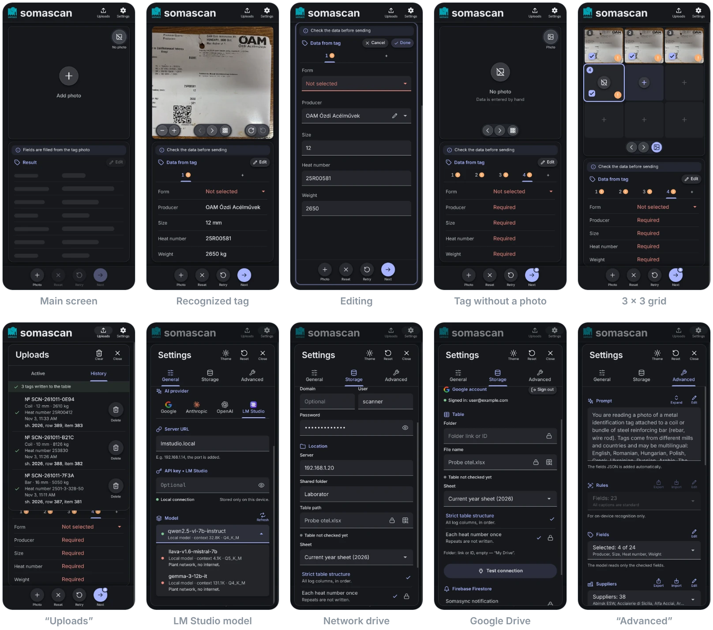
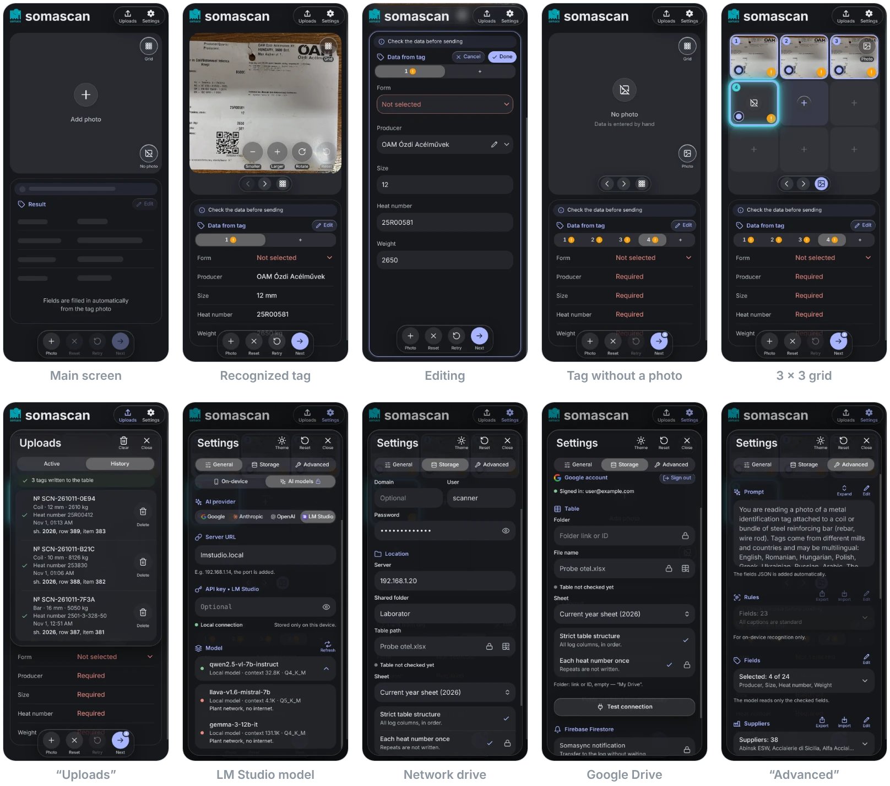

**English** · [Русский](README.ru.md)

#  Somascan

A mobile app for **Somaco (Holcim), Romania**: it reads the tags of incoming reinforcing steel and writes them into the steel sample log.

An employee photographs a tag (rebar, wire rod in coils). The app recognizes it on the phone (ML Kit / Apple Vision, offline) or with an AI model, shows the fields for a check and appends a row to `Probe otel.xlsx` on a Windows network drive or in Google Drive.

**Interface:**  English ·  Română ·  Тоҷикӣ ·  Русский  
**Stack:** Vite · React 19 · TypeScript · Capacitor 8 (Android / iOS) · oxlint

## Screenshots

Dark theme, English interface, recognition by LM Studio. Android — Material 3; iPhone — iOS 26 (Liquid Glass), classic UIKit materials on iOS 18 and earlier.

**Android**



**iPhone**



```bash
npm run build && node scripts/screenshots/capture.mjs   # retake the screenshots
```

## Contents

- [How it works](#how-it-works)
- [Recognition](#recognition)
  - [Providers](#providers)
  - [On-device recognition](#on-device-recognition)
  - [Photos](#photos)
  - [Advanced settings](#advanced-settings)
- [Main screen](#main-screen)
- [Steel sample log](#steel-sample-log)
- [Writing to the log](#writing-to-the-log)
  - [Queue](#queue)
  - [One write](#one-write)
  - [Retries and errors](#retries-and-errors)
  - [Background engine](#background-engine)
  - [Network drive settings](#network-drive-settings)
  - [Google Drive](#google-drive)
  - [Phones without the company network](#phones-without-the-company-network)
- [Development](#development)
- [Building](#building)
  - [Android](#android)
  - [Signing](#signing)
  - [iOS](#ios)
  - [Platform notes](#platform-notes)
  - [Icon and splash screen](#icon-and-splash-screen)
- [Structure](#structure)
- [Known risks](#known-risks)
- [License](#license)
- [AI disclosure](#ai-disclosure)

## How it works

```
Tag photo ──► recognition
              ├─ on device: ML Kit (Android) / Vision (iOS) + field rules
              └─ AI model: Gemini | Claude | OpenAI | LM Studio
          ──► fields (check and edit) ──► queue ──► row in Probe otel.xlsx
                                                    network drive | Google Drive
```

## Recognition

### Providers

| Provider | Where it runs | Note |
|---|---|---|
| **On-device** (default) | the phone: ML Kit (Android), Apple Vision (iOS) | no internet, keys or server; fields by rules |
| **Gemini** | Google cloud | API key |
| **Claude** | Anthropic cloud | API key |
| **OpenAI** | OpenAI cloud | API key |
| **LM Studio** | a server in the plant network | OpenAI-compatible API, data stays in the network |

- **AI models are behind a lock** in “General → Recognition”: the first tap opens the lock, the second one selects. Photos then go to the provider.
- **API keys** are entered in the app. There are no `.env` files: anything put in at build time can be read from the APK / IPA.
- **Model lists** come from the provider's API (with a key) or from the public [models.dev](https://models.dev) directory (preview, without a key). Only models that read images and were released within the last N months are shown (6 by default). Lists are cached for 30 days.
- **LM Studio** lists `vlm` models with a dot: green — loaded, red — not. Choosing a model unloads the previous one and loads the new one. The server is shared by all phones, so a model switch waits until nobody is recognizing, and recognition waits for a switch. Phones mark themselves in the table storage (`somascan-lmstudio`, `ModelUseGate.ts`); a mark expires after a minute.

### On-device recognition

The phone reads the tag text itself: Google ML Kit on Android (Text Recognition v2 and Barcode Scanning, models bundled into the APK), Apple Vision on iPhone. The engine returns text lines with their frames; rules in `recognition/ocr/` assemble the fields — no model, no training.

1. **Captions.** Each field knows how mills caption it in different languages: Heat, Charge, Șarjă, Adag, Wytop, Плавка… (`ruleLabels.ts`, editable in “Advanced → Rules”). Case, diacritics and punctuation are ignored; common OCR errors and two-line captions in two languages are handled.
2. **Position.** The value is after the caption in the same line, to the right in the same row or right below. Frames are straightened by the tag tilt; for a photo with perspective a row shift is fitted (`pageLayout.ts`).
3. **Shape.** The heat is a code with digits, the size is 4–60 with Ø or mm, the grade is a base with its class (`B500C`), the weight is in kilograms (`2.0 Ton` → 2000, a range gives its upper bound) (`valueReaders.ts`). A heat number repeated in a serial number, a bundle code or a QR / DataMatrix code confirms or corrects the heat (`heatCheck.ts`).
4. **Producer.** Taken from the known suppliers list, forgiving OCR errors; without a name — from the mill's e-mail or website (`domainProducer.ts`). The warehouse's own tags (after cutting and bending) are SOMACO; the heat is the code under the barcode.
5. **Strand tags** (PC strand: BPM, D&D Drótáru) have no heat: the lot or coil number is used, the diameter comes from the EN 10138-3 designation (`strandTag.ts`). An unreadable number is left empty: a wrong heat in the log is worse than an empty one.
6. **Rotation.** The layout is tried in all four quarter turns; if needed the photo is read again turned (`LabelExtractor.ts`).

The answer has the same shape as a model's, so the rest of the app does not change. The rules are covered by tests on real OCR output of tags from 11 mills and of SOMACO's own tags (`tests/onDeviceLabel.test.ts`, `tests/fixtures/ocr/`). “Advanced → Recognized text → Share” exports the last reading as JSON: send it to the developer when a tag is read wrong. In the browser on-device recognition is unavailable.

### Photos

- **HEIC / HEIF** from the gallery is re-encoded to JPEG on Android right after picking (`PhotoImportPlugin.java`). A format a provider does not accept is re-encoded before sending (`imageType.ts`).
- **Quality.** The model rates the photo (`_photo` in the answer), and the app checks the pixels for blur, darkness and overexposure (`PhotoQuality.ts`). A poor photo gets a “Poor photo quality” alert; the fields stay on screen.
- **Hint.** If required fields are empty, a one-line hint on the photo says what to do: “No tag found”, “Rotate the photo”, “Move closer to the tag”, “Not all fields recognized” (`retakeHint.ts`, `readingAdvice.ts`). “Rotate” turns the photo for real, and “Retry” sends it turned.

### Advanced settings

| Setting | What it does |
|---|---|
| Prompt | instructions for AI models; the field list and the JSON shape are appended automatically (`labelPrompt.ts`) |
| Rules | captions by which on-device recognition finds the fields; only changed fields are stored; export and import as JSON |
| Fields | which fields are read: four built-in ones by default (producer, size, heat number, weight), optional ones and custom ones |
| Suppliers | known supplier mills (`knownSuppliers.ts`): the model and the rules take the spelling from the list; export and import as JSON |
| Backups | how long table backups are kept: 7 (default), 30, 90 or 365 days |
| Models | the age of shown models and “Refresh” for the lists |
| Photo | the size before sending: 1024 / 1600 / 2048 px (default) or the original |
| About | the version: one for everything (`package.json`, `versionName`, `MARKETING_VERSION`) |

“Reset” in the settings header restores the defaults, except API keys and storage.

## Main screen

- **Up to nine tags.** “Photo” on an empty cell picks several shots at once; tags go strictly in order. Holding “Reset” removes all tags.
- **Grid 3 × 3.** “Grid” shrinks the photo into its cell. A cell shows the state: spinner — recognizing, green check — ready, orange “!” — needs action, red — error.
- **Tag without a photo.** “No photo” adds a tag whose data is entered by hand; “Photo” on it makes it wait for a photo again.
- **Required fields.** The enabled built-in fields are required for every tag; “Next” does not send a tag until they are filled in.
- **Each heat number once.** A heat already on another tag or in “Uploads” is shown as an error (toggle in “Storage → Write rules”, on by default).
- **Form.** Coil or bar is chosen from a drop-down right on the result card. In every choice list the chosen item is first.
- **Editing.** “Edit” opens the fields over the whole screen; “Done” saves, “Cancel” discards the changes of all tags.
- **Next** sends all selected ready tags as a batch; if some are not ready, it asks “Send the ready ones?”.
- **Layout.** Portrait phone: the whole screen scrolls, the action bar is at the bottom. Landscape phone: photo on the left, fields on the right.

## Steel sample log

Tags are written to `Probe otel.xlsx` — the log the workshop keeps (`A:\ATELIER ARMATURI\Probe si Sarje Otel\`).

- **One sheet per year** (`2026`, `2025`…). A missing year's sheet is created with the header and formatting of the newest one.
- **Header** in rows 4–6, data from row 7. Pre-formatted rows without data count as empty.
- **Columns are found by header text**, not by letter: they can be moved, and an added column named after a tag field is filled too.

| Column | Value | Source |
|---|---|---|
| Nr. Crt. | previous number + 1 | — |
| Cantitatea | weight: `8126Kg` | Weight |
| Data trimitere la incercat | not filled — entered by the lab | — |
| Data intrare | write date, `DD.MM.YYYY` | — |
| Sarja | heat number: digits as a number, otherwise text | Heat number |
| Producator | mill | Producer |
| Bobina / Bara | diameter as a number in the column of the form | Size + Form |
| Doc. de calitate | quality document | Quality document (optional) |

- **Each heat number once.** Before writing, all sheets are searched for the heat; a found one is a `duplicateHeat` error with its sheet and row.
- **Strict structure** (on by default): only a sheet with all the log columns in order is written; otherwise `layoutMismatch`.
- **The app does not create the table.** A missing log is a `tableNotFound` error until the path is fixed. Check it with the icon at the end of the path field or with “Test connection”.
- **Hidden sheet `somascan-journal`** keeps every written record (`SCN-…` → sheet, row, tag). It prevents duplicates after an interrupted write; Somasync uses it to move tags from phones.
- **Empty log** for tests and a fresh start: `tests/fixtures/Probe otel.xlsx` (the 2026 sheet without data). Rebuilt with:

```bash
npx tsx --tsconfig tsconfig.app.json scripts/lab-table/make-template.ts "Probe otel.xlsx" "tests/fixtures/Probe otel.xlsx"
```

## Writing to the log

### Queue

“Next” puts the tags into the queue. The queue is kept on the device, survives a restart and is written in the background, one record at a time. “Uploads” has two tabs: **Active** (waiting, writing, not written — with “Retry”) and **History** (written: sheet, row, “Nr. Crt.”). An unwritten tag can be cancelled; a write already replacing the file is finished.

### One write

The same cycle for both storages (`TableWriter`):

1. **Lock** — the `<table>.lock` folder (Drive — a file); another device gets `busy`, a lock older than 5 minutes is removed.
2. **Read** the log anew; a missing table is `tableNotFound`.
3. **Idempotency** — a record already in `somascan-journal` counts as done.
4. **Append** the row and check: all previous values on all sheets must stay in place (`integrityFailed` otherwise).
5. **Replace** atomically: temporary file → SHA-256 check → old file to `backups/` → rename.
6. **Verify** the written row cell by cell (`verifyFailed` — retry).
7. **Clean** backups older than the chosen period.

Other sheets, styles, merges, widths, filters and notes are kept (ExcelJS; tested on the real 2016–2026 log).

### Retries and errors

Temporary failures (no network, table open in Excel, held by another device) are retried after 15 s, 30 s, 1, 2, 5, 10 minutes, then every 15 minutes. Permanent ones (wrong password, no table, no sheet, wrong structure) wait for the settings to change, then retry by themselves. Codes — `UploadError`, texts — `errors:upload.*`.

### Background engine

The queue is written by an engine outside the screen's WebView — `upload-engine.js` (`src/engine`, built by `npm run build`), so it keeps going when the app is minimized.

| | Android | iOS |
|---|---|---|
| Runs in | a hidden WebView (`UploadEngine.java`) | JavaScriptCore (`UploadEngine.swift`) |
| Minimized | WorkManager foreground service `dataSync` | background time; iOS 26+ — `BGContinuedProcessingTask` |
| Progress | notification with `ProgressStyle`; Android 16 — segments and Live Update | iOS 26+ — system progress; earlier — Live Activity (`UploadActivity` extension) |
| Closed | the work continues | continues when the app is opened |
| Waiting for network | WorkManager starts the engine | `BGAppRefreshTask` / `BGProcessingTask` |

The screen only sends commands and receives queue snapshots (`NativeUploadQueue.ts`, protocol `src/engine/protocol.ts`). In the browser the queue runs on the page (`LocalUploadQueue`). Engine log: `adb logcat -s UploadEngine UploadWork UploadNotification`; on iOS — Console.app, `[UploadEngine]`.

### Network drive settings

“Settings → Storage → Network share”:

- **Server**, **shared folder**, **table path** (to an existing log, `Probe otel.xlsx` by default), **domain**, **user**, **password**.
- **Lock.** The table path is locked against accidental edits; the lock icon unlocks it while the tab is open.
- **Table check.** The icon at the end of the path field checks the table and the structure of the sheet the write goes to; the result is shown under the fields.
- **Write rules:** strict table structure and each heat number once (behind a lock).
- **Sheet:** the current year's sheet by default, or any sheet of the table. An optional “Sheet” field lets a single tag go to another sheet.

SMB on Android — [smbj](https://github.com/hierynomus/smbj), on iOS — [AMSMB2](https://github.com/amosavian/AMSMB2) over libsmb2. The operation contract is in `uploads/smb/smbFiles.ts`.

### Google Drive

The same write cycle; the differences are in `uploads/drive/DriveTableBackend.ts`:

- **Sign-in** with the native account picker (`GoogleDriveAuth` plugin); the queue then gets fresh tokens by itself.
- **Folder and file** — a folder link or ID and the table name. The table must already exist; `backups` is created on the first write.
- **Version conflict** — a table changed between reading and writing is not overwritten: the write is retried with the new data.
- **Verification** — the MD5 from Drive is compared with the bytes sent, then the row is read back.

**Google Cloud setup (once):**

1. In [Google Cloud Console](https://console.cloud.google.com/) create a project and enable **Google Drive API**.
2. OAuth consent screen: **Internal** for Google Workspace accounts or **External** with test users. Scope — `https://www.googleapis.com/auth/drive` (access to an existing folder).
3. **Android client:** package `com.somascan.app`, SHA-1 of the project key `AA:67:2E:F2:C4:DB:4C:CD:2A:EB:78:15:64:C5:C6:2A:FD:88:87:88` (see [Signing](#signing)).
4. **iOS client:** bundle ID `com.somascan.app`. The client ID goes to `ios/App/App/Info.plist` → `GIDClientID`, the reversed ID — to `CFBundleURLSchemes`.
5. While an External screen is in “Testing”, add the warehouse accounts to Test users.

### Phones without the company network

When the log is on a network drive and the phones cannot reach it, the phones write into a copy of `Probe otel.xlsx` in Google Drive. The desktop app **Somasync** (branch `desktop`, “Storage → Phones”) moves new tags from the copy into the log as the same row and puts the log back in place of the copy.

Somasync checks the copy every 15 s. For an instant transfer, enable **Firebase Firestore** on the Google Drive tab (behind a lock): after writing, the phone updates the document `somascan-bells/<channel>` (SHA-256 of “folder id/table name”) and Somasync reacts at once. Firestore keeps only the time of the ring, no data (`firestoreBell.ts`). Project setup and rules are in the Somasync README.

## Development

```bash
npm install
npm run dev        # web version, http://localhost:5173
```

| Command | What it does |
|---|---|
| `npm run dev` | Vite dev server |
| `npm run build` | type check, page build and engine build (`dist/upload-engine.js`) |
| `npm test` | all checks (`node:test` + `tsx`) |
| `npm run lint` | oxlint |
| `npm run preview` | preview of the production build |
| `npm run cap:sync` | build and `cap sync` for all platforms |
| `npm run cap:android` / `cap:ios` | build, sync and open Android Studio / Xcode |
| `npm run cap:run:android` / `cap:run:ios` | build and run on an emulator or device |

After a change in the web code run `npm run build && npx cap sync` (the `cap:*` scripts do it themselves). App ID: `com.somascan.app`.

**Tests** cover the log, backups, SMB and Drive on fake servers, the queue engine in a bare JS context, settings and recognition. A local SMB server (Samba in Docker) is in `scripts/smb-test-server/`: server `10.0.2.2:1445` (Android emulator) or `127.0.0.1:1445` (iOS simulator), folder `Warehouse`. In a development build the stores are available in the console as `window.__somascan`.

## Building

### Android

Requirements: Android SDK (Android Studio or `android-commandlinetools`), JDK 21. The project targets Android 16 (`compileSdk`/`targetSdk` 36, `minSdk` 24).

```bash
sdkmanager "platform-tools" "platforms;android-36" "build-tools;35.0.0" "emulator" \
  "system-images;android-35;google_apis;arm64-v8a"            # x86_64 on Intel / Windows
avdmanager create avd -n somascan_pixel7 -k "system-images;android-35;google_apis;arm64-v8a" -d pixel_7
echo "sdk.dir=$ANDROID_HOME" > android/local.properties        # not in git
npm run cap:run:android                                         # run on the emulator or device
```

APK:

```bash
npm run build && npx cap sync android && (cd android && ./gradlew assembleDebug)
adb install -r android/app/build/outputs/apk/debug/app-debug.apk
```

Over Wi-Fi: “Developer options → Wireless debugging” on the phone, then `adb connect <ip>:<port>`.

### Signing

Debug and release are signed with the project key `android/keystore/somascan.jks` (alias `somascan`), passwords in `android/keystore.properties`. Both files are **not in git**: copy them by hand and keep a backup — with a lost key installed apps cannot be updated and Google Drive needs a new OAuth client. Without `keystore.properties` the build is signed with the machine's debug key.

Key SHA-1: `AA:67:2E:F2:C4:DB:4C:CD:2A:EB:78:15:64:C5:C6:2A:FD:88:87:88` (check: `./gradlew signingReport`). A build with another key cannot be installed over this one: uninstall the app first.

### iOS

macOS with Xcode 26+ (Swift 6.2). The `ios/` project is in the repository; dependencies come from Swift Package Manager (AMSMB2, GoogleSignIn). Minimum iOS 16.2.

```bash
npm run cap:ios          # open in Xcode, then Run
npm run cap:run:ios      # run on the simulator
```

- `simctl` not found — `sudo xcode-select -s /Applications/Xcode.app/Contents/Developer`.
- Xcode 27: `cap run ios` fails on a missing `Simulator.app` — run from Xcode.
- `Mach error -308` — `xcrun simctl shutdown all` and try again.
- The `UploadActivity` extension (Live Activity) needs the same signing team as the app.

### Platform notes

- **Safe areas.** The page is drawn under the system bars; the insets come in CSS as `--safe-*` (`styles/tokens.css`). The bar colour follows the theme (`NativeTheme` plugin).
- **Network.** LM Studio and other `http://` requests go through the native `NativeHttp` plugin: no CORS and no WebView blocking. A server address can be short — `192.168.1.14`.

### Icon and splash screen

The icon and the splash screen are made from `scripts/somaco-logo.png` by one script, in all sizes and theme variants:

```bash
python3 -m venv .venv && .venv/bin/pip install pillow   # once
.venv/bin/python scripts/generate-app-icon.py
```

## Structure

```
src/
  app/                  root component, header, global sync
  components/           shared UI: icons/, ui/ (ActionButton, Tabs, List, TextInput, Disclosure…)
  features/
    recognition/        providers/, catalog/ (model lists), label/ (fields, prompt, suppliers),
                        ocr/ (on-device rules), image/ (photo loading and quality)
    workspace/          main screen: tags, grid, photo, result card, editing
    settings/           settings sheet and its tabs; SettingsStore
    uploads/            queue and history, table check, xlsx/ (log), smb/, drive/, leases/
  engine/               upload queue engine (upload-engine.js)
  hooks/                shared React hooks
  i18n/, locales/       i18next; texts en / ro / tj / ru
  lib/                  infrastructure without React: store, storage, http, platform, theme, interaction
  styles/               tokens, base, animations, platform styles
tests/                  node:test checks and fixtures
scripts/                lab-table, smb-test-server, screenshots, generate-app-icon.py
android/, ios/          native projects and local plugins
```

### Conventions

- **Modules.** Feature code lives in `features/<feature>/`; shared code — in `components/`, `hooks/`, `lib/`. `lib/` knows nothing about React or business logic. Imports go through `@/`.
- **Names.** Components and classes — `PascalCase`, hooks — `useSomething`, other modules — `camelCase`.
- **Styles** live next to the component; classes are kebab-case with the component prefix, states — `is-*`; colours only from `styles/tokens.css`.
- **State** is kept in store classes on `lib/store/Store` and read through `useStore` / `useSettings`.
- **Texts** only through `t()` and `locales/`; keys are typed.
- **Comments** in Russian; JSDoc on every export.
- **Touches.** Press feedback is drawn by code (`lib/interaction`), not by `:active`; system dialogs only through `NativeDialogs`.
- **Risks** are marked `РИСК:` in the code and listed below.

### How to add

- **A provider:** a subclass of `RecognitionProvider` in `recognition/providers/`, registration in `ProviderRegistry.ts`, the id in `PROVIDER_IDS`, an icon in `providerIcons.tsx`, the name in `settings.json`.
- **A language:** `locales/<code>/`, the code in `i18n/languages.ts`, resources in `i18n/resources.ts`, iOS permission texts in `<code>.lproj/InfoPlist.strings`.
- **A tag field:** an entry in `BUILT_IN_FIELDS` (`labelFields.ts`) and its name in `label.json`.
- **A setting:** a field in `settingsSchema.ts`, a method in `SettingsStore`, a control in the tab.

## Known risks

| What | Where | Consequence |
|---|---|---|
| Undocumented parts of ExcelJS | `uploads/xlsx/excelInternals.ts` | after updating `exceljs` run `npm test` and compare a real log before and after a write |
| The check before replacement compares values, not formatting | `TableWriter.ts` | lost styles are not noticed; the previous version is in `backups/` |
| Duplicate protection lives on the hidden `somascan-journal` sheet | `LabelWorkbook.ts` | if the sheet is lost, a retry may append the row again |
| Sheet year and “Data intrare” come from the phone clock | `LabelWorkbook.append` | a wrong date gives the wrong sheet |
| An abandoned lock is judged by the clocks of different devices | `TableBackend.ts` | clocks more than 5 minutes apart can break locking |
| The sheet list is a snapshot of the last check | `TableCheckStore.ts` | a renamed sheet gives `sheetNotFound` until the next check |
| iOS SMB errors from Windows are recognized by text | `SmbShareClient.swift` | check after updating AMSMB2 |
| LM Studio queue marks expire by the phones' clocks | `ModelUseGate.ts`, `uploads/leases/` | two phones starting in the same second can collide |
| Google sign-in depends on the OAuth clients | `Info.plist`, `android/keystore` | a new key or a deleted client stops sign-in |
| Android bottom bar depends on the WebView version | `NotesCard.css` | check on an old and a new WebView |
| API keys and the SMB password are stored unencrypted | `SettingsStore.ts` | move to Keychain / Keystore before wider distribution |
| The known suppliers hint | `labelPrompt.ts` | on a poor photo the model may pick a similar supplier |

Screen scenarios (grid, editing, sending, settings) are checked by hand, without automated tests.

## License

[Apache License 2.0](LICENSE) © 2026 Muhammad Halimov. Keep the authorship and license notice ([NOTICE](NOTICE)) and mark modified files. The names and logos of Somaco, Holcim and the services are trademarks of their owners and are not covered by the license. Third-party libraries keep their own licenses (libsmb2 — LGPL-2.1, linked dynamically).

## AI disclosure

The author is responsible for the code, design decisions and maintenance. AI tools were involved in the development of this app.
