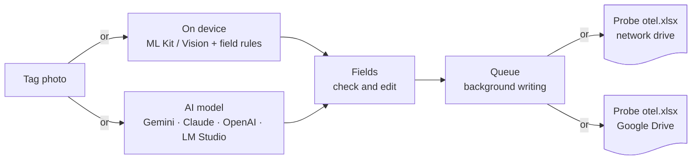

**English** · [Русский](README.ru.md)

#  Somascan

A mobile app for **Somaco (Holcim), Romania** — recognition of incoming reinforcing steel tags and recording of their data in the steel sample log `Probe otel.xlsx` on a Windows network drive or in Google Drive.

**Interface:**  English ·  Română ·  Тоҷикӣ ·  Русский  
**Stack:** Vite · React 19 · TypeScript · Capacitor 8 (Android / iOS) · oxlint

## Screenshots

**Android** (Material 3)


**iPhone** (iOS 26, Liquid Glass)


```bash
npm run build && node scripts/screenshots/capture.mjs   # retake the screenshots
```

## Contents

- [How it works](#how-it-works)
- [Recognition](#recognition)
- [Steel sample log](#steel-sample-log)
- [Writing to the log](#writing-to-the-log)
- [Development](#development)
- [Building](#building)
- [Structure](#structure)
- [Known risks](#known-risks)
- [License](#license)
- [AI disclosure](#ai-disclosure)

## How it works



- The main screen holds up to nine tags (3 × 3 grid). A tag is sent with “Next” after its form (coil or bar) is selected and the required fields are filled in.
- Each heat number is accepted once (by default): a repeat on screen, in “Uploads” or in the log is treated as an error.
- A tag without a photo is filled in manually.

## Recognition

| Provider | Where it runs | Note |
|---|---|---|
| **On-device** (default) | the phone: ML Kit (Android), Apple Vision (iOS) | offline, no keys; fields by rules |
| **Gemini**, **Claude**, **OpenAI** | the provider's cloud | API key, entered in the app |
| **LM Studio** | a server in the plant network | data stays in the network |

- **On-device.** The tag text is recognized on the phone; rules in `recognition/ocr/` identify the fields by their captions in different languages (Heat, Șarjă, Adag, Плавка…) and by the shape of the value. The captions are configured in “Advanced → Rules”. The rules are tested on real recognition data of tags from 11 mills (`tests/fixtures/ocr/`).
- **AI models** are behind a lock in “General → Recognition”. Model lists are loaded from the provider's API or from [models.dev](https://models.dev). LM Studio is a server shared by all phones: a model switch is performed when no phone is recognizing.
- **Photo quality.** Blur, glare, poor lighting and a missing tag are detected automatically; a one-line hint is shown on the photo (“Rotate the photo”, “Move closer to the tag”).
- **Advanced:** prompt, rules, fields to read, known suppliers (export and import as JSON), backup period, photo size, appearance (Liquid Glass or Material Design on any device; zoom and rotate buttons on the photo or on the panel).

## Steel sample log

Tags are written to `Probe otel.xlsx`, the workshop log: one sheet per year, header in rows 4–6, data from row 7. Columns are identified by header text, so their order may change.

| Column | Value |
|---|---|
| Nr. Crt. | previous number + 1 |
| Cantitatea | weight, `8126Kg` |
| Data intrare | write date, `DD.MM.YYYY` |
| Sarja | heat number |
| Producator | mill |
| Bobina / Bara | diameter in the column of the form |
| Doc. de calitate | quality document (optional field) |

- **The table is not created by the app.** If the log is missing, writing fails with `tableNotFound` until the path is corrected; the table is checked with the icon at the end of the path field.
- **Strict structure** (by default): writing is performed only to a sheet with all the log columns in the established order.
- **Hidden sheet `somascan-journal`** stores all written records and prevents a duplicate row after an interrupted write.
- An empty log for tests: `tests/fixtures/Probe otel.xlsx`.

## Writing to the log

“Next” places tags in a queue. The queue is preserved across restarts and written in the background, one tag at a time; its state is shown in “Uploads”. On a phone writing is performed by an engine outside the screen (`src/engine`): WorkManager with a notification on Android, a background task on iOS (with a Live Activity before iOS 26).

Write procedure (`TableWriter`), common to both storages:

1. Locking with `<table>.lock`; a lock older than 5 minutes is removed.
2. Reading the log, appending the row, checking that all previous values are intact.
3. Atomic replacement of the file; the previous version is saved to `backups/` (7 days by default).
4. Reading back and verifying the written row.

Temporary failures (no network, table open in Excel) are retried at growing intervals, up to once every 15 minutes; permanent ones (wrong password, missing table, wrong structure) await a change of settings.

**Network drive** — “Settings → Storage → Network share”: server, shared folder, path to an existing log, domain, user, password. SMB: [smbj](https://github.com/hierynomus/smbj) on Android, [AMSMB2](https://github.com/amosavian/AMSMB2) on iOS.

**Google Drive** — Google account sign-in, a folder link and the table name. Google Cloud setup (one-time):

1. In [Google Cloud Console](https://console.cloud.google.com/) enable **Google Drive API**; consent screen Internal (Workspace) or External with test users; scope `https://www.googleapis.com/auth/drive`.
2. Android client: package `com.somascan.app`, SHA-1 of the project key (see [Signing](#signing)).
3. iOS client: bundle ID `com.somascan.app`; the client ID goes to `ios/App/App/Info.plist` → `GIDClientID`, the reversed ID — to `CFBundleURLSchemes`.

## Development

```bash
npm install
npm run dev        # web version, http://localhost:5173
```

| Command | What it does |
|---|---|
| `npm run build` | type check, page and engine build |
| `npm test` | all checks (`node:test` + `tsx`) |
| `npm run lint` | oxlint |
| `npm run cap:sync` | build and `cap sync` |
| `npm run cap:run:android` / `cap:run:ios` | build and run on an emulator or device |

After a change in the web code, `npm run build && npx cap sync` is required. A local SMB server for tests (Samba in Docker): `scripts/smb-test-server/`.

## Building

The full guide — tools from scratch, signing, iOS, API keys, LM Studio, network drive, Google Drive, Firebase: [guides/BUILD.md](guides/BUILD.md).

### Android

Android SDK (Android Studio or `android-commandlinetools`), JDK 21; `compileSdk` 36, `minSdk` 24. Put `sdk.dir=…` into `android/local.properties`.

```bash
npm run build && npx cap sync android && (cd android && ./gradlew assembleDebug)
adb install -r android/app/build/outputs/apk/debug/app-debug.apk
```

### Signing

Debug and release are signed with the project key `android/keystore/somascan.jks`; the passwords are stored in `android/keystore.properties`. Both files are **not in git**: they are transferred manually and require a backup — without the key, installed apps cannot be updated. SHA-1: `AA:67:2E:F2:C4:DB:4C:CD:2A:EB:78:15:64:C5:C6:2A:FD:88:87:88`.

### iOS

macOS with Xcode 26+; minimum iOS 16.2. Dependencies come from Swift Package Manager.

```bash
npm run cap:ios          # open in Xcode, then Run
```

If `simctl` is not found: `sudo xcode-select -s /Applications/Xcode.app/Contents/Developer`.

## Structure

```
src/
  app/                  root component, header
  components/           shared UI
  features/
    recognition/        providers, model lists, tag fields, on-device rules, photos
    workspace/          main screen: tags, grid, result card, editing
    settings/           settings and their tabs
    uploads/            queue, log (xlsx), network drive (smb), Google Drive
  engine/               background upload engine
  lib/, hooks/          infrastructure without business logic
  locales/              texts en / ro / tj / ru
tests/                  checks and fixtures
guides/                 build and setup guide, native feel plan
android/, ios/          native projects and plugins
```

Conventions: imports through `@/`; texts only through `t()` and `locales/`; colours only from `styles/tokens.css`; comments in Russian; risky places are marked `РИСК:`.

## Known risks

| What | Consequence |
|---|---|
| Undocumented parts of ExcelJS (`excelInternals.ts`) | after updating `exceljs` run `npm test` and compare a real log before and after a write |
| Duplicate protection relies on the hidden `somascan-journal` sheet | if the sheet is lost, a retry may duplicate the row |
| Sheet year and date come from the phone clock | with a wrong date the tag goes to another sheet |
| Locks are judged by the clocks of different devices | clocks more than 5 minutes apart can break locking |
| API keys and the SMB password are stored unencrypted | migration to Keychain / Keystore before wider distribution |

## License

[Apache License 2.0](LICENSE) © 2026 Muhammad Halimov ([NOTICE](NOTICE)). The names and logos of Somaco, Holcim and the services are trademarks of their owners.

## AI disclosure

The author is responsible for the code, design decisions and maintenance. AI tools were involved in the development of this app.
