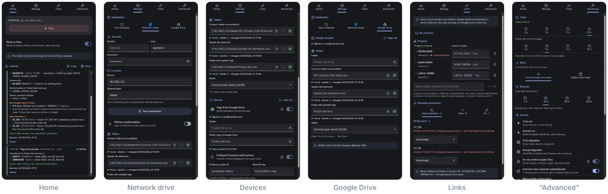
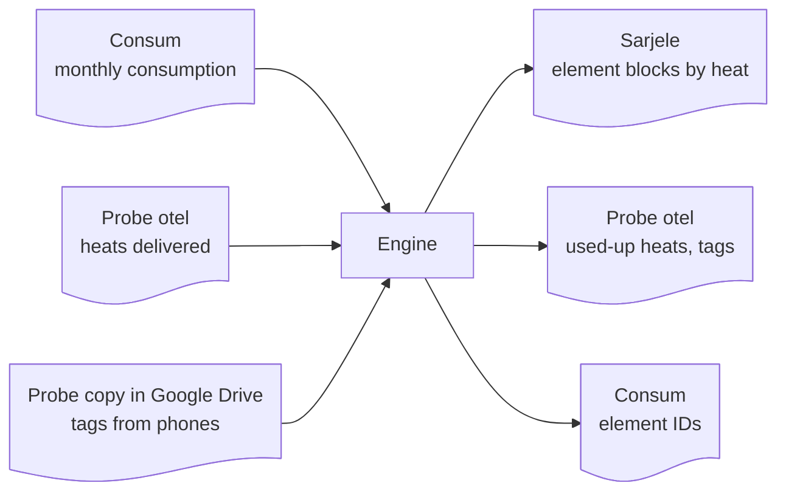

**English** · [Русский](README.ru.md)

#  Somasync

A desktop app (Windows and macOS) for **Somaco (Holcim), Romania** — accounting of reinforcing steel by heat: distribution of element consumption from the monthly Consum report over heats, element blocks in Sarjele and marking of used-up heats in Probe.

**Interface:**  English ·  Română ·  Тоҷикӣ ·  Русский  
**Stack:** Electron 44 · React 19 · TypeScript · Vite 8 · ExcelJS · i18next

## Screenshots

Demo data: projects, elements and heats are fictitious.



```bash
npm run build && node scripts/screenshots/capture.mjs   # retake the screenshots
```

## Contents

- [How it works](#how-it-works)
- [Table storage](#table-storage)
- [Phones](#phones)
- [Rules of operation](#rules-of-operation)
- [Manual links: links.json](#manual-links-linksjson)
- [Development](#development)
- [Structure](#structure)
- [Known risks](#known-risks)
- [License](#license)
- [AI disclosure](#ai-disclosure)

## How it works



| File | Contents |
|---|---|
| **Consum** (sheet “Decont Lunar”) | consumption for the month: projects, elements, kg of steel per material code |
| **Sarjele din elemente** | a sheet per project, a block per element: heats and kg |
| **Probe otel** | delivery log; a used-up heat is filled yellow |

Run sequence:

1. **Watching.** A saved Consum (change of time and size) starts the engine.
2. **Reading.** The engine reads deliveries from Probe, write-offs from Sarjele and consumption from Consum.
3. **Linking.** Each element is matched to its Sarjele block: by ID (`NI-0004`), registry, manual link or similar name; otherwise a new block is created.
4. **Plan.** Remainder of a heat = delivered minus written off; consumption is distributed over heats of the matching Ø and form.
5. **Writing:** backup, Sarjele, Probe, IDs in Consum, check.

Each run is shown on the Home tab as a card with the outcome: Written, Plan only, No changes, Postponed, Error. Settings, `log.txt` and `links.json` are stored in `%APPDATA%\Somasync\` (Windows) or `~/Library/Application Support/Somasync/` (macOS).

**Data safety:** trial mode without writing; a backup before every write with restore from the Advanced tab; writing through a temporary file with a check; a file open in an editor is not written — the write is postponed until it is closed. All processing is local; files are transferred only to Google Drive, and only when it is the selected storage.

## Table storage

The tables must already exist; the app does not create them. Each storage has its own set of files.

- **This computer** — paths to the tables.
- **Network drive** (SMB) — account (domain, user, password) and location (server, shared folder). “Test connection” connects the share with system tools: Windows — `net use \\server\share` (paths `\\server\share\…`), macOS — `mount volume smb://…` (the share appears in `/Volumes`); then the tables are picked with the folder icon. The password is stored encrypted (DPAPI / Keychain).
  - The tables are read with system tools, as ordinary files. If Windows already has access to the share (domain sign-in, saved credentials, open access), no account is needed in the program.
  - “Without authorization” — connection without a user name and password: Windows — with the system account, as in File Explorer; macOS — as a guest.
  - Before watching starts, the program connects the share itself if the tables on it are unavailable (for example, after a system restart).
- **Google Drive** — Google account sign-in in the system browser (OAuth for desktop apps: the answer returns to `http://127.0.0.1:<port>`, PKCE), a folder link and table names. Without an OAuth client, “Sign in with Google” reports that Google Drive is not set up. The tables are processed in a local copy (`<app data>/drive/<folder id>/`): only changed tables are downloaded, the same `<table>.lock` locks as in the mobile app are used, the previous version is saved to `backups` on the server. A table changed in Drive during a run is not overwritten.

Google Cloud setup (one-time; the project and the consent screen are the same as for the mobile app, see its [build guide](https://github.com/muhammad-halimov/somascan/blob/main/guides/BUILD.md#google-drive-oauth-clients)):

1. [Google Cloud Console](https://console.cloud.google.com/) → APIs & Services → Library → **Google Drive API** → Enable.
2. Google Auth Platform → Data access → scope `https://www.googleapis.com/auth/drive`; Audience → Test users for an External screen in “Testing” mode.
3. Google Auth Platform → Clients → Create client → type **Desktop app** → Create → Download JSON.
4. The JSON is placed into the app data folder as `google-oauth.json`, or the build receives `SOMASYNC_GOOGLE_CLIENT_ID` and `SOMASYNC_GOOGLE_CLIENT_SECRET`: `SOMASYNC_GOOGLE_CLIENT_ID=… SOMASYNC_GOOGLE_CLIENT_SECRET=… npm run dist:win`.

## Phones

If the tables are on this computer or a network drive and the phones have no access to the company network, the mobile app writes tags into a **copy of Probe in Google Drive**, and Somasync transfers them into Probe (“Storage → Phones”; code — `host/PhoneBridge.ts`, `engine/ProbeBridge.ts`).

- The copy is checked every 15 s during watching with writing (by MD5).
- New tags (by the hidden sheet `somascan-journal`) are appended to Probe as the same row the phone would write; then Probe replaces the copy.
- While Probe is open in Excel, the transfer is postponed and the copy is not replaced.
- A tag whose heat is already in Probe is skipped with the reason shown in the journal.

**Firebase Firestore** (optional, behind a lock) — instant transfer: after writing, the phone updates the document `somascan-bells/<channel>` (the channel is the SHA-256 of “folder id/copy name”, the same on the phone and in the app without a separate setting), and the app starts a check immediately. Firestore stores only the time of the last notification. Checking the copy remains the fallback.

Setup (one-time; details with screens — in the [build guide of the mobile app](https://github.com/muhammad-halimov/somascan/blob/main/guides/BUILD.md#firebase-firestore)):

1. [Firebase console](https://console.firebase.google.com/) → add Firebase to the Google Cloud project or create a new one.
2. Firestore Database → create a database (Standard) → Rules: the rules below → Publish.
3. Project settings → General: project ID and Web API key (without a key — Add app → Web). The Web API key is not a secret: access is defined by the rules.
4. The ID and the key are entered on the computer (“Storage → Phones → Firebase Firestore notifications”) and on the phones (“Settings → Storage → Google Drive → Firebase Firestore”).

The free quota (50,000 reads and 20,000 writes a day) is more than sufficient.

```
rules_version = '2';
service cloud.firestore {
  match /databases/{database}/documents {
    match /somascan-bells/{channel} {
      allow get: if channel.size() == 64;
      allow create, update: if channel.size() == 64 && request.resource.data.keys().hasOnly(['at']);
    }
  }
}
```

## Rules of operation

- **Modes.** Trial mode writes nothing; writing is enabled by “Write to files” on the Home tab or “Actual run” on the Advanced tab. “Start” enables watching.
- **Migration** (one-time, for a Sarjele kept by hand): existing blocks receive IDs without distribution over heats. Order: trial migration → “Need attention” on the Links tab → actual migration.
- **Consum.** Sheet `Decont Lunar`; columns are identified by headers (ELEMENT, “ID sync”); consumption — columns AK…AZ (code in row 9, Ø in row 7, form in row 8: “bob” — Bobina, otherwise Bara); data from row 10. Formulas are read by their saved result.
- **New month.** The month is taken from `LUNA <MONTH> <YEAR>`; a new Consum is a copy of the previous one, and IDs move to it.
- **Projects.** A project is processed only when linked to a Sarjele sheet (Links tab) or with “Connect new projects automatically”.
- **Heats.** “From the last one used” starts from the heat written last. Insufficient steel is shown as “— NO STOCK —” and is not written. Yellow is removed only from heats filled by the app (hidden sheet `sync-journal`).
- **Service data.** The “ID sync” column in Consum and the “Model ID” column in Sarjele are hidden; all IDs are on the hidden sheet `sync-registry` in Sarjele.
- **Backups** are saved to `backups/` next to the files; restore: Advanced → “Restore from backup”.

## Manual links: links.json

Overrides the block of a Consum element when automatic linking is impossible or wrong. The drop-down on the Links tab writes to the same file; it is opened from Advanced → “Manual links (links.json)”.

```json
{
  "PETRA DATE|ST_100": "ST_100.110",
  "PETRA DATE|ST_110": "@new",
  "NORD INFRA|GRINDA 7": "@skip"
}
```

| Value | Action |
|---|---|
| `"block title"` | write to this block (until the element receives an ID) |
| `"@new"` | create a new block (until the element receives an ID) |
| `"@skip"` | never process the element |

The key is `PROJECT|element`; case and extra spaces are ignored. Search order: `@skip` → ID in Consum → registry in Sarjele → links.json → similar name → new block. Invalid JSON stops runs with an error; the file is never overwritten by the app.

## Development

```bash
npm install
npm start          # build and run from the project folder
```

| Command | Purpose |
|---|---|
| `npm run build` | `tsc -b` + window (`dist/`) + engine (`dist-engine/`) + main process (`dist-host/`) |
| `npm test` | all checks (`node:test` + `tsx`) |
| `npm run dist` / `dist:x64` | macOS (Apple Silicon / Intel) → `release/` |
| `npm run dist:win` | Windows x64 → `release/Somasync-<version>-win-x64.zip` |

- **Windows:** the archive is unpacked into any folder, the app is started with `Somasync\Somasync.exe`; no installation is required.
- **macOS:** after unpacking, Somasync is closed (Cmd+Q) and `install-macos.command` next to `Somasync.app` is started (the first time: right-click → Open); it copies the app to Applications, removes the quarantine flag and signs it locally. Changes in the project reach the installed app only this way.

Tests run on synthetic workbooks (`tests/fixtures.ts`) and the empty log of the mobile app (`tests/fixtures/Probe otel.xlsx`); Google Drive is tested on a fake server, sign-in — through `127.0.0.1` with a fake token server (`tests/drive.test.ts`), the phone bridge — with the real engine (`tests/phoneBridge.test.ts`, `tests/bridge.test.ts`). The plant's real files are not part of the project: before releasing a new engine version, the old and new versions are run on copies of the real files and the journal and the result are compared.

## Structure

```
src/
  app/                  window: tabs, theme, state, Firestore listener
  features/             tabs: run (Home), storage, links, settings (Advanced)
  locales/              texts en / ro / tj / ru
  shared/               shared by window, main process and engine
  host/                 Electron main process: settings, journal, watching, Google Drive, phones
  engine/               engine without Electron or React: planning, books, writing, lab (tags)
tests/                  checks
```

Conventions: the engine communicates only through arguments, the exit code (0 — done, 1 — error, 3 — postponed) and a JSON file; texts are passed as message codes and translated by the window; imports through `@/`; comments in Russian; risky places are marked `РИСК:`.

## Known risks

| What | Consequence |
|---|---|
| Sarjele blocks and Probe columns are identified by header text | a renamed header excludes the block or the sheet |
| The form in Consum is taken from “bob” in row 8 | a typo changes the form |
| IDs in Consum are written by editing the XML | in an unusual file the IDs may not be written (with a warning) |
| A lock file of a crashed editor | writing is postponed until the lock is deleted |
| The pause after a Consum change | on a slow network a partially written file may be read |
| Password and Google key without system encryption | stored in `state.json` in base64 (`raw:`) |
| Writing a tag duplicates the logic of the mobile app (`engine/lab/`) | changes are made together with `features/uploads/xlsx/` in main |

## License

[Apache License 2.0](LICENSE) © 2026 Muhammad Halimov ([NOTICE](NOTICE)). The names and logos of Somaco and Holcim are trademarks of their owners.

## AI disclosure

The author is responsible for the code, design decisions and maintenance. AI tools were involved in the development of this app.
