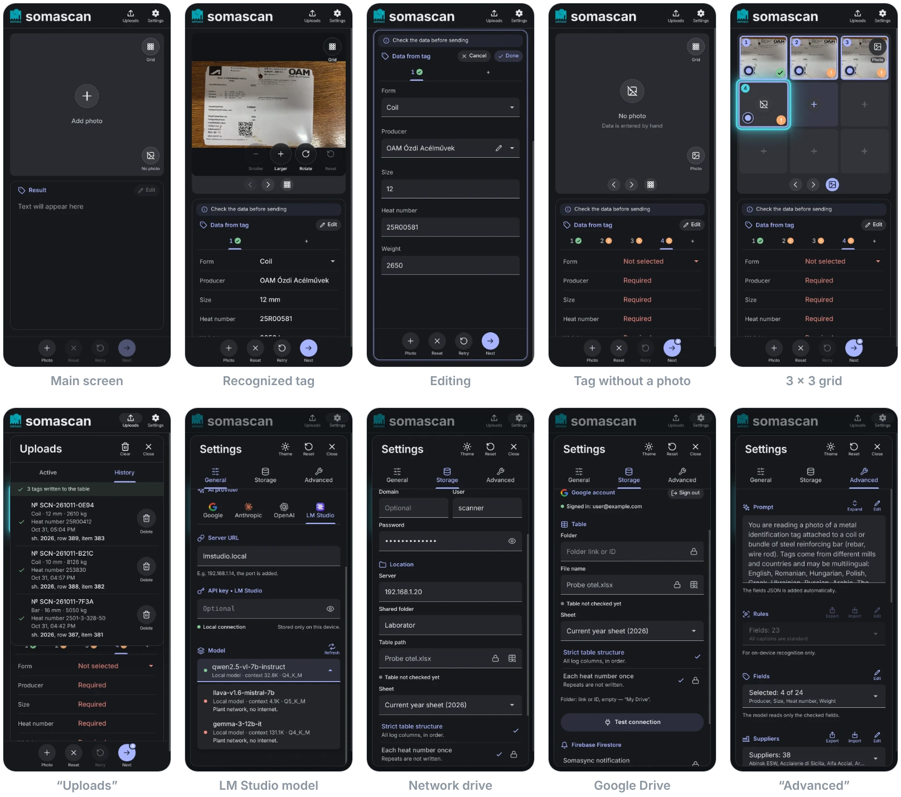
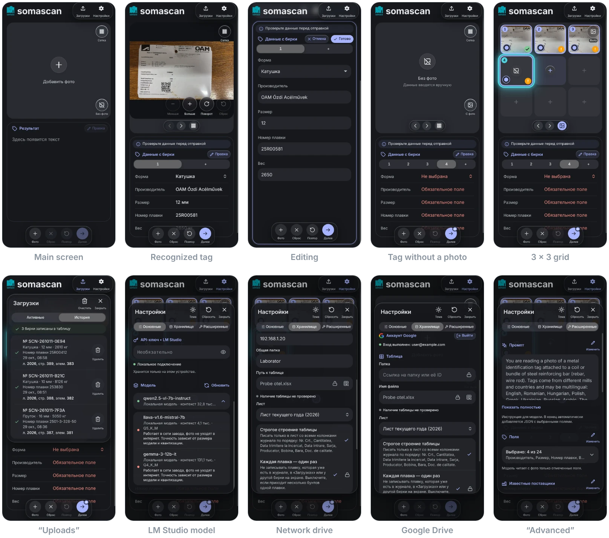

**English** · [Русский](README.ru.md)

#  Somascan

🇬🇧 English · 🇷🇴 Română · 🇹🇯 Тоҷикӣ · 🇷🇺 Русский

A mobile app for **Somaco (Holcim), Romania** — OCR scanning of the labels (delivery notes) of incoming materials at the plant.

An employee photographs a label (rebar, wire rod in coils and so on); the app recognizes it right on the phone (ML Kit / Apple Vision, no internet) or with an AI model, extracts the fields and appends a row to an `.xlsx` table. The table is kept on a Windows network drive or in Google Drive.

**Stack:** Vite · React 19 · TypeScript · Capacitor 8 (Android / iOS) · oxlint.

## Screenshots

Dark theme, English interface; recognition by LM Studio. Android — Material 3, iPhone — iOS 26 (Liquid Glass); on iOS 18 and earlier — classic UIKit materials.

**Android**



**iPhone**



```bash
npm run build && node scripts/screenshots/capture.mjs # Make screenshots
```

## Contents

- [Screenshots](#screenshots)
- [How it works](#how-it-works)
  - [Photo formats](#photo-formats)
  - [Photo quality](#photo-quality)
  - [Recognition settings (Advanced)](#recognition-settings-advanced)
  - [Known suppliers](#known-suppliers)
  - [On-device recognition (ML Kit / Vision)](#on-device-recognition-ml-kit--vision)
  - [Recognition providers](#recognition-providers)
  - [Several tags at once (grid)](#several-tags-at-once-grid)
  - [Table storage (.xlsx)](#table-storage-xlsx)
  - [Which labels are processed](#which-labels-are-processed)
- [Steel sample log (Probe otel.xlsx)](#steel-sample-log-probe-otelxlsx)
- [Writing to a network drive](#writing-to-a-network-drive)
  - [How one write goes (TableWriter + SmbTableBackend)](#how-one-write-goes-tablewriter--smbtablebackend)
  - [Retries and errors](#retries-and-errors)
  - [Background upload (queue engine)](#background-upload-queue-engine)
  - [Settings](#settings)
  - [Implementation](#implementation)
  - [Testing without the plant's server](#testing-without-the-plants-server)
- [Writing to Google Drive](#writing-to-google-drive)
  - [Google Cloud setup (once)](#google-cloud-setup-once)
- [Quick start](#quick-start)
- [Android — installing the SDK from scratch (macOS)](#android--installing-the-sdk-from-scratch-macos)
- [Building the APK](#building-the-apk)
  - [Installing on a device over Wi-Fi](#installing-on-a-device-over-wi-fi)
  - [Signing (debug and release)](#signing-debug-and-release)
- [iOS (macOS only)](#ios-macos-only)
  - [If simctl is not found](#if-simctl-is-not-found)
  - [Xcode 27: cap run ios fails on Simulator.app](#xcode-27-cap-run-ios-fails-on-simulatorapp)
  - [Safe areas and the status bar](#safe-areas-and-the-status-bar)
  - [CORS for iOS / Android](#cors-for-ios--android)
- [Icon and splash screen](#icon-and-splash-screen)
- [Structure](#structure)
  - [Conventions](#conventions)
  - [How to add…](#how-to-add)
- [Known risks](#known-risks)
- [License](#license)
- [AI disclosure](#ai-disclosure)

---

## How it works

```
Label photo ──► OCR / recognition (on device: ML Kit | Vision; Gemini | Claude | OpenAI | LM Studio)
            ──► structured fields ──► row in .xlsx
            ──► storage: Windows network drive | Google Drive
```

### Photo formats

The Android WebView neither shows nor decodes photos in HEIC/HEIF (the “high efficiency” camera format of many phones, e.g. HONOR and Samsung), so on Android such a photo from the gallery or from files is re-encoded to JPEG natively right after it is picked (`PhotoImportPlugin.java`, Android 9+, orientation is respected, the long side is up to 4096 px; the copies live in the cache and are deleted on the next launch). For recognition the photo type is taken from the response, and if it is not there (photos from the Android gallery come without a Content-Type) — from the first bytes of the file (`recognition/image/imageType.ts`); a format that not every provider accepts (HEIC, GIF, BMP…) is re-encoded to JPEG.

### Photo quality

Along with the fields, the model rates the photo itself (the `_photo` key in the answer: `ok` and problem codes — blurry, glare, dark, the tag is not fully in the frame, etc.), and the app also checks the pixels for obvious blur, darkness and overexposure (`recognition/image/PhotoQuality.ts`). If the photo should be retaken, after recognition a system alert “Poor photo quality” is shown with the reasons and an “OK” button; the recognized fields stay on screen.

If a recognized tag still has empty required fields (or a retake is advised), a one-line hint appears on the photo between “Back” and “Grid”: “Try rotating the photo” — with an “i” like the “Check the data” note, translucent like the corner buttons, it zooms with the photo when switching to the grid and back. “Rotate” on the photo really turns it: the rotation belongs to the tag — it is kept when switching tags, shown in the grid and in the full-screen view — and “Retry” sends the photo for recognition already turned (`workspace/utils/retakeHint.ts`, `InlineImage` `rotation`). “Reset” on the photo brings back the original scale and rotation.

### Recognition settings (Advanced)

- **Prompt** — instructions for the model (on-device recognition has neither a prompt nor models); edited right in the tab, “Restore default” brings back the built-in one. The list of fields with explanations, the known-suppliers rule, the photo rating and the JSON shape are appended to it automatically (`recognition/label/labelPrompt.ts`).
- **Fields** — which fields are read from the photo: built-in ones (four are on by default — producer, size, heat number, weight; the others, such as steel grade and quality document, are optional) and custom ones (a name in each language and an explanation for the model). The “Sheet” field does not come from the photo: it picks the log sheet for the tag (see “Settings” under “Writing to a network drive”).
- **Suppliers** (known suppliers) — see below.
- **Backups** — how long to keep table backups in the `backups` folder: 7 (default), 30, 90 or 365 days. The setting lives in storage (`storage.backupDays`): the write engine gets it with the other write settings (`BackupPolicy`, `TableWriter`).
- **Models** — show models no older than 3 / 6 / 12 months, or all; **model lists** — the update date for each provider and “Refresh” (refreshes all lists).
- **Photo** — the size (by the long side) to shrink the shot to before sending: 1024 / 1600 / 2048 px (default) or the original; Claude accepts photos up to 5 MB, so for it — no more than 2048.
- **“Reset”** in the settings header restores the default settings, except API keys and storage settings.
- **The settings window** is as tall as its content (no taller than 680 px and the screen): a short tab leaves no empty space at the bottom. The top of the window stays in place, and on a tab change the bottom moves smoothly to the new height (`SettingsSheet`). The “i” notices come at the end of their section: under the photo size choice, under “Test connection” in “Storage”. Descriptions and notes fit in one line (on a 360 px wide screen, in every language); an “i” notice has its icon exactly at the middle of the letters (the text box is trimmed to the cap height, `text-box`), with equal padding above and below; under the prompt — the hint on the left and “Show all” on the right opposite it. No connection for a model list is short: “No connection. Check the network.” (the server address is in the recognition message). The window title (“Settings”, “Uploads”) is 26 px, larger than the captioned icons. Buttons in section headers are an icon with a caption under it (“Edit”, “Export”, “Refresh”), and the section title stands “on the ground” — on one line with the button captions, not in the middle of their height; in “Storage” the network share shows the account first, then the location.
- **About** — the app version (now 1.0.0); there is one version for everything: `package.json` (put in by `vite.config.ts`), `versionName` on Android, `MARKETING_VERSION` on iOS.

### Known suppliers

“Advanced” holds a list of supplier mills (`recognition/label/knownSuppliers.ts`). It is added to the prompt after the list of fields: if the producer name on the tag is hard to read and the model read something vaguely similar, it takes the spelling from the list instead of a made-up one; a clearly printed name is copied as is, and with no sign of a supplier — `null`. When the mill's name is not printed but its e-mail or website is, the producer is taken from the domain (`sales@sovel.gr` → Sovel, `office@oamkft.hu` → OAM from the list), not from free mail (gmail.com…) or the domains of customers and certification bodies (the producer field hint and rule 8 of the default prompt). By default — 35 mills from the steel sample log for the lab (2016–2026, spelling variants and typos merged into one name). The list can be edited with the pencil: add, rename, delete, restore the default one; with an empty list the rule is not added to the prompt.

To the left of the pencil — “Export” and “Import”: the list as a JSON file `somascan-suppliers.json` (`{"suppliers": ["…"]}`), to move it to another phone or hand it to colleagues. Export opens the system share sheet (save to Files, Google Drive, send to a messenger), in the browser the file is downloaded. Import offers only `.json` files and reads one only after checking its type and size (up to 1 MB; a photo or video picked by mistake is not loaded); it takes such a file or just an array of names; the names are added to the list or replace it (with an empty list — simply fill it), duplicates in a different case are dropped (`parseSuppliersJson`, `lib/platform/files.ts`).

In editing, the producer is chosen from this list — a drop-down that opens right under the field, like the lists in settings (the form and the sheet open the same way, also without edit mode). A name that is not in the list stays in the field as it was recognized; the pencil to the left of the arrow makes the text editable right where it is — to type your own name or fix the recognized one. In a long list (8 items and more) the first row is search — part of the list itself (the same menu surface on Android with a line that turns accent in focus, a cell with a magnifier on iOS); the list height follows the found rows smoothly. It is in the producer drop-down and in the “Fields” and “Suppliers” lists in “Advanced” (not in the form: it has two options): case and diacritics do not matter, the words of the query in any order (“ozd” finds “OAM Ózdi Acélművek”); the query is cleared when the list closes (`components/ui/ListSearch.tsx`, `lib/text/searchText.ts`). With an empty list the producer is a plain text field.

### On-device recognition (ML Kit / Vision)

The default provider, **On-device**, needs neither internet nor keys nor a server: the phone reads the tag text itself — Google ML Kit on Android (Text Recognition v2 for Latin script and Barcode Scanning; the models are bundled into the APK, Google Play Services are not needed — `TagOcrPlugin.java`), Apple Vision on iPhone (`VNRecognizeTextRequest` in accurate mode, Latin-script languages, no dictionary correction, small text from 1/80 of the photo height — a tag shot from a distance — and `VNDetectBarcodesRequest` — `TagOcrPlugin.swift`). The engine returns lines of text with their frames, and rules in `recognition/ocr/` assemble the fields from them — no model and no training:

1. **Captions.** Each field knows how mills caption it in different languages (`fieldRules.ts`): heat — Heat, Heat No, Charge, Șarjă, Adag, Wytop, Colata, Döküm, Плавка…; weight — Weight, Greutate, Tömeg, Waga, Ağırlık…; size — Size, Diameter, Diametru, Átmérő, Przekrój… The comparison ignores case, diacritics, spaces and punctuation (OCR often reads “/” as “l”, and “ChargelAdag” still gives two captions); of overlapping captions the longer one wins (“production date” is not “product”). Captions of one field right next to each other are one group (“Charge/Adag/Wytop”, also when OCR read “/” as “J”), while two captions of one field with a value between them are two (“QUALITY: B500 Ductility Class C” — “B500” is not lost). Common OCR errors in captions are covered (“SZE(mm)” is the size, “MILL'S NAME” the producer, “Ø mm” read as “0mm” the size). A caption in two languages on two lines (“GREUTATEA” over “WEIGHT”, “PARTEI NUMĂRUL RULOULUI” over “BATCH No OF COIL” on ArcelorMittal tags) is one caption: the value is printed between the lines. In three languages the middle line may be unreadable (Latin OCR turns Cyrillic into “Nnaeka Ne”), and the outer lines join across it; the caption column is aligned left or right (on Moldova Steel Works tags the captions are pressed against the values). “Kg:” is a weight caption only at the start of a line (“2048 kg” is a value). A caption that ends in the middle of a word takes the whole word (“Diametrul” for the caption “diametru”), and a unit after a caption is part of it (“Size,mm”, “Net weight, kg”). Latin OCR reads “№” as “Ne”, “Ng” or “N” — that is a number mark, not part of the value. Custom fields are found by their names in every language.
2. **Where the value is.** After the caption in the same line (“Heat No: 251216”), otherwise to the right in the same row of the tag, otherwise right below the caption; another caption in between is a boundary. The frames are straightened by the overall tilt of the tag (a photo taken at an angle), and distances are measured in line heights (`pageLayout.ts`). In a photo with perspective (the right edge of the tag farther from the camera) the value column drifts half a row to a row away from the captions, and every caption touches the value of the neighbouring row with its edge. Then a shift of the column is fitted (constant or growing down the tag) at which the captions line up best with the values (`fitRowShift`). It is used only if it explains at least two more rows than the table without a shift — a straight tag is not affected. ML Kit joins into one line whatever stands on one baseline: the lower line of a caption and a large value (“Șarja № 42600058”, “about kg 1450”). The frame of such a line starts almost level with the upper caption line but reaches below it — it is the value of the upper caption (“below” it).
3. **What the value looks like** (`valueReaders.ts`). The heat is a code with digits (“25R00581”). The size is a number from 4 to 60 with Ø, Ф, R, Q or mm (“12” in a “(mm)” row gives “12 mm”, “Q16” stays as on the tag). The grade is the base with the class, also when the class is printed apart (“B 500 Ductility Class C” → “B500C”). The weight is in kilograms, with the unit taken from the value or the caption (“2.0 Ton Approx” gives 2000, “2 650 kg” gives 2650), a range gives its upper bound, like the model (“abt 2-2,5 mt” → 2500). A heat can have a dot (“2688.26” on Acciaierie di Sicilia tags) or spaces around its dashes (“2604 – 3 – 065 – 20” → “2604-3-065-20”). A “Ø” read as a zero is the diameter (“012MM” → “12 mm”), “10,0” gives “10 mm”; a line that is just a typical diameter (“12mm”) is the size even without a caption (on a tag shot sideways the caption gets cut off). Grade: a “B” read as “3” (“3500C” → “B500C”), structural steel (“S 275 JR” → “S275JR”), the ductility class on a line of its own (“CALITATE OTEL: B500” and “CLASA DUCTILITATE C” → “B500C”); a size or weight (“014MM”) and bare numbers (“40-60”) are not a grade. A line that is just a weight with “kg” (“2066 kg”) is the weight even without a caption. The technical approval number is recognized by its shape even without a caption (“AT 016-01/593-2025”; when OCR drops a zero or adds a letter — “003-1/195-2024”, “016i-01-584-2025” — the number is restored), and in the standards list (“Standard: AT003-01/200-2024”, “RO-AT 016-01/592-2025”) it is the technical approval too; a standard is a code with letters (a bare number like “260619” is not one). The heat is checked against its repeats on the tag (`heatCheck.ts`): the tail of the heat is often printed again in a clean place — in the Suez Steel serial number (“L6N0668021B2260204” contains “N0668”), in the Çolakoğlu bundle code, in a QR or DataMatrix code. A repeat as is confirms the heat; a repeat with confusable digits (6/8, 3/8, 5/6, 0/8…; one for an all-digit heat, up to two for a heat with a letter) corrects it — from a code always, from text if OCR is more confident in it than in the heat line (“2602N0888” under rust → “2602N0668”). A number mark before the size damaged by a scratch (“Al° 20” instead of “№ 20”) does not get in the way: a value of a mark and a number is the size. A heat number without its caption (covered by rust, “Heat Number” read as “Hea.da”) is a free line that looks exactly like a heat number (“2620040”) and stands in the value column as a row of the table: within the values found or with remains of a caption on its left. A number above the table without a caption (on ArcelorMittal tags — “260429395804” under the DataMatrix) is another field even though it looks like a heat; long heats are still accepted. A colon between letters in a code is OCR noise (“C:M6389” → “CM6389”). Dates are in ISO and times in 24-hour format. A value that looks exactly like its field outweighs a doubtful one, and each value line goes to one field only.
4. **Producer** — from the known suppliers list, forgiving one or two OCR errors in long names: first next to the “Producer” caption, then anywhere on the tag (header, logo, address); when the full name was not read, a distinctive first word identifies the supplier, also with one OCR error (“COLAKOGLU”, “COLAKOGLUE” → Colakoglu Metalurji; generic words like Moldova or Hellenic do not). A logo line read with errors in a quarter of its letters (“Suez Gtee” → Suez Steel) or cut off by the edge of the photo (“ArcelorMit” → ArcelorMittal) is the supplier too. The product, the steel grade (“B500C”) and a size marked with “Ø” are found without a caption too. No name on the tag — by the mill's e-mail or website (`domainProducer.ts`): a domain from the list (“www.oamkft.hu” → OAM Ózdi Acélművek, “sales@sovel.gr” → Sovel), otherwise its own name from the domain (“info@company.com” → Company); free mail (gmail.com…) does not count, a printed name wins.
5. **Codes.** If a number is also in the QR or DataMatrix code, look-alike characters are fixed from the code (“25R0O581” becomes “25R00581”). “key: value” pairs inside a code are read like lines of the tag.
6. **Rotation.** The engine may read a turned tag but return the line boxes sideways or upside down (and in its own frame), so the line layout is tried in all four quarter turns and the turn wins where the most captions are found and the most of them got their values (lines running top to bottom do not count). A turned layout is two points weaker: for a tag read straight it finds “values” in the wrong places by chance (in an upside-down page the line “below a caption” is the one above it — that is how the Moldova tag got the approval “003-01” as its heat), while a really turned tag is caught by re-reading the turned photo. If that turn is not the one the photo was read in, or few captions are found, the photo is read again turned by 90°, 270° and 180° — text on a turned photo is read worse — and the best of all reads is taken (`pageLayout.ts` `turns`, `LabelExtractor.ts`).

The answer has the same shape as a model's (fields plus `_photo`), so everything after it is unchanged: the card, required fields, heat duplicates, the queue. A photo with no text gets “no tag in the photo”, and text without a single caption gets “retake”. The rules are covered by tests on real OCR text of tags from different mills — OAM Ózd, ArcelorMittal (straight, sideways, with perspective), Suez Steel, Çolakoğlu, ICECON (Icdas), Acciaierie di Sicilia, Mescier, Diler, Moldova Steel Works, SOVEL (`tests/onDeviceLabel.test.ts`, fixtures in `tests/fixtures/ocr/`).

In “General” → “Recognition” the “AI models” tab carries a lock, like the table path: so as not to switch to it by accident (photos go to the provider, a key is needed), the first tap opens the lock and the second one chooses it; the lock closes again when you leave the tab or close the settings, and stays open while a model recognizes (`GeneralTab.tsx`, `badge` in `Tabs`). Under the tabs, with on-device recognition, a one-line “i” notice: “AI models are more accurate — tap to unlock.”.

**Recognized text** (“Advanced”, shown with on-device recognition): the “Share” button hands over, as a JSON file, what the phone read from the last recognized tag — the lines with their frames in all turns, the codes and the fields found (`lastReading` in `OnDeviceProvider.ts`). If a tag is recognized wrong: “Retry” on it, then send this file to the developer; with it the rules are checked against the real output of ML Kit / Vision rather than another OCR's text.

**Experimental:** a tag with unusual captions is read worse than by an AI model; the missing required fields are filled in during editing. In the browser (dev server) on-device recognition is unavailable — choose another provider.

### Recognition providers

| Provider | Where it runs | Note |
|---|---|---|
| **On-device** (default) | on the phone: ML Kit (Android), Apple Vision (iOS) | no internet, keys or server; fields by rules, experimental |
| **Gemini** | cloud (Google) | API key required |
| **Claude** | cloud (Anthropic) | API key required |
| **OpenAI** | cloud | API key required |
| **LM Studio** | locally, in the plant network | OpenAI-compatible local server, data does not leave the network |

**API keys** are entered in the app: “Settings → General → API key” (the eye icon shows the key). They do not go into the build — there are no `.env` files in the project, since anything substituted at build time can be read from the APK/IPA.

**Model lists** are not hard-coded:

- with a key — the list comes from the provider's own API;
- without a key — a preview from the public [models.dev](https://models.dev) directory is shown (greyed out; a model cannot be chosen until a key is entered);
- LM Studio — models of type `vlm` from `/api/v0/models` of the local server. Each has a dot: green — the model is in the server's memory, red — it is not. Choosing a model unloads the previous one and loads the new one (LM Studio 0.4+ REST API: `/api/v1/models/unload`, `/load`); while loading, the dot blinks yellow and the list is greyed out, and under the list there are “Loading the model into LM Studio…” and “Cancel” (the choice goes back to the previous model).
- LM Studio is a server shared by several phones, and there is one model in its memory for everyone. So switching the model **waits** until nobody on this server is recognizing or switching the model — neither other phones nor this one (“LM Studio is busy (devices: N) — the model will switch once everyone finishes or cancels”); the wait can be cancelled too. Recognition, in turn, waits while another phone's or this phone's model switch is in progress. LM Studio itself does not report whether the model is busy, so the phones mark themselves in the table storage — the same place as the log: on the network drive, a `somascan-lmstudio` folder next to the table (file `<device id>.json`); in Google Drive, `somascan-lmstudio-<device id>` files in the table's folder (`recognition/catalog/ModelUseGate.ts`, `uploads/leases/`). The mark is renewed while the phone is busy and expires by itself after a minute — a phone that was switched off or crashed stops getting in the way. Storage not set up or not answering — the phone works without the queue, as before. Because of the mark, recognition through LM Studio starts a fraction of a second later.

Each model shows its release date, context, price, a recommendation for tags in the interface language and (only in the English interface, because the sources write in English) a description from its source: the provider's API (Gemini returns a description itself), for Claude and OpenAI — the models.dev directory, for LM Studio — the build author, architecture and quantization.

The lists of all providers are loaded at startup, cached for 30 days and fetched again when the key or server address changes. Only models that read images and were released in the last N months are shown (6 by default; changed in “Settings → Advanced → Models”).

### Several tags at once (grid)

The main screen can hold **up to nine tags**: on an empty cell, “Photo” (or “Add photo”) lets you pick several shots at once in the gallery and in files — as many as there are free cells; the camera takes one at a time. In the gallery more than the free cells cannot be ticked at all: on Android it is the system photo picker with a limit (`PhotoImportPlugin.java` `pickPhotos`; the file picker plugin passes only “one” or “any number”), on iOS — PHPicker with a limit. Files and the browser have no limit: the extra photos are not added, and the app says “Added N of M”. Tags go **strictly in order**: new photos go to the end, with no gaps, and a removed (“Reset”) or sent (“Next”) tag shifts the following ones. **Holding “Reset”** (half a second; right click in the browser) opens a sheet with a single “Reset all” (no “Cancel”: it closes by tapping outside or “Back”), then a confirmation — and all tags are removed, the grid is empty; on an empty cell, when there are other tags, a plain tap on “Reset” offers the same (`hooks/useLongPress.ts`). Each photo is recognized on its own (no more than two requests at a time, the rest wait); for the grid a reduced copy of the photo is built, so that nine phone shots do not take up the WebView's memory.

- **“Grid”** — at the top right of the photo card: the photo shrinks into its cell, and a 3 × 3 grid appears — thumbnails with a number and a state: spinner — being recognized, green check mark — ready, **orange “!” — form not chosen**, red sign — error. The next free cell is a “plus”, the others are unavailable (cells can only be filled in order). Tapping a cell enlarges it back to a single tag (an empty cell opens the “Add photo” card); “Photo” in the corner of the grid, “Open” in the browsing bar (and in an empty list) and the system “Back” (iOS gesture, Android button) return to the open tag.
- **“Back”** — at the top left of a tag opened from the grid: back to the grid. It appears once the tag has arrived from the grid (it slides in together with the tag), not at the moment the tag is opened.
- **“No photo” / “Photo”** — a toggle at the bottom right of a cell without a shot (opposite “Grid”, same look; the captions of the corner buttons fit in full), both ways: on an empty cell “No photo” adds a tag at the end whose data is entered by hand (editing does not open by itself: the tag is shown in view mode with empty fields, the data is entered via “Edit”); that tag has the same button — “Photo”: the tag waits for a photo again (“Add photo” in its place, in the grid — a “plus” and an orange “!”), and what was entered by hand (fields and form) is **reset** at once, without asking: the tag is as new — the result card shows “Text will appear here”, the data will come from the photo; an empty last tag is simply removed — an empty cell is in its place again. In place of the photo it has a crossed-out picture captioned “No photo”, in the grid — the same icon instead of a thumbnail; “Retry” is unavailable (there is nothing to recognize). Its empty default fields are labelled “Required”, optional ones — “Not filled in”. A form is needed, as for any tag.
- **Default fields are required for any tag** — both recognized from a photo and without a photo (producer, size, heat number, weight — those of them that are enabled in the settings): empty ones are in the error colour (on a recognized tag — “Not recognized”, on a tag without a photo — “Required”; in editing — a red line or border and the hint “Required”), in the grid such a tag has an orange “!”, and “Next” will not send it until they are filled in — it says which tag is missing which fields and opens editing at the first of them (`missingRequiredLabelFields`).
- **Each heat number once** (a toggle in “Storage” → “Write rules”, on by default and behind a lock; it is turned off if several coils of one heat arrive). The heat number is compared ignoring spaces and case (`25r 00581` = `25R00581`, a number = the same text; `recognition/label/heatNumber.ts`). If the same heat number is already on an earlier tag on screen or already in “Uploads” (queued or written), the tag's heat number field is in the error colour with the hint “Heat number already on tag N” / “already sent — No. SCN-…”, in the grid — an orange “!”, and “Next” will not send it: it says what it matched and opens editing (`heatDuplicates` in `workspace/utils/sendReadiness.ts`). The log checks the same when writing — see “Steel sample log”.
- **Browsing bar** — the bottom strip of the photo block (a shared frame with the photo card, the photo inside is rounded at all corners): compact buttons without captions ‹ › and, on the right, a view toggle: in the grid — “Open” (photo icon), on a single tag — “Grid” (grid icon); on iOS 26+ — a glass “pill” inside the block. The bar slides in and out smoothly (in an empty list — together with the transition to the grid and back): the photo block grows and shrinks in height together with the bar's padding, with the same curve and duration as the transition, and the result card slides after it without jerks. In the grid the same button is in the top right corner, captioned “Photo”. On a single tag the arrows flip through tags like slides (the photo slides in from the side; while the full photo decodes, its thumbnail stands in its place and the photo fades in over it — no blinking), in the grid they move the selection across cells, and “Open” enlarges the selected one to a single tag.
- **Selection for sending**: all loaded photos are selected right away; the “radio button” in the bottom left corner of a cell (a 26 px ring, with a dot when selected) clears and sets the selection (an unselected one is dimmed). Selected ones are outlined in the accent colour inside the cell, the open one — with a thick turquoise outline outside with a bright wide glow (the brand colour of the logo; in the grid it extends past the edges of the card and the photo block and is not clipped) and slightly larger than its neighbours, a selected open one — with both.
- **“+ Photo”** in the action bar and “Add photo” on the open tag **replace its photo** (for a tag without a photo — add one), no new tag appears; if recognized or hand-entered data would be lost — a confirmation first. New tags are added in an empty cell (the “+” at the end of the grid, of the tag numbers and of browsing).
- **Tag numbers** in the result card (above the fields: Material tabs on Android, segments on iOS; at the end there is always a “+” — an empty cell for the next one) — jump to any tag without the grid. Next to the number — the same mark as in the corner of the tag's grid cell: a green check on a ready tag, an orange “!” on one that waits for action (no form, empty required fields, a repeated heat, no photo); the screen reader says the state in words (`workspace/utils/tagState.ts`).
- At the top of the result card there is a narrow note “Check the data before sending” (once the tag is recognized): a separate rounded element with margins from the card edges, not a full-width strip; below it — a narrow header: the title and an “✎ Edit” “pill” (in editing, in its place — “✕ Cancel” and the primary “✓ Done”, like “Cancel” and “Done” in the Android and iOS bars: “Done” saves the changes, “Cancel” **discards** them — if anything changed, it first asks “Discard changes?” — and the fields of all tags corrected during this editing go back to what they were). Entering and leaving editing is animated (View Transitions): the photo block slides away, the result card smoothly moves and stretches to the full screen, the view rows are replaced by input fields without showing through; without WebView support and with “reduce motion” — instantly. The “pills” in the header are a Material 3 tonal button with an icon on Android, a tinted UIKit capsule on iOS 18, the same with a glass highlight on iOS 26+ (`ActionButton` with `layout="inline"`).
- **“Next”** sends **all selected** ready tags as a batch (the button shows how many are selected) and removes them from the screen: their photos (in the grid — the cells, one after another; on a single tag — the photo itself, followed by its data from the result card) fly along an arc to the “Uploads” button, shrinking and fading, the “Uploads” icon pulses briefly, and the remaining tags in the grid smoothly move into the freed places (`workspace/utils/sendFlight.ts`; with “reduce motion” the photos simply fade out). If some of the selected ones are not ready (being recognized, error, no form, waiting for a photo, empty required fields, repeated heat number) — first the question “Send the ready ones?”; declining opens the first one that is not ready.

The transition between the grid and a single tag is a “camera” animation (Web Animations API) with the platform curve: Material 3 emphasized on Android, the system curve on iOS; the selection rings and the outline of the open tag are hidden during the transition (scaled up threefold, they would look like a thick frame) and fade in afterwards, and “Photo” in the corner of the grid appears once “Grid” has already faded out; while the photo is decoding, a thumbnail is in its place, and the layer being left is removed in the same frame in which the animation ends (no flicker). Buttons and icons follow the platform style: Material on Android, classic UIKit materials on iOS 18, Liquid Glass on iOS 26+ (`workspace/components/PhotoCard`, `PhotoGrid`, `hooks/useScanSession`).

**Portrait on iOS and Android** (phones and tablets; not a desktop browser): there was room for only two or three rows under the fields (the photo block, the note, the header, the tag numbers and the action bar took up almost the whole screen), so in view mode the fields do not scroll inside the card; instead **the whole screen scrolls**: the photo block moves up, and the card shows all fields. The action bar (“Photo”, “Reset”, “Retry”, “Next”) is a **bar at the bottom of the screen**, compact (42 px circles), and “Next” is always at hand: on Android — a full-width Material 3 bottom bar, captions above the gesture bar area; on iOS 18 — a full-width material toolbar (UIToolbar); on iOS 26+ — a floating glass “pill” above the Home indicator. Content scrolls under it, and the workspace leaves room under the bar (the bar height is measured by `NotesCard`, `--notes-actions-height`). In editing, on a phone in landscape and in a desktop browser the bar is in the card, as before; when entering editing it moves into place together with the transition. The workspace is its own stacking context (`isolation: isolate`): buttons in the corners of the photo card go under the header when scrolling, instead of being drawn over it and the status bar (as used to happen on iOS).

**Landscape** (phone, screen height up to 600 px): the photo is on the left at the full height of the workspace (its size is computed from that height via the `cqh` container units, with the browsing bar under it), the result card is on the right at full height, its fields scroll inside, and the area itself does not scroll: data is edited while looking at the photo, in editing too. The header is lower (52 px), the logo smaller, the card's action buttons denser; the notch and rounded screen corners are taken into account on the sides (safe-area). The “Settings” and “Uploads” windows scroll inside, the photo viewer is full screen (it is rendered in `body`: a size container would keep a fixed layer within its bounds). Tablets in landscape and a desktop browser keep the normal layout.

### Table storage (`.xlsx`)

- **Windows network drive** (SMB share) — the table is on the plant's file server. Works: see “Writing to a network drive”.
- **Google Drive** — the table is in a Drive folder (including on a shared drive). Works after setting up the Google OAuth clients: see “Writing to Google Drive”.

### Which labels are processed

Labels from different producers differ in format, language (EN / RO / HU / EL) and print quality. They are often rusty, scratched, skewed and shot at an angle, so recognition has to be robust to this. Examples:

| Producer | Typical fields |
|---|---|
| Greek rebar (Sovel) | Date, Time, Size (mm), Weight (Kg), Heat No, Shift No, Code, technical agreement (`AT 016-01/…`) |
| Suez Steel Co | P.Date, Heat number, Size, Grade, Standard, Weight (Ton), N. of bars, Work Order, Technical agreement no., Customer, Serial Number |
| OAM Ózdi Acélművek (Hungary) | Charge, Diameter (mm), Weight (kg), Package, Grade, Date, Standard, Technical doc. |
| ArcelorMittal Kryvyi Rih | Contract, Destination, Size, Grade, Standard, Heat (SARJA), Batch / № of coil, Weight, Comparator ref. |

Where the data goes — the steel sample log for the lab (`Probe otel.xlsx`), see “Steel sample log”.

> Status: recognition and upload to the table (network drive, Google Drive) work.

---

## Steel sample log (`Probe otel.xlsx`)

Tags are written to the steel sample log — the same file the workshop keeps (`A:\ATELIER ARMATURI\Probe si Sarje Otel\Probe otel.xlsx`). How the log is laid out:

- **one sheet per year** (`2026`, `2025`, …, newest on the left); a tag is written to the sheet of the year it is written in. If that sheet does not exist (the first write in January), it is created first in the workbook with the header, widths, merges, filter and formatting of the newest sheet;
- **header** in rows 4–6 with merged cells, data — from row 7. Rows are usually pre-formatted (borders, fill) and “Nr. Crt.” sometimes has numbers filled in ahead — such rows count as empty;
- columns the app fills in:

| Column | What is written | Source |
|---|---|---|
| Nr. Crt. | the previous row's number + 1 | — |
| Cantitatea | weight as in the log: `8126Kg` | “Weight” field |
| Data trimetere la incercat | **not filled in** — the date of sending for testing is entered by the lab | — |
| Data intrare | the day of writing to the log, `DD.MM.YYYY` | — |
| Sarja | heat number: digits only — as a number, otherwise as text (`0016`, `25R00205` are kept as is) | “Heat number” field |
| Producator | mill | “Producer” field |
| BST 500 Ø Bobina / Ø Bara | diameter as a number — the first number of the value (`10 mm` → `10`, `R20` → `20`, `Q16` → `16`) — into the column for the product form; in editing the size field holds only the number (letters and units are dropped while typing), the view shows the value as on the tag | “Size” field + “Form” (chosen by hand from a drop-down right on the result card — by tapping the value, without edit mode; until a form is chosen the list starts with “Not selected” in the error color, and once one is chosen only the two forms remain) |
| Doc. de calitate | quality document | optional “Quality document” field (off by default; the model reads the certificate number if it is printed, or it is entered in edit mode) |

Columns are found **by header text** (ignoring case and diacritics, with known variants: “Data sosirii”, “Acte de calitate”, “Data trimitere…”), not by column letters — the log is *subject to change*: columns can be rearranged, and an added column named after any tag field in any language (e.g. “Marcă oțel”) will be filled in too. The app does not add new columns; a sheet without a recognizable header is an `unknownLayout` error (the write waits for the path to be fixed).

**Each heat number is written once** (if “Each heat number once” is on; in the real log of past years the same heat number does appear several times — several coils). Before writing, the log looks for this heat number on all sheets with a log header (ignoring spaces and case); if it is found, nothing is written: a `duplicateHeat` error with the sheet and row where the heat number already is (`LabelWorkbook.findHeat`). This also catches repeats from other phones that are not in this phone's “Uploads”. A retry after an interrupted write does not count as a repeat: the log recognizes its own tag by the record number first.

**Strict table structure** (on by default, “Storage” → under the sheet choice): writing goes only to a sheet that has all the log columns — Nr. Crt., Cantitatea, Data trimitere la incercat, Data intrare, Sarja, Producator, Bobina, Bara, Doc. de calitate — in order and with no other named columns between them (your own columns further right do not get in the way; `strictMismatch` in `uploads/xlsx/labTableLayout.ts`). Otherwise the tag waits with a `layoutMismatch` error, and turning the toggle off retries the write by itself. In the current log the sheets 2025 and 2026 match the strict structure; the old ones (2016–2024 — without “Cantitatea”, in a different order) do not. Off — as before: columns are found by name, missing ones are skipped.

**The app does not create a table of its own.** The log must already be at the path from the settings; if it is not there, writing is impossible: the tag waits in the queue with a `tableNotFound` error (“Table not found”) until the path is fixed. Neither the table nor folders for it are created — only the service lock (`<table>.lock`) and the `backups` folder next to the already existing table. Whether the table exists is checked with the check icon at the end of the “Table path” field (for Google Drive — “File name”) in the “Storage” tab (the result is a line under the fields: found, with size and modification date; not found; could not check) and with the “Test connection” button (the result is a dialog). If the check has already shown that there is no table, “Next” warns about it right away.

**An empty log** for tests — `tests/fixtures/Probe otel.xlsx`: the `2026` sheet of the real log with the same header, widths, filter and 380 pre-formatted rows, without data. It can also be used to start a new log by hand (put it on the network drive or in Drive). It is rebuilt from the log:

```bash
npx tsx --tsconfig tsconfig.app.json scripts/lab-table/make-template.ts "Probe otel.xlsx" "tests/fixtures/Probe otel.xlsx"
```

**Which tags are already written** — in the hidden sheet `somascan-journal` (state `veryHidden`: it is visible neither in the sheet tabs nor in Excel's “Unhide”): record number `SCN-…` → sheet and row. Thanks to it, a retry after an interruption does not duplicate the row, and the check after saving finds it.

## Writing to a network drive

The **“Next”** button on the result card puts the selected recognized (and edited) tags into the queue and opens the next tag (or an empty card for a new one). If storage is not set up yet, the tags still go into the queue, and “Next” says so right away with the “Storage is not set up” dialog — writing starts once storage is set up. Writing runs **in the background, strictly one at a time** — the queue is kept on the device and survives a restart; on a phone it is written by an engine outside the WebView — both when the app is minimized and when it is closed (see “Background upload (queue engine)”). The state of each record is shown in “Uploads” — on the **“Active”** (waiting, being written, not written) and **“History”** (written) tabs; below the tabs is a narrow strip: how many tags there are and what is happening with them (in progress, not written — “Retry”, written): *queued → writing to the table → written* (sheet, row and item number in the log — the “Nr. Crt.” of the written row) or *not written* with the reason and a “Retry” button (the “Active” tab also has “Retry all”, “History” has “Clear”); the queue counter is on the “Uploads” button in the header. An unwritten tag can be **cancelled** (the “Cancel” button instead of “Delete”): a waiting one is removed from the queue at once, one that is being written stops at the nearest step before the file is replaced (the log is untouched, the lock is released); if the file is already being replaced, the write is carried through to the end. Only a written tag can be deleted from the history.

### How one write goes (`TableWriter` + `SmbTableBackend`)

1. **Lock.** A folder `<table>.lock` with an `owner.json` file (device, time) is created atomically next to the table. While it exists, other devices get `busy` and try again later. An abandoned lock (older than 5 minutes) is removed.
2. **Recovery.** If the table is missing but the temporary file of a previous write is left over, it becomes the table.
3. **Reading.** The log is read from the server **anew every time** — it may have been changed in Excel or from another phone. If the file is missing — `tableNotFound`: the table is not created, the record waits for the path to be fixed (if the table's folder is missing too, this shows already at step 1 — there is nowhere to create the lock, same error).
4. **Idempotency.** If a tag with this record number is already in the hidden sheet (the write broke off after saving), nothing is appended — the record counts as done.
5. **The row** is appended to the chosen sheet (see “Settings”; by default, the year's sheet) after the last filled one (see “Steel sample log (Probe otel.xlsx)”); if the row has no formatting, it gets the formatting of the row above. Then comes the **check before replacement**: the new workbook is read back, and every previous value on all sheets must stay in place, new ones may appear only in the written row. Otherwise — `integrityFailed`, the file on the server is not touched and the record waits to be looked into.
6. **Atomic replacement with a backup** (a native plugin, one call, so that it is not interrupted when the app goes to the background): the new version is written to a temporary file `<table>.tmp` → read back and checked by SHA-256 → the previous file is renamed to the backup `backups/<name>.<YYYY-MM-DD_HH-MM-SS-ms>.xlsx` next to the table → the temporary file is renamed to the table → the size is checked.
7. **Verification.** The table is read again, and the written row is checked cell by cell. A mismatch — `verifyFailed`, the write will be retried.
8. **Backup cleanup.** Backups older than the chosen period (**7 days** by default; 30, 90 or 365 in “Advanced” → “Backups”) are deleted (only files matching the backup name pattern; other files are not touched).

The workbook's other sheets, styles, merged cells, widths, filters and notes are preserved (ExcelJS; tested on the real 2016–2026 log: after a write only the cells of the new row differ).

### Retries and errors

Temporary failures (no network, the server is not responding, the table is open in Excel, it is held by another device, verification failed) are retried with a growing pause: 15 s, 30 s, 1, 2, 5, 10, then every 15 minutes. Permanent ones (wrong password, no share, no permissions, the drive is not set up, no table at the path from the settings, no chosen sheet, the file is not `.xlsx`, the file has no steel sample log, the check before replacement would find changes to other data) wait for the user: after the storage settings are changed, all unwritten records go back into the queue by themselves. The queue wakes up when a record appears, when the network comes back, when the app returns to the foreground and when a background task starts. Error codes — `UploadError`, texts — `errors:upload.*`.

### Background upload (queue engine)

Previously the queue was processed in the screen's WebView: when the app was minimized, Android froze the process and iOS suspended the page — the write “hung” and went through instantly on return, and an app closed in the middle of a write left its lock on the server, and then for 5 minutes there was a stream of “another device is writing to the table”. Now the queue is written by the **engine** — a separate JS file `upload-engine.js` (`src/engine`, built with `vite.engine.config.ts`, part of `npm run build`), which the native side keeps outside the screen:

| | Android | iOS |
|---|---|---|
| Where it runs | a hidden WebView of the process (`UploadEngine.java`), not tied to the screen | JavaScriptCore (`UploadEngine.swift`), outside WKWebView |
| Minimized | WorkManager background work (`UploadWork.java`) as a foreground service of type `dataSync` with the notification “Writing to the table · Left to write: N”, until the queue is written | the app's background time (`beginBackgroundTask`, ~30 s); iOS 26+ — a continued processing task (`BGContinuedProcessingTask`) with system progress, without the ~30 s limit |
| Progress | the notification (`UploadNotification.java`) is shown by the engine right away, on every queue activity — in sync with “Uploads”, without waiting for the background work (which turns this same notification into the foreground service one). System `NotificationCompat.ProgressStyle`: Android 16 — a bar of segments in the app's colour (one tag — one segment, up to 12), percent in the text and Live Update (a “42 %” chip in the status bar and on the lock screen, permission `POST_PROMOTED_NOTIFICATIONS`); Android 15 and lower — the standard notification progress bar. Once the batch is written, the result stays for 4 s (“Written to the table: 3” or “Not everything was written”) | iOS 26+ — `BGContinuedProcessingTask` progress (the system task progress UI); before iOS 26 — Live Activity (`UploadLiveActivity.swift`, extension `UploadActivity`): lock screen and Dynamic Island, bar and percent (updated once per second, transitions are animated by the system), at the end — the result for 4 s |
| Closed (swiped away) | the process stays alive while the background work runs — the queue gets written | iOS does not launch an app closed by the user in the background: the queue continues when the app is opened |
| Waiting for network / pause after a failure | WorkManager starts the work (condition “network available”), brings up the process and the engine — without opening the app | `BGAppRefreshTask` / `BGProcessingTask` (network) — when the system allows |

The upload progress is computed by the engine (`EngineActivity.progress`: processed out of all in the current batch, new tags are added to it, and `current` — how far the tag being written now has got, by write steps: lock, read, prepare, replace, verify; `fraction` — the smooth progress of the batch for the bar and the percent: between steps it moves towards the next step without overtaking it or going back, the engine updates it every 300 ms — so the bar moves evenly even in a batch of one tag; `EngineActivity.finished`: the result of the written batch — written out of all), so the progress and the result are the same on both platforms.

Live Activity (iOS 16.2+) is the extension target `UploadActivity` in `App.xcodeproj` (`ios/App/UploadActivity/`, embedded by the “Embed Foundation Extensions” phase, bundle id `com.somascan.app.UploadActivity`), the shared model is `App/UploadActivityAttributes.swift` (part of both targets), and the app's `Info.plist` has `NSSupportsLiveActivities`. The texts come from the app in its language. iOS starts a Live Activity only for an app in the foreground: a batch started by a background task runs without it. Signing the extension needs the same developer team as the app (Signing & Capabilities of the `UploadActivity` target).

The app screen is only a window into the queue: the `UploadEngine` plugin (`uploads/queue/NativeUploadQueue.ts`) sends commands (enqueue, retry, cancel, delete), the storage settings and the device id, and receives queue snapshots. The engine keeps the queue and the settings in the app's files (Android `files/upload-engine/`, iOS `Application Support/upload-engine/`); the queue of the previous version is moved over from `localStorage` on the first launch. The protocol is `src/engine/protocol.ts`; the native host (`SomascanHost`) provides storage, the network drive (the same `SmbOps` / `SmbShareOps` as the `SmbShare` plugin), HTTP for Drive, the Google token, timers and logging. In the browser the queue is still processed on the page (`LocalUploadQueue`).

**Own lock** (of this same device) is removed right away on a new attempt: the device writes the table only from the engine and one record at a time, so its own lock is a trace of a broken-off write, not someone else's work. Another device's fresh lock is still `busy`; an abandoned one is removed after 5 minutes.

On Android 13+ the notification permission is requested when sending, if it is not granted (once per launch; without it the upload still runs, but the notification is not visible). If notifications are off (the permission, the app's notifications or the “Writing to the table” channel; on iOS before 26 — Live Activity), “Uploads” shows a warning with a “Turn on” button, which opens the app's system notification settings. Engine log: Android — `adb logcat -s UploadEngine UploadWork UploadNotification`, iOS — Console.app, process App, `[UploadEngine]`. Testing without a phone: `npm test` runs the built engine in a “bare” JS context (like JavaScriptCore) with a fake host — writing to a network drive and to Drive, a restart in the middle of a write with its own lock, a missing table (`tests/engine.test.ts`).

### Settings

“Settings → Storage → Network share”:

- **Server** (`server`, `10.0.0.5` or `10.0.0.5:445`), **shared folder** (e.g. `Atelier`), **table path** inside it — to an already existing log (ends with `.xlsx`; neither the table nor folders are created). By default — `Probe otel.xlsx` in the root of the share (`DEFAULT_TABLE_FILE`); an empty path from earlier versions is replaced with it. **Domain** (optional), **user**, **password** — stored in the WebView's `localStorage` (see the note in `SettingsStore`).
- **Lock.** The table path (for Google Drive — the folder and the file name) is locked for editing: the text is dimmed, the keyboard does not open. The lock icon in the field unlocks it — while the “Storage” tab is open; this way the path is not changed by accident.
- **Table check.** The check icon at the end of the path field checks whether the table exists (the icon colour is the result), and the result is shown in a line below the fields; “Test connection” does the same and reports the result in a dialog. The result (`uploads/store/TableCheckStore.ts`) belongs to the settings it was obtained with: after editing the server, the folder or the path it is “Table not checked yet” again (choosing a sheet does not reset it). A found table is also checked by the structure of the sheet the write will go to (the chosen one or the year's sheet; `uploads/xlsx/tableStructure.ts`): no log header — “nothing will be written”, and with strict structure — also what is missing (missing columns, wrong order, extra columns between them). The structure of all sheets is remembered during the check, so changing the sheet or the switch shows up at once.
- **Write rules** — below the sheet, both on by default (see “Steel sample log (Probe otel.xlsx)”): **strict table structure** and **each heat number once**. “Each heat number once” is behind a lock, like the table path: the switch is locked, the lock icon on the right unlocks it while the “Storage” tab is open. Changing any rule retries unwritten tags at once.
- **Sheet** — below the table: where the tags are written. By default — the current year's sheet (if it does not exist, it is created); any sheet of the table can be chosen. The sheet list is read during the table check (and by itself on opening the tab, if there is no list for this table yet) and is stored on the device together with the table location (`somascan.tableSheets.v1`). The sheet from the settings is taken at the moment of writing — changing it also affects tags in the queue. If the chosen sheet is not in the table — error `sheetNotFound`: the tag waits (changing the sheet in the settings retries the write by itself).
- **Tag's own sheet** — an optional “Sheet” field (“Advanced” → “Fields”, off by default): it is chosen in the result card from the same list, like the product form, with “as in settings” as the first option. It is not read from the photo, not sent to the model, not written to a log column, and it survives “Retry”.

### Implementation

| Layer | Where | What |
|---|---|---|
| Queue | `features/uploads/store/UploadStore.ts` | records with statuses, pauses, history limit |
| Worker | `features/uploads/worker/UploadWorker.ts`, `RetryPolicy.ts` | one record at a time; settings, network and wake-ups come from the environment |
| Engine | `src/engine/` (`Engine`, `main`, `host`, `polyfills`, `HostSmbShare`, `hostFetch`, `protocol`) | the queue outside the WebView: Android — `UploadEngine.java` + `UploadWork.java` (WorkManager) + `UploadNotification.java`, iOS — `UploadEngine.swift` + `UploadBackground.swift` + `UploadLiveActivity.swift` |
| Screen | `features/uploads/queue/` | `NativeUploadQueue` (`UploadEngine` plugin), `LocalUploadQueue` (browser), `appQueue` (instances), `appBackends` (table check) |
| Writing | `features/uploads/worker/TableWriter.ts`, `TableBackend.ts`, `tableBackends.ts` | the shared write cycle; storage (SMB or Drive) — according to the settings |
| Log | `features/uploads/xlsx/` | `LabelWorkbook` (ExcelJS, loaded lazily), `excelInternals` (undocumented parts of ExcelJS, see “Known risks”), `labTableLayout` (header), `labTableCells` (values), `tableCell`, `uploadColumns`, `BackupPolicy` |
| SMB | `features/uploads/smb/smbFiles.ts`, `SmbShare.ts`, `smbSettings.ts`, `SmbTableBackend.ts` | operations contract, wrapper over the plugin, parsing of settings and paths, lock and replacement on the share |
| Google Drive | `features/uploads/drive/` | `DriveClient` (REST API v3), `DriveTableBackend`, `GoogleDriveAuth` (sign-in), `driveSettings` |
| Android | `android/.../SmbSharePlugin.java`, `SmbOps.java`, `SmbShareClient.java` | [smbj](https://github.com/hierynomus/smbj) (Apache-2.0), one thread, wake lock for the duration of an operation |
| iOS | `ios/App/App/SmbSharePlugin.swift`, `SmbShareClient.swift` (`SmbShareOps`) | [AMSMB2](https://github.com/amosavian/AMSMB2) (MIT) on top of libsmb2 (LGPL-2.1, linked as a dynamic framework — the “Embed Frameworks” phase), task queue, background time per operation |

The network drive operations contract (`probe`, `read`, `write`, `commit`, `rename`, `remove`, `list`, `mkdir`, `mkdirs`) is described in `smbFiles.ts` — it is shared by the `SmbShare` plugin and the engine host; paths go with `/` from the root of the share, data is base64.

### Testing without the plant's server

```bash
npm test                                   # all checks: log, backups, SMB and Drive on fake servers, queue engine, settings, recognition (node:test + tsx)
```

A local SMB server (Samba in Docker) with a ready-made command and `smb.conf` is in `scripts/smb-test-server/`. In the app: server `10.0.2.2:1445` (Android emulator) or `127.0.0.1:1445` (iOS simulator), shared folder `Warehouse`, path `Probe si Sarje Otel\Probe otel.xlsx` (put a copy of the log or the empty log `tests/fixtures/Probe otel.xlsx` there — the table itself is not created). Outside a production build (`npm run dev`, `vite build --mode development`) the stores are available from the debugger console as `window.__somascan`.

---

## Writing to Google Drive

The same pipeline as for the network drive (`TableWriter`): queue, lock, backup, atomic replacement, verification, backup cleanup. The differences are in `features/uploads/drive/DriveTableBackend.ts`:

- **Sign-in.** “Settings → Storage → Google Drive → Sign in with Google”: the native account picker and consent to Drive access (Android — Google Identity `AuthorizationClient`, iOS — Google Sign-In SDK; the `GoogleDriveAuth` plugin). After that the queue gets a fresh token by itself, without any UI. If access is revoked, records wait with the status “No access to Google Drive” until the user signs in again.
- **Folder and file.** A link to the folder from the Drive address bar or its ID (empty — the root of “My Drive”), the table name (`.xlsx` is added automatically). The table must already be in the folder — the app does not create it (check it with the check icon at the end of the “File name” field); the `backups` folder is created on the first write.
- **Lock.** A `<table>.lock` file with the device id; with simultaneous writes the earliest one wins, the others try again later. An abandoned lock is removed after 5 minutes.
- **Version conflict.** If the table was changed between reading and writing (Excel online, another phone), the write does not overwrite other people's rows but is retried with the new data.
- **Verification.** The MD5 computed by Drive after the upload is compared with the bytes sent; then the table is read again, and the written row is checked cell by cell.
- **Backups** are made on the server (`files.copy`) into the `backups` folder and deleted after the chosen period (7 days by default).

### Google Cloud setup (once)

1. In [Google Cloud Console](https://console.cloud.google.com/) create a project and enable **Google Drive API**.
2. OAuth consent screen: type **Internal** for the company's Google Workspace accounts (no Google verification) or **External** with test users. Scope — `https://www.googleapis.com/auth/drive`: the app needs access to an already existing folder, while `drive.file` sees only files created by the app itself.
3. **Android OAuth client:** package `com.somascan.app` and the SHA-1 of the project's signing key `AA:67:2E:F2:C4:DB:4C:CD:2A:EB:78:15:64:C5:C6:2A:FD:88:87:88` (see “Signing (debug and release)”): both debug and release are signed with it, so a single client is enough on any machine that has `android/keystore.properties`. A build without it is signed with the machine's debug key (`~/.android/debug.keystore`, different on every computer) — it needs its own client. For Google Play — one more client for the Google Play App Signing key. The Client ID is not written into the code.
4. **iOS OAuth client:** bundle ID `com.somascan.app`. The Client ID goes in `ios/App/App/Info.plist` → `GIDClientID`, the reversed ID goes in the same file in `CFBundleURLTypes` → `CFBundleURLSchemes`: it is the same client ID with its parts in reverse order (`697326360300-xxxx.apps.googleusercontent.com` → `com.googleusercontent.apps.697326360300-xxxx`; in the console — the client's “iOS URL scheme” field, in its `.plist` — `REVERSED_CLIENT_ID`). Both are set now — the client of project `697326360300`; if you change the client, change both values. With an empty `GIDClientID`, sign-in answers “Google sign-in is not set up in this build” — the app does not crash. `CFBundleName` is “Somascan”: this is the name iOS shows in the “… Wants to Use ‘accounts.google.com’ to Sign In” prompt.
5. **Test users.** While the External consent screen is in “Testing” mode, only accounts from the Test users list can sign in — add the warehouse accounts there. Internal (Google Workspace) has no such restriction.

Testing without network or an account: `npm test` runs writes through a fake Drive API (`tests/fakeDrive.ts`): a missing table is not created, appending, backups, locks, version conflict, cleanup.

---

## Quick start

```bash
npm install
npm run dev        # web version, http://localhost:5173
```

| Command | What it does |
|---|---|
| `npm run dev` | Vite dev server |
| `npm run build` | `tsc -b` + `vite build` (page) + queue engine build → `dist/upload-engine.js` |
| `npm test` | all checks (`node:test` + `tsx`) |
| `npm run preview` | local preview of the prod build |
| `npm run lint` | linter (oxlint) |
| `npm run cap:sync` | web build + `cap sync` to all platforms |
| `npm run cap:android` | build, sync and open the project in Android Studio |
| `npm run cap:ios` | build, sync and open the project in Xcode (macOS) |
| `npm run cap:run:android` | build + run on an Android emulator/device |
| `npm run cap:run:ios` | build + run on the iOS simulator |

After any change to the web code you need `npm run build && npx cap sync` (all `cap:*` scripts do this themselves).

App ID: `com.somascan.app` (`capacitor.config.ts`).

---

# Mobile build

## Android — installing the SDK from scratch (macOS)

### 1. Install the casks

```bash
brew install --cask android-commandlinetools
```

The SDK is installed into `/opt/homebrew/share/android-commandlinetools` (only `cmdline-tools`).

### 2. Environment variables

In `~/.zshrc` (once):

```bash
export ANDROID_HOME="/opt/homebrew/share/android-commandlinetools"
export ANDROID_SDK_ROOT="$ANDROID_HOME"
export PATH="$ANDROID_HOME/cmdline-tools/latest/bin:$ANDROID_HOME/platform-tools:$ANDROID_HOME/emulator:$PATH"
```

then `source ~/.zshrc`.

On Windows/Linux it is the same, but with the SDK path from Android Studio (`SDK Manager`), or install Android Studio and the SDK will be pulled in by itself.

### 3. Accept the licenses

```bash
yes | sdkmanager --licenses --sdk_root="$ANDROID_HOME"
```

### 4. Install the packages

```bash
sdkmanager --sdk_root="$ANDROID_HOME" \
  "platform-tools" \
  "platforms;android-36" \
  "build-tools;35.0.0" \
  "emulator" \
  "system-images;android-35;google_apis;arm64-v8a"
```

`arm64-v8a` is for Apple Silicon; Intel / Windows need `x86_64`. The download takes a long time: the emulator is ~1.2 GB, the image ~3.8 GB. The project is built for Android 16 (`compileSdk`/`targetSdk` 36, `minSdk` 24, `android/variables.gradle`); the emulator image is Android 15 (35), and it lacks what appeared in Android 16 (the segmented progress bar and Live Update in the upload notification) — for that you need the `system-images;android-36;…` image.

### 5. Create an AVD

```bash
avdmanager create avd -n somascan_pixel7 -k "system-images;android-35;google_apis;arm64-v8a" -d pixel_7 --force
```

### 6. `local.properties`

The `android/local.properties` file is in `.gitignore` — everyone has their own SDK path:

```bash
echo "sdk.dir=$ANDROID_HOME" > android/local.properties
```

### 7. Start the emulator

```bash
emulator -avd somascan_pixel7 &
adb wait-for-device
adb shell 'while [ "$(getprop sys.boot_completed)" != "1" ]; do sleep 1; done'
```

### 8. Build and run

```bash
npm run cap:run:android
```

If there are several devices, pick the one you need (id from `adb devices`):

```bash
npx cap run android --target emulator-5554
```

If the app was minimized:

```bash
adb shell am start -n com.somascan.app/.MainActivity
```

## Building the APK

```bash
npm run build && npx cap sync android && cd android && ./gradlew assembleDebug && cd ..
```

File: `android/app/build/outputs/apk/debug/app-debug.apk`.

The debug build is signed with the project key (`android/keystore`, see “Signing (debug and release)”; without `android/keystore.properties` — with the machine's debug key) and is fine for installing on a device/emulator (`adb install -r android/app/build/outputs/apk/debug/app-debug.apk`).

### Installing on a device over Wi-Fi

Phone: Developer options → Wireless debugging. Then:

```bash
adb connect 192.168.1.1:5555      # device IP:port
adb devices -l                    # the device must be in the list
npm run build && npx cap sync android && (cd android && ./gradlew assembleDebug)
adb -s 192.168.1.1:5555 install -r android/app/build/outputs/apk/debug/app-debug.apk
```

### Signing (debug and release)

The app is signed with a **shared project key**, not the machine's debug key: `android/keystore/somascan.jks` (alias `somascan`), the passwords are in `android/keystore.properties`. Both files are **not in git** (`android/.gitignore`); they are copied to another machine by hand and a backup copy is kept — with a lost key the installed app cannot be updated, and Google Drive will need a new OAuth client. `app/build.gradle` signs both `assembleDebug` and `assembleRelease` with this key; without `keystore.properties` debug is signed with the usual `~/.android/debug.keystore`.

The key's SHA-1 (for the Android OAuth client in Google Cloud, see “Writing to Google Drive”):

```
AA:67:2E:F2:C4:DB:4C:CD:2A:EB:78:15:64:C5:C6:2A:FD:88:87:88
```

To check: `cd android && ./gradlew signingReport` or `apksigner verify --print-certs app/build/outputs/apk/debug/app-debug.apk`. A build with this key cannot be installed over a build signed with another key (the former debug key): first uninstall the app from the device — together with its data (settings, API keys, queue).

## iOS (macOS only)

The `ios/` project is already in the repository (the app target, the `UploadActivity` extension, local plugins) — `npx cap add ios` is not needed:

```bash
npm run cap:ios          # build, sync and open the project in Xcode, then Run on a simulator
# or
npm run cap:run:ios
```

Xcode 26+ is required (Swift 6.2: the iOS 26 background task builds only with it, `UploadBackground.swift`). Dependencies come from Swift Package Manager (`CapApp-SPM`, AMSMB2, GoogleSignIn), CocoaPods is not needed. The minimum version is iOS 16.2.

### If `simctl` is not found

Error on `npx cap run ios`:

```
Unable to retrieve simulator list: xcrun: error: unable to find utility "simctl", not a developer tool or in PATH
```

`xcode-select` points to the Command Line Tools, not to Xcode.app. The fix (needs a password):

```bash
sudo xcode-select -s /Applications/Xcode.app/Contents/Developer
sudo xcodebuild -license accept
sudo xcodebuild -runFirstLaunch
```

Check:

```bash
xcodebuild -version
xcrun simctl list devices available
```

### Xcode 27: `cap run ios` fails on Simulator.app

The build succeeds, but at the end:

```
[error] ERR_UNKNOWN: There was an error opening simulator: The file
        /Applications/Xcode.app/Contents/Developer/Applications/Simulator.app does not exist.
```

In Xcode 27 `Simulator.app` is no longer at the old path, and `native-run` fails on a helper step. The simulator itself and `xcrun simctl` work. Workaround: build and run the project from Xcode (`npm run cap:ios`, then Run), or build with `xcodebuild` and install/launch via `xcrun simctl install` / `xcrun simctl launch`.

If `simctl` answers `Mach error -308 (server died)`, CoreSimulator has crashed: run `xcrun simctl shutdown all` and try again; on weak laptops keep only one simulator running.

### Safe areas and the status bar

The web view is drawn over the whole screen; cutouts and bars are handled by CSS:

- `ios.contentInset: 'never'` in `capacitor.config.ts` — UIKit does not add its own insets;
- `viewport-fit=cover` in the meta viewport (`index.html`), the insets come from `--safe-top/right/bottom/left` (`src/styles/tokens.css`: `env(safe-area-inset-*)` or the `--safe-area-inset-*` variables from Capacitor);
- Android: the built-in `SystemBars` plugin (`insetsHandling: 'css'`). On WebView 140+ the page is drawn under the system bars, and their heights arrive in CSS; on older WebViews Capacitor itself places the page between the bars (the insets are then 0);
- the colour of the status bar and the navigation bar follows the theme — the local `NativeTheme` plugin (`src/lib/theme/`).

### CORS for iOS / Android

The app page is opened from the origin `capacitor://localhost` (iOS) and `https://localhost` (Android). If CORS is enabled on the API/proxy, these origins must be allowed, otherwise requests fail silently (`didFailResourceLoad` in the WebKit log). For a local **LM Studio** this is not needed: the app sends its requests natively (the `NativeHttp` plugin), so neither CORS nor the WebView's blocking of `http://` gets in the way; “Reset” during recognition closes the connection, and LM Studio stops generating. Cloud providers (Gemini, Claude, OpenAI) are cancelled by dropping the request — their synchronous APIs have no separate cancel command. The address can be entered in short form — `192.168.1.14`, the `http://` scheme and port 1234 are added automatically.

## Icon and splash screen

The app icon is the Somaco logo (an elephant with the word “somaco”) on a white background. The source is the upscaled logo `scripts/somaco-logo.png`: the script cuts the mark out of it (white background → transparent, smoothed edge) and recolours it in the pure brand turquoise, so upscaling artifacts do not get into the icon. From the same source the script also makes the splash screen (light and dark): iOS — `Splash.imageset`, Android 12+ — the system splash icon `mipmap-*/splash_icon.png`, Android before 12 — `drawable*/splash.png`. To change the icon and splash screen, replace this file and run the script. Everything is done by `scripts/generate-app-icon.py`: it draws the sources in a temporary folder, lays them out in all sizes via `@capacitor/assets` and adds the theme variants.

| File | Purpose |
|---|---|
| `AppIcon-512@2x.png` in `AppIcon.appiconset` (1024×1024, white background, **no transparency** — an iOS requirement) | light iOS icon |
| `mipmap-*/ic_launcher*.png` | regular and adaptive Android icon (the mark inside the “safe area”) |
| `AppIcon-Dark-512@2x.png`, `AppIcon-Tinted-512@2x.png` in `AppIcon.appiconset` | dark and “tinted” iOS 18+ icons |
| `mipmap-*/ic_launcher_monochrome.png`, `values-night/ic_launcher_background.xml` | Android 13+ themed icon and the dark icon background in night theme |

```bash
python3 -m venv .venv && .venv/bin/pip install pillow   # once
.venv/bin/python scripts/generate-app-icon.py            # sources, all sizes and theme variants
```

The favicon and the header logo — `src/assets/favicon.ico`. Service logos are official SVGs right in `components/icons/Icons.tsx`, in brand colors: Google and Google Drive, the Claude mark (claude.ai) for Anthropic, the OpenAI mark (single-color — black in the light theme, white in the dark one), the LM Studio icon (files.lmstudio.ai; the app icon colors), Windows for the network share.
## Structure

```
src/
  main.tsx                 entry point: styles, translations, first render
  app/                     root component, header, offline banner, global sync
  components/              shared UI without business logic
    icons/                   SVG icons
    ui/                      ActionButton (icon with a caption), Tabs (Material tabs), List, Button, TextInput, ActionTextInput (icon buttons in the field: lock, check), SelectInput (system picker), SecretInput, Field, FormSection…
  features/                feature modules; each has its own components, hooks and logic
    recognition/             recognition (no UI)
      providers/               RecognitionProvider (base class) → Gemini, Anthropic, OpenAI, LM Studio
      catalog/                 ModelCatalog (list cache), ModelFilter (vision + age), PublicModelDirectory (models.dev), modelFit (recommendation for tags), LocalModelLoader (loading a model in LM Studio), ModelUseGate (queue for LM Studio between devices)
      label/                   tag fields, prompt, LabelParser, LabelFormatter, measure (size and weight), productForm, knownSuppliers
      image/                   InlineImage (loading and downscaling photos), imageType (type by the first bytes), PhotoQuality (quality check)
      LabelRecognizer.ts       photo → provider → tag fields
    workspace/               main screen: up to 9 tags (3 × 3 grid), photo, gestures, full-screen view, result, edit mode;
                             hooks/useScanSession (tags), hooks/usePhotoPicker (photo picking; HEIC on Android → JPEG, utils/pickedPhotoUrl),
                             hooks/useSendSelected (“Next”), utils/sendReadiness (readiness to send)
    settings/                settings sheet: “General”, “Storage”, “Advanced” tabs; SettingsStore;
                             components/storage/ — network drive and Google Drive forms, table check, lock, sheet choice
    uploads/                 upload queue and history (“Uploads”): UploadStore, TableCheckStore (checks that the table exists), queue (screen ↔ engine), worker (UploadWorker, TableWriter, RetryPolicy), xlsx (LabelWorkbook, labTableLayout — log columns and strict structure, tableStructure — structure for the check, excelInternals — undocumented parts of ExcelJS…), smb (SmbShare plugin), drive (Google Drive and sign-in), leases (LM Studio queue marks in the table storage), UploadError
  engine/                  upload queue engine (upload-engine.js): runs outside the WebView — Android hidden WebView, iOS JavaScriptCore
  hooks/                   shared React hooks (theme, network, panels, history layers, Android “Back” button…)
  i18n/                    i18next setup, language list, key typing
  locales/<lang>/<module>.json   translations: en, ro, tj, ru × common, workspace, label, settings, uploads, errors
  lib/                     infrastructure without React or business logic
    store/                   Store — observable state for useSyncExternalStore
    storage/                 safe wrapper over localStorage
    encoding/                base64 for passing files through the Capacitor bridge, md5 (file check in Google Drive)
    http/                    requestJson + HttpError
    interaction/             touches as in a native app: PressController (press lifecycle),
                             PressFeedback (Material ripple / UIKit highlight), TouchDiscipline (focus, selection, menu)
    navigation/              stack of “Back” handlers
    platform/                platform and design (data-platform, data-ios-design), NativeDialogs (system dialogs one at a time), keyboard, deviceId
    theme/                   theme: system / light / dark, bridge to the native theme (NativeTheme)
    validation/              type guards for external data
  styles/                  global styles: tokens (colors, dark theme), base, animations, platform-ios (materials and glass), native (touch feedback)
  assets/                  favicon
tests/                     node:test checks (npm test): log, backups, SMB and Drive on fake servers (fakeSmb, fakeDrive), queue engine (engineHarness), settings, recognition; fixtures/ — empty log “Probe otel.xlsx”
scripts/                   lab-table (empty log made from the real one), smb-test-server (Samba in Docker), screenshots (screenshots for the README), generate-app-icon.py (icon and splash screen)
guides/                    NATIVE_FEEL_PLAN.md — plan for a “native” feel of the interface
vite.engine.config.ts      build of the queue engine (upload-engine.js)
capacitor.config.ts        Capacitor configuration (appId: com.somascan.app)
android/, ios/             native projects; local plugins: NativeTheme (both platforms), NativeSheet (Android, Material 3 action sheet), SmbShare, GoogleDriveAuth, NativeHttp, UploadEngine (queue engine and background upload)
```

### Conventions

- **Modules.** A feature's code lives in `features/<feature>/`. Code shared by several features goes to `components/`, `hooks/`, `lib/`. `lib/` knows nothing about React components or business logic.
- **Imports** go through the `@/` alias (= `src/`), no `../../`.
- **File names.** Components and classes — `PascalCase.tsx` / `PascalCase.ts`; hooks — `useSomething.ts`; other modules — `camelCase.ts`; folders — lowercase.
- **Styles** live next to the component (`PhotoCard.tsx` + `PhotoCard.css`) and are imported on the last import line. Classes are kebab-case with the component prefix (`photo-card`, `photo-card-…`), states — `is-*` (`is-active`, `is-closing`). Colors come only from the tokens in `styles/tokens.css`.
- **State.** Shared data is kept in store classes (`SettingsStore`, `ModelCatalog`, `UploadStore`) built on `lib/store/Store`; components read them through `useStore`/`useSettings` and change them through the class methods. Local screen state lives in ordinary hooks.
- **Texts.** No strings in code: everything goes through `t()` and `locales/`. Keys are typed: a typo in a key or a missing translation is a build error. Services throw `RecognitionError` with a code, and the UI turns the code into a message.
- **Comments** — in Russian only. JSDoc on every export, class, method and props field; inside the code — comments where the “why” is not obvious.
- **Interface.** A choice among several options is tabs (`Tabs`), lists are flat rows (`List`), every icon button has a caption (`ActionButton`) no wider than the button itself. Windows close with a tap outside the window, with the × button or with the system “Back”, but not with a swipe.
- **Risks** are marked in the code with a `РИСК:` (“risk”) comment (search: `grep -rn 'РИСК:' src ios android scripts`); the summary is in the “Known risks” section below.
- **Touches.** On touch platforms (`<html data-press="js">`) press feedback is drawn by code (`lib/interaction`), not by `:active`/`:hover` — in a WebView they “stick”. A new pressable element is added to `PRESSABLE_SELECTOR` (`lib/interaction/pressables.ts`) and gets its feedback styles in `styles/native.css`; in a component's CSS, `:active`/`:hover`/`:focus-visible` are written only for the browser: `:root:not([data-press]) …` (the focus ring also under `:root[data-keyboard]`). System dialogs and panels — only through `NativeDialogs`.

### How to add…

- **a provider:** a subclass of `RecognitionProvider` (or `OpenAICompatibleProvider`) in `features/recognition/providers/`, registration in `ProviderRegistry.ts`, the id in `PROVIDER_IDS` (`features/recognition/types.ts`), the icon in `PROVIDER_ICONS` (`settings/components/providerIcons.tsx`), the name in `settings.json` → `general.providers` for each language;
- **a language:** a `locales/<code>/` folder with the same JSON files and `index.ts`, the code in `i18n/languages.ts`, the resources in `i18n/resources.ts`; iOS system permission texts — `ios/App/App/<code>.lproj/InfoPlist.strings` (and the region in the project's `knownRegions`);
- **a built-in tag field:** an entry in `BUILT_IN_FIELDS` (`features/recognition/label/labelFields.ts`: key, value kind, explanation for the model in English; `manual: true` — the field is chosen by hand and is not sent to the model) and the name in `label.json` → `fields` for each language. Users add their own fields themselves in “Advanced” → “Fields”;
- **a setting:** a field in `settingsSchema.ts` (type, default value, validation in `parseSettings`), a method in `SettingsStore`, a control in the tab.

## Known risks

Things that work but may break or let you down under certain conditions. In the code each such place is marked `РИСК:`.

| What | Where | What can go wrong and what to do |
|---|---|---|
| Undocumented parts of ExcelJS (`findCell`, sheet order `orderNo`, width 9, merge list) | `uploads/xlsx/excelInternals.ts` | after updating `exceljs` — run `npm test` and compare the real log before and after a write |
| The check before replacing the file looks at values, not formatting | `uploads/worker/TableWriter.ts` (`checkIntact`) | it will not notice lost styles or widths; the previous version is in `backups/` |
| Protection against a duplicate row is kept on the hidden `somascan-journal` sheet | `uploads/xlsx/LabelWorkbook.ts` | if the sheet is deleted (the log was copied into a new workbook), a retry after a dropped connection may append the row again |
| The sheet year and “Data intrare” come from the device clock | `LabelWorkbook.append` | a wrong date on the phone — the wrong sheet and the wrong date |
| Abandoned lock (5 minutes) — judged by the clocks of different devices | `uploads/worker/TableBackend.ts` (`LOCK_STALE_MS`) | if clocks differ by more than 5 minutes, another device's lock can be taken for abandoned and vice versa |
| The sheet list is a snapshot of the last check | `uploads/store/TableCheckStore.ts` | a sheet renamed in Excel stays in the list until the next check, and the write gets `sheetNotFound` |
| Backups are kept for the chosen period (7–365 days) | `uploads/xlsx/BackupPolicy.ts` | long history is kept only by the server's own backup or by Drive |
| iOS: “already exists” / “no path” from a Windows server are recognized by the libsmb2 error text | `ios/App/App/SmbShareClient.swift` | after updating AMSMB2, check writing to an existing folder on Windows |
| LM Studio queue — marks in the table storage, expiry by the phones' clocks | `recognition/catalog/ModelUseGate.ts`, `uploads/leases/` | Google Drive shows new files in the list with a small delay: a model switch and a recognition started on different phones in the same second can collide (the recognition is cut off — “Retry”); phones with different table storage have no shared queue |
| Google sign-in depends on the OAuth clients of the Google Cloud project (iOS — client ID in `Info.plist`, Android — SHA-1 of the signing key) | `Info.plist`, `android/keystore`, Google Cloud Console | if the client is deleted, the signing key changes, or the consent screen is in “Testing” without the account in Test users — sign-in stops working |
| Android: the bottom bar depends on the WebView version (before 140 — between the system bars, from 140 — under them) | `workspace/components/NotesCard.css` | check on an old (emulator) and a new WebView (phone) |
| API keys and the SMB password are in the WebView `localStorage`, unencrypted | `settings/store/SettingsStore.ts` | before distributing the app more widely — move them to Keychain / Keystore |
| The “Known suppliers” hint | `recognition/label/labelPrompt.ts` | on a poor photo the model may “recognize” a similar supplier — the operator checks the producer |

**Technical debt** (not bugs, but worth keeping in mind): screen scenarios (grid, editing, sending, settings) are not covered by automated tests — they are checked by hand in the browser and on the emulator / simulator; the largest files are `LabelWorkbook.ts` (~390 lines: the whole log), `useScanSession.ts` and `ScanWorkspace.tsx` (~360), `PhotoCard.tsx` (~315, grid animations and the “flight” to “Uploads”) — they should be split further with the next changes.

## License

[Apache License 2.0](LICENSE) © 2026 Muhammad Halimov. The code may be used, modified and distributed, including for commercial purposes, provided that the authorship and license notice is kept (the [NOTICE](NOTICE) file) and modified files are marked. The names and logos of Somaco, Holcim and the services (Google, Google Drive, Anthropic, OpenAI, LM Studio, Windows) are trademarks of their owners: the license does not cover them. Third-party libraries are under their own licenses (libsmb2 — LGPL-2.1, linked dynamically; see “Implementation” in the network drive section).

## AI disclosure

The author is responsible for the code, design decisions and maintenance. AI tools were involved in the development of this app.
