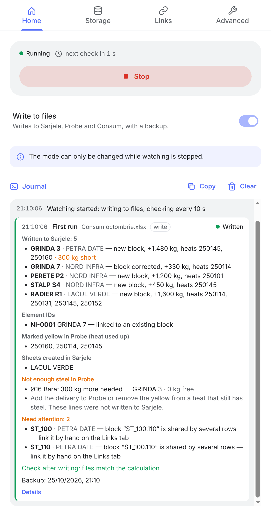
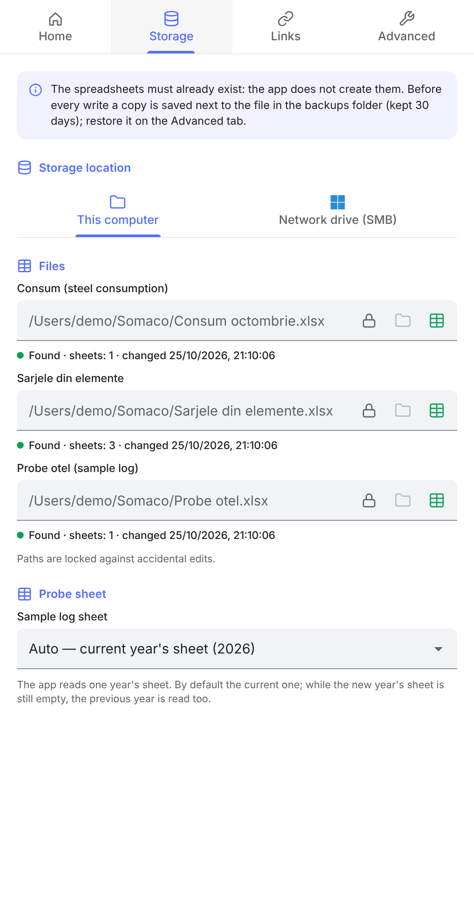
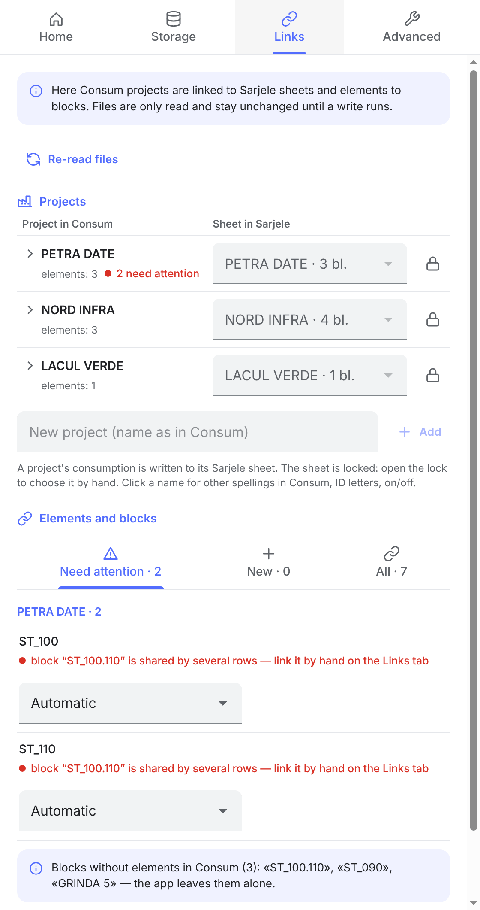
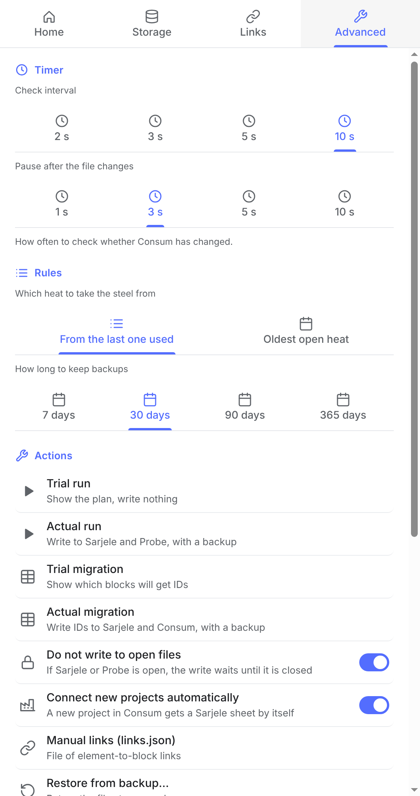

**English** · [Русский](README.ru.md)

#  Somasync

🇬🇧 English · 🇷🇴 Română · 🇹🇯 Тоҷикӣ · 🇷🇺 Русский

A desktop app (macOS and Windows) for Somaco (Holcim, Romania) that keeps track of reinforcing steel by heat. It carries consumption over from the monthly Consum report into the Sarjele and Probe spreadsheets — work that used to be done by hand.

**Domain.** At the Somaco plant, reinforcing steel goes into the elements (beams, walls, columns…) of construction projects. Steel arrives in heats: each has its own number, diameter (Ø), form — bar (Bara) or coil (Bobina) — and weight. Records are kept in three Excel files:

| File | Contents |
|---|---|
| **Consum** (sheet “Decont Lunar”) | consumption for the month: projects, their elements and kg of steel per material code. Filled in by the operators |
| **Sarjele din elemente** | one sheet per project; one block per element: which heats and how many kg of steel it was made from |
| **Probe otel** | delivery log: which heats arrived and how much; a used-up heat is filled yellow |

**What the app does.** It watches Consum. When an operator saves the file, the app:
1. calculates what is left of each heat: delivered according to Probe minus written off in Sarjele;
2. splits each element's consumption over heats of the right Ø and form;
3. adds or corrects element blocks in Sarjele and fills used-up heats yellow in Probe;
4. shows in the journal what was written, where steel is short and which elements need attention.

To recognise an element reliably from month to month, the app gives it an ID (`NI-0004`) — in a hidden column of Consum and next to the block in Sarjele.

**Data safety.** A trial mode that writes nothing. A backup before every write and restore from the Advanced tab. A file open in an editor is left alone — the write is postponed. Writes go through a temporary file and are checked afterwards. Everything runs locally: files are never sent anywhere (Sarjele is confidential).

**Technology.** Electron 44, React 19, TypeScript, Vite 8, ExcelJS, i18next. Files on this computer or on a Windows network drive (SMB). Interface languages: English (default), Romanian, Tajik, Russian.

## Screenshots

<table>
  <tr>
    <td align="center" valign="top"><br><sub><b>Home</b><br>watching, write mode, run journal</sub></td>
    <td align="center" valign="top"><br><sub><b>Storage</b><br>where Consum, Sarjele and Probe are</sub></td>
    <td align="center" valign="top"><br><sub><b>Links</b><br>projects → sheets, elements → blocks</sub></td>
    <td align="center" valign="top"><br><sub><b>Advanced</b><br>timer, rules, backups, actions</sub></td>
  </tr>
</table>

<sub>Demo data: the projects, elements and heats are made up. Click a picture to open it full size.</sub>

## Contents

- [How it works](#how-it-works)
- [Build and install](#build-and-install)
- [In practice](#in-practice)
- [Manual links: links.json](#manual-links-linksjson)
- [Tests](#tests)
- [Structure](#structure)
- [Known risks](#known-risks)
- [Decisions](#decisions)
- [License](#license)
- [AI disclosure](#ai-disclosure)

## How it works

```
Consum (Decont Lunar) ──► engine ──► Sarjele (element blocks, ID registry)
        ▲                        └─► Probe (yellow heats, sync-journal)
        └── element IDs (hidden column “ID sync”)
```

1. Watching. Every few seconds the app compares the modification time and size of Consum. If the file changed, it waits a moment and starts the engine.
2. Reading. The engine (a separate process) reads Probe (how much arrived per heat), Sarjele (how much is already written off) and Consum (elements, consumption per code, IDs, month).
3. Links. Each Consum element looks for its Sarjele block: by ID, by the registry, by a manual link, by a similar name. If none is found, a new block with a new ID is created.
4. Plan. What is left of a heat = delivered according to Probe minus written off in Sarjele. It is stored nowhere and recalculated on every run. Consumption is split over heats of the right Ø and form.
5. Write: backup, Sarjele, Probe, IDs into Consum, then a check.

This computer and the network drive each have their own file paths: switching the storage location on the Storage tab switches the set of files too.

Settings, the log (`log.txt`) and `links.json` live in the app data folder: `~/Library/Application Support/Somasync/` on Mac, `%APPDATA%\Somasync\` on Windows. The log file can be opened from the tray icon.

**Journal** (Home tab). App events take one line: watching started, file unavailable, error. Each engine run is a card: what started it (Consum changed, retry of a postponed write, an action from the Advanced tab), which Consum, which mode, and the outcome — Written, Plan only, No changes, Postponed, Error. Inside, by section: Sarjele blocks (new / filled in / corrected, kg and heats), element IDs, heats filled yellow or cleared in Probe, steel shortages, elements that need attention (with the reason), the check after writing and the backup. “Details” is the engine's technical output; the same text goes to `log.txt` (in Russian, for troubleshooting).

**Open files.** If Sarjele or Probe is open in an editor, the app does not write to it: the editor would keep showing the old version and saving from it would overwrite what was written. The write is postponed and retried automatically once the file is closed. If only Consum is open, Sarjele and Probe are written and the IDs in Consum wait until it is closed. Turned off in Advanced → “Do not write to open files”.

## Build and install

```bash
npm install          # first time and after package.json changes
npm start            # build and run from the project folder
npm run dist         # Mac (Apple Silicon): release/
npm run dist:x64     # Mac (Intel)
npm run dist:win     # Windows x64: release/Somasync-<version>-win-x64.zip
npm test             # tests
```

Mac: quit Somasync (Cmd+Q) and run `Установить.command` (“Install”). It copies the app to Applications, removes the quarantine flag and signs it locally. Changes in the project reach the installed app only this way.

Windows: unzip into any folder and run `Somasync\Somasync.exe`. No installation needed.

## In practice

Starting
- Trial mode writes nothing. To write: the “Write to files” switch on the Home tab or “Actual run” on the Advanced tab.
- “Start” turns watching on; it continues after the app restarts.

Runs and migration (Advanced → Actions)
- **Run** — one full pass over each Consum, the same as while watching, but once and on demand. The app reads the files, links elements to blocks and splits consumption over heats. “Trial run” only shows the plan in the journal. “Actual run” writes: blocks into Sarjele, yellow heats into Probe, IDs into Consum (with a backup).
- **Migration** — a one-time move of an old, hand-kept Sarjele under the app's control. Old blocks have no IDs. Migration only finds the existing block for each Consum element (by a similar name or a manual link) and gives it an ID: next to the block in Sarjele, in the `sync-registry` sheet and in the “ID sync” column of Consum. Consumption is not split over heats and no new blocks are created; elements without a block of their own are skipped. “Trial migration” shows which blocks will get IDs, “Actual migration” writes them (with a backup).
- Order for a new Sarjele: trial migration → sort out “Need attention” on the Links tab → actual migration → normal work. After migration, elements find their blocks by ID.

Watching
- Only saving Consum starts a run. Edits in Sarjele or Probe do not start a run by themselves.
- On a slow network drive the pause after a change may be too short; increase it then.
- If a file disappears (deleted, network down), the journal says “unavailable”, and “available again” when it is back.
- The app does not treat its own ID write into Consum as a change: there is no extra run after a write.

Open files
- If an editor crashed, its lock file (`~$…` or `.~lock.…#`) may stay behind and writes keep being postponed. The path to the lock is in the journal — it can be deleted by hand.
- If the editor does not show the changes, close the file and open it again.

Consum
- Sheet `Decont Lunar`. Columns are found by their headers: ELEMENT (rows 7–9), “ID sync” (rows 1–9). A column inserted on the left breaks nothing.
- Consumption — columns AK…AZ: code in row 9, Ø in row 7, form in row 8. If row 8 contains “bob” it is Bobina; everything else counts as Bara.
- Projects — merged cells in column A. If all rows of a project are hidden, the project is not used. Case, symbols and the year in the name do not matter.
- Rows from 10 on are read; “TOTAL…” and “PIERDERI…” are skipped. Kilograms are rounded to whole numbers.
- For formulas, the saved result is used. If the file was saved without recalculation, consumption will be empty.
- Only the form `NI-0004` is allowed in the ID column. Other text, or the same ID in two rows — the row is skipped, the reason is in the journal.

New month
- The month comes from the caption `LUNA <MONTH> <YEAR>`. A new Consum is a copy of the previous one; IDs carry over.
- IDs move to the new file if the old one was removed from the Storage tab or the new month is later. Otherwise a row with someone else's ID is skipped: most likely it was copied, and the ID should be cleared.

Links
- Manual links from elements to blocks — `links.json`, see [its own section](#manual-links-linksjson).
- Projects — a table “Consum project → Sarjele sheet”. The sheet is locked; open the lock to choose it by hand. Clicking a name shows other spellings in Consum, ID letters, on/off, remove.
- A project that is not set up is not processed. With “Connect new projects automatically” it is connected by itself and gets a sheet (“connected automatically” in the table); choosing a sheet by hand adds it to the settings.
- If several blocks look similar, or one block serves several rows, the element is skipped. The block is chosen by hand in the “Elements and blocks” section.

Heats
- The rule “From the last one used” starts from the heat that was written last. Older open heats are listed in the journal — check them and fill them yellow by hand if needed.
- Not enough steel — the plan shows a “НЕТ ОСТАТКА” (no stock) line, which is not written to Sarjele.
- If there are no free rows under a block, the element is skipped.
- Yellow is removed only from heats the app filled itself (hidden `sync-journal` sheet in Probe).

Writing and backups
- Before a write, all files are copied to `backups/` next to them. Restore: Advanced → “Restore from backup”.
- Writes go through a temporary file with a check. If the app was closed in the middle of a write, the leftover `<file>.lock` folder is removed automatically.
- In Consum only the “ID sync” column changes; formulas and formatting are left alone.

Service data
- In Consum the “ID sync” column is hidden. Its letter is in the journal (`Consum: колонка ID — …`).
- In Sarjele the “Model ID” column (codes and block ID) is hidden. If the column is shared with other blocks, it is not hidden; its text is made invisible instead (format `;;;`).
- All IDs are on the hidden `sync-registry` sheet in Sarjele (right-click a sheet tab → Unhide).

## Manual links: links.json

The file tells the app which Sarjele block to write a Consum element to, when the app cannot decide by itself or decides wrongly. The drop-down next to an element on the Links tab (“Elements and blocks”) writes to the same file, so editing it by hand is rarely needed.

**Location.** `~/Library/Application Support/Somasync/links.json` on Mac, `%APPDATA%\Somasync\links.json` on Windows. Open it from Advanced → “Manual links (links.json)” — if the file does not exist, the app creates an empty `{}`. Each computer has its own file; it is not part of the spreadsheet backups.

**Format.** A JSON object, one line per element.

```json
{
  "PETRA DATE|ST_100": "ST_100.110",
  "PETRA DATE|ST_110": "@new",
  "NORD INFRA|GRINDA 7": "@skip"
}
```

The key is `PROJECT|element`:
- `PROJECT` — the project name in the app (first column of the Projects table on the Links tab), not necessarily as in Consum;
- `element` — the name from the ELEMENT column in Consum;
- case and extra spaces do not matter: `petra date|st_100 ` is the same.

The value says what to do with the element:

| Value | What it does | When it applies |
|---|---|---|
| `"block title"` | write to this block (a block without an ID on the project sheet; case and spaces do not matter) | while the element has no ID: after the first write the element gets an ID and is linked by it from then on |
| `"@new"` | create a new block for the element | while the element has no ID |
| `"@skip"` | never process the element | always, even if it already has an ID |

To remove a link, delete the line or choose “Automatic” on the Links tab. The file is read on every run; no restart needed.

**Order in which the app looks for an element's block:** `@skip` → ID in the Consum column → ID registry in Sarjele → line in links.json (title or `@new`) → old block without an ID with a similar name → new block.

**Protection against mistakes:**
- the file is not valid JSON (an extra comma, a missing quote) or not an object — runs stop: the journal shows an Error card with the reason and the position in the file, Sarjele and Probe are not changed. Otherwise all `@skip` entries and links would silently disappear and elements would go to the wrong place. The app never overwrites a broken file, so edits in it are not lost;
- there is no block with the given title (a typo, or the block already has an ID) or the command is unknown (`@neww`) — the element is skipped with the reason under “Need attention”; no extra block is created;
- a line whose key has no `|` or whose value is not text is skipped, the rest still work; the journal shows a warning;
- the same element twice (in different case) — the last line applies; the journal shows a warning;
- a block can be linked to only one element: a second line with the same block is skipped as a “shared block”;
- a BOM at the start of the file (Windows Notepad) and an empty file are accepted.

## Tests

`npm test` — tests on small synthetic workbooks (`tests/fixtures.ts`): plan, write, repeated run, open file, restore, locks, backups, heat allocation, settings, links.json, translations. The plant's real files are not in the project.

Before releasing a new engine version, run the old and new versions on copies of the real files and compare the journal and the result.

## Structure

```
src/
  main.tsx                window: entry point
  app/                    App (tabs, macOS title bar, theme), state (bridge to the main process and stores), i18n
  features/               tabs
    run/                  Home: RunScreen (status, Start/Stop, mode), Journal (journal, run cards)
    storage/              Storage: location, network drive, files with checks, Probe sheet
    links/                Links: LinksScreen, ProjectsTable (project → sheet, lock), ElementsSection (element → block)
    settings/             Advanced: timer, rules, actions, system, language
  components/             shared UI: icons/ (icons, flags), ui/ (Button, Inputs, Layout, List, Tabs)
  locales/<language>/     texts: common, run, storage, links, settings, messages (engine and app messages)
  shared/                 shared by window, main process and engine: protocol, settings, messages, names, Store
  host/                   Electron main process (one class per file)
    HostServices          services and how they are wired
    SettingsStore         settings (state.json), network drive password
    Journal               events and runs, log.txt
    SyncService           engine runs and their state; ConsumWatcher — watching; EngineRunner — starting the engine
    LinksService          Links tab: reading links, links.json
    StorageService        Storage tab: file checks, connecting the network drive
    MainWindow, TrayMenu, ipc, preload, main
  engine/                 engine (dist-engine/sync.mjs), no Electron or React
    SyncEngine            commands: sync, scan, create-sheets, restore
    Workspace             loaded files, projects, element-to-block links, data for the Links tab
    planning/             ProjectCatalog, ElementLinker (+ Ownership, LinksFile), HeatAllocator, Planner (plan and what to rewrite)
    books/                ConsumBook, ConsumIdPatcher, SarjeleBook, SarjeleWriter, ProbeBook — reading and writing the files
    SyncWriter            writing (open files, locks, backup, SafeSave) and the check after writing
    RunReport             technical text and run summary (RunSummary) for the journal
    FileGuard             FileLock, EditorLock, Backups
    Cells                 ExcelJS cells and addresses
tests/                    tests
scripts/                  generate-app-icon.py — icons from the Somaco logo
assets/, build/           tray icons, app icon
docs/screenshots/         README screenshots (demo data), en/ and ru/
```

Rules
- The engine talks to the app only through arguments, environment variables, the exit code (0 — done, 1 — error, 3 — write postponed) and a JSON file (`JSON_OUT`: the run summary or data for the Links tab).
- Human-readable texts from the engine and the main process are passed as codes (`Message`: code + parameters); the window translates them. A new text is a key in all four `locales/<language>/`; tests compare the keys and parameters across languages.
- The window talks to the main process only through `window.api`.
- Imports via `@/` (= `src/`). Code comments are in Russian. Risky places are marked `РИСК:` (“risk”).

## Known risks

| What | Where | Consequence |
|---|---|---|
| A Sarjele block is recognised by its header (Model / ø / KG) | `engine/books/SarjeleBook.ts` | if the header is renamed, the block is not found and its consumption drops out of the stock |
| Probe columns are found by header words | `engine/books/ProbeBook.ts` | a renamed header turns the sheet off |
| Form in Consum is taken from “bob” in row 8 | `engine/books/ConsumBook.ts` | a typo in the header changes the form |
| IDs in Consum are written by editing the XML | `engine/books/ConsumIdPatcher.ts` | in an unusual file the IDs may not land (there will be a warning) |
| Table look around the hidden “Model ID” column | `engine/books/SarjeleWriter.ts` | after styling changes, check the real Sarjele by eye |
| An empty hidden sheet is taken for a new project | `engine/books/SarjeleWriter.ts` | such a sheet will be renamed and shown |
| Lock file of a crashed editor | `engine/FileGuard.ts` | writes are postponed until the lock is deleted |
| Age of an abandoned lock is judged by the clock | `engine/FileGuard.ts` | if clocks differ by more than 10 minutes, an error is possible |
| Pause after a Consum change | `host/ConsumWatcher.ts` | on a slow network the engine may read a half-written file |
| Network drive password without system encryption | `host/SettingsStore.ts` | stored in `state.json` unencrypted |

## Decisions

- No SQLite. The data lives in the files themselves: manual edits are taken into account and there is no second source of truth.
- Everything runs locally. Sarjele is a confidential file.

## License

[Apache License 2.0](LICENSE) © 2026 Muhammad Halimov. The code may be used, modified and distributed, including for commercial purposes, provided that the authorship and license notice is kept (the [NOTICE](NOTICE) file) and modified files are marked. The names and logos of Somaco and Holcim are trademarks of their owners: the license does not cover them. Third-party libraries are under their own licenses (Electron, React, ExcelJS, i18next — MIT; JSZip — MIT or GPL-3.0, used under MIT).

## AI disclosure

The author is responsible for the code, design decisions and maintenance. AI was used in the development of this app.
