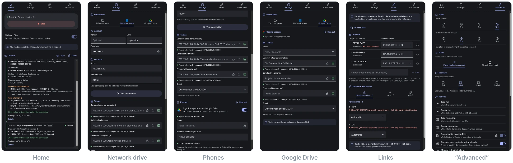

**English** · [Русский](README.ru.md)

#  Somasync

🇬🇧 English · 🇷🇴 Română · 🇹🇯 Тоҷикӣ · 🇷🇺 Русский

A desktop app (Windows and macOS) for **Somaco (Holcim), Romania** — accounting of reinforcing steel by heat.

The app watches the monthly Consum report; when an operator saves it, the app splits each element's consumption over heats, writes the element blocks into Sarjele and fills used-up heats yellow in Probe — work that used to be done by hand. The tables are kept on this computer, on a Windows network drive or in Google Drive. Tags that phones without access to the company network write into a copy of Probe in Google Drive are moved into Probe by the app itself.

**Stack:** Electron 44 · React 19 · TypeScript · Vite 8 · ExcelJS · i18next.

## Screenshots

Dark theme, English interface; demo data — the projects, elements and heats are made up.



```bash
npm run build && node scripts/screenshots/capture.mjs # Make screenshots
```

## Contents

- [Screenshots](#screenshots)
- [How it works](#how-it-works)
  - [Files](#files)
  - [A run step by step](#a-run-step-by-step)
  - [Journal](#journal)
  - [Open files](#open-files)
  - [Data safety](#data-safety)
- [Table storage](#table-storage)
  - [This computer and the network drive](#this-computer-and-the-network-drive)
  - [Google Drive](#google-drive)
  - [Phones: tags via Google Drive](#phones-tags-via-google-drive)
  - [Google Cloud setup (once)](#google-cloud-setup-once)
- [In practice](#in-practice)
- [Manual links: links.json](#manual-links-linksjson)
- [Quick start](#quick-start)
- [Building for Windows and macOS](#building-for-windows-and-macos)
- [Tests](#tests)
- [Structure](#structure)
  - [Conventions](#conventions)
- [Known risks](#known-risks)
- [License](#license)
- [AI disclosure](#ai-disclosure)

---

## How it works

```
Consum (Decont Lunar) ──► engine ──► Sarjele (element blocks, ID registry)
        ▲                        └─► Probe (yellow heats, sync-journal)
        └── element IDs (hidden column “ID sync”)
storage: this computer | network drive | Google Drive
```

### Files

At the Somaco plant, reinforcing steel goes into the elements (beams, walls, columns…) of construction projects. Steel arrives in heats: each has its own number, diameter (Ø), form — bar (Bara) or coil (Bobina) — and weight. Records are kept in three Excel files:

| File | Contents |
|---|---|
| **Consum** (sheet “Decont Lunar”) | consumption for the month: projects, their elements and kg of steel per material code. Filled in by the operators |
| **Sarjele din elemente** | one sheet per project; one block per element: which heats and how many kg of steel it was made from |
| **Probe otel** | delivery log: which heats arrived and how much; a used-up heat is filled yellow |

To recognise an element reliably from month to month, the app gives it an ID (`NI-0004`) — in a hidden column of Consum and next to the block in Sarjele.

### A run step by step

1. Watching. Every few seconds the app compares the modification time and size of Consum. If the file changed, it waits a moment and starts the engine.
2. Reading. The engine (a separate process) reads Probe (how much arrived per heat), Sarjele (how much is already written off) and Consum (elements, consumption per code, IDs, month).
3. Links. Each Consum element looks for its Sarjele block: by ID, by the registry, by a manual link, by a similar name. If none is found, a new block with a new ID is created.
4. Plan. What is left of a heat = delivered according to Probe minus written off in Sarjele. It is stored nowhere and recalculated on every run. Consumption is split over heats of the right Ø and form.
5. Write: copy, Sarjele, Probe, IDs into Consum, then a check.

### Journal

On the Home tab app events take one line: watching started, file unavailable, error. Each engine run is a card: what started it (Consum changed, retry of a postponed write, an action from the Advanced tab), which Consum, which mode, and the outcome — Written, Plan only, No changes, Postponed, Error. Inside, by section: Sarjele blocks (new / filled in / corrected, kg and heats), element IDs, heats filled yellow or cleared in Probe, steel shortages, elements that need attention (with the reason), the check after writing and the backup. “Details” is the engine's technical output in the interface language: the engine prints its lines as message codes (`TECH_MARK` + JSON), the window translates them and re-translates them when the language changes; `log.txt` gets the same text in the interface language of the moment (for troubleshooting).

Settings, the log (`log.txt`) and `links.json` live in the app data folder: `~/Library/Application Support/Somasync/` on Mac, `%APPDATA%\Somasync\` on Windows. The log file can be opened from the tray icon.

### Open files

If Sarjele or Probe is open in an editor, the app does not write to it: the editor would keep showing the old version and saving from it would overwrite what was written. The write is postponed and retried automatically once the file is closed. If only Consum is open, Sarjele and Probe are written and the IDs in Consum wait until it is closed. Turned off in Advanced → “Do not write to open files”.

### Data safety

A trial mode that writes nothing. A copy before every write and restore from the Advanced tab. A file open in an editor is left alone — the write is postponed. Writes go through a temporary file and are checked afterwards. Everything runs on this computer: files go nowhere except your own Google Drive, and only when it is the chosen storage location (Sarjele is confidential). Interface languages: English (default), Romanian, Tajik, Russian.

---

## Table storage

The tables must already exist — the app does not create them. This computer, the network drive and Google Drive each have their own files: switching the destination on the Storage tab switches the set of files too. Every table field is locked against accidental edits; the check icon at its end shows whether the file is there and which sheets it has. The Probe “Sheet”: by default the current year's sheet; while the new year's sheet is still empty, the previous year is read too.

### This computer and the network drive

- **This computer** — paths to the tables, picked with the folder icon.
- **Network drive** (SMB share) — first the account (domain, user, password), then the location (server, shared folder). “Test connection” connects the share with system tools: Windows — `net use \\server\share` (the paths are `\\server\share\…`), macOS — `mount volume smb://…` (the share appears in `/Volumes`). Then the tables are picked with the folder icon. The password is stored encrypted (Keychain / DPAPI) and reaches the window only when the eye icon is clicked.

### Google Drive

The engine works with files, so the Drive tables live in a local copy (`<app data>/drive/<folder id>/`): the engine reads and writes the copy, and what it changed goes back to Drive. The code is in `host/drive/`: `GoogleOAuth`, `DriveClient`, `DriveMirror`, `DriveService`.

- **Sign-in.** “Storage → Google Drive → Sign in with Google” opens the Google sign-in page in the system browser (OAuth for desktop apps: the answer comes back to `http://127.0.0.1:<port>`, PKCE). The account e-mail is shown; “Sign out” revokes access. The access key (refresh token) is stored encrypted, like the network drive password, and never reaches the window.
- **Folder and tables.** A link to the folder from the Drive address bar or its ID (empty — the root of “My Drive”), and the names of the tables in it.
- **Download.** Before every run only the tables that changed are downloaded — by the Drive version and the MD5 of the copy.
- **Lock.** For the duration of a run with writing the tables are locked with the same `<table>.lock` files as in the mobile app (owner label; an abandoned lock is removed after 5 minutes), so the phone and the computer do not overwrite Probe for each other. A busy table or no connection postpones the run to the next check.
- **Upload and version conflict.** After a run with writing, what the engine changed is uploaded: the previous version is copied on the server into the `backups` folder next to the tables (kept as many days as the local copies), the new revision is atomic and its MD5 is checked. If a table was changed in Drive during the run (Excel online, another device), it is not overwritten — the next run downloads the new version and recalculates.
- **Watching.** Before every check a Consum that changed in Drive is downloaded, and the change of the copy starts a run.

### Phones: tags via Google Drive

When the tables are on this computer or a network drive and the phones cannot reach the company network, the mobile app writes tags into a **copy of Probe in Google Drive**, and the app moves them into Probe. Turned on in “Storage → Phones” (the section is there when “Save to” is not Google Drive): the Google account and folder are those of the Google Drive storage, the copy's name is its Probe name. On the phones — Google Drive storage with the same folder and the same name. The code is `host/PhoneBridge.ts` and the engine command `--bridge` (`engine/ProbeBridge.ts`).

- **When.** While watching with writing to files is on: in every watching check, but not more often than once in 15 s. Drive sends no file-change notifications without a public address, so the app compares the copy's MD5 (the content; a change of sharing does not count) — two short requests.
- **The phones changed the copy.** Under the lock `Probe otel.xlsx.lock` — the same one the phones set — the copy is downloaded and the engine appends to Probe the tags it does not have yet: by the hidden sheet `somascan-journal`, where the phone keeps the record number and the tag itself. The row is the one the phone would have written (`engine/lab/LabelWorkbook.ts` is taken from the mobile app): the sheet the phone wrote to (a new year's sheet is created), “Nr. Crt.” in Probe's order, arrival date — the write time on the phone. Then Probe is uploaded in place of the copy, and the phones see the fresh log. The app's journal shows a “Tags from phones” card.
- **Only Probe changed** (an edit in Excel, filling heats) — Probe is uploaded in place of the copy without a run. No copy — it is created from Probe.
- **Not moved.** The heat is already in Probe (each heat once), the sheet is not in Probe, a record of an older app version without the tag — the tag is skipped with the reason in the card; after Probe is uploaded it is gone from the copy.
- **Probe is open in Excel.** The transfer waits and the copy is not replaced — otherwise the tags from phones would be lost. Under the section — “Tags from phones are waiting: close Probe”; once the file is closed they move by themselves.
- **Safety.** Before Probe is replaced — a copy in `backups`, then the new workbook is checked before writing (all earlier values in place, moved tags in their rows); the copy's previous version in Drive goes to `backups` next to it. The synced state (copy MD5 and Probe's change time) is kept in `bridge.json`: no extra run after a restart.
- **Instantly: Firebase Firestore** (optional, “Phones → Instantly via Firebase Firestore”, behind a lock). After writing into the copy the phone updates the document `somascan-bells/<channel>` in Firestore (the channel is the SHA-256 of “folder id/copy name”: the same on the phone and in the app with no extra setting). No data is kept in Firestore — only the notification: the document has one field, the time of the last ring. The app window listens to this document (`app/bellListener.ts`, the browser build of Firebase — Chromium networking with the system proxy) and starts a check at once: the transfer takes seconds instead of up to 15 s. Checking the copy stays as the fallback: a lost ring breaks nothing. Under the switch — “Listening to Firestore” or the error (it also goes to the journal).

**Firestore setup (once).** 1) In the [Firebase console](https://console.firebase.google.com/) add Firebase to the Google Cloud project (the one with the Google sign-in clients will do) or create a new one. 2) Firestore Database → create a database (Standard). 3) Rules — below: read the document by its exact channel and write only the ring time into it; channels cannot be listed. 4) “Project settings” → project ID and Web API key (no key — add a web app to the project). The Web API key is not a secret: the rules set the access. 5) Enter the ID and the key here and on the phones (“Settings → Storage → Google Drive → Firebase Firestore”). The Firestore free quota (50,000 reads and 20,000 writes a day) is more than enough.

```
rules_version = '2';
service cloud.firestore {
  match /databases/{database}/documents {
    match /somascan-bells/{channel} {
      allow get: if channel.size() == 64;
      allow create, update: if channel.size() == 64 && request.resource.data.keys().hasOnly(['at']);
    }
  }
}
```

### Google Cloud setup (once)

1. In [Google Cloud Console](https://console.cloud.google.com/) enable **Google Drive API** (the project of the mobile app is fine).
2. Create an OAuth client of the **Desktop app** type. Scope — `https://www.googleapis.com/auth/drive`: the app needs access to an already existing folder.
3. Either download the client's JSON and put it into the app data folder as `google-oauth.json` (`%APPDATA%\Somasync\` on Windows, `~/Library/Application Support/Somasync/` on Mac), or build the app with it: `SOMASYNC_GOOGLE_CLIENT_ID=… SOMASYNC_GOOGLE_CLIENT_SECRET=… npm run dist:win`. Without a client, “Sign in with Google” says that Google Drive is not set up.
4. While the consent screen is in “Testing” mode, only accounts from its Test users list can sign in — add the warehouse accounts there.

Testing without network or an account: `npm test` runs the local copy through a fake Drive (`tests/drive.test.ts`): download of changed tables only, locks, upload with a copy of the previous version, version conflict, cleanup; and the sign-in through `127.0.0.1` with a fake token server. The phone bridge is tested there too, with the real engine (`tests/phoneBridge.test.ts`, `tests/bridge.test.ts`).

---

## In practice

Starting
- Trial mode writes nothing. To write: the “Write to files” switch on the Home tab or “Actual run” on the Advanced tab.
- “Start” turns watching on; it continues after the app restarts.

Runs and migration (Advanced → Actions)
- **Run** — one full pass over each Consum, the same as while watching, but once and on demand. The app reads the files, links elements to blocks and splits consumption over heats. “Trial run” only shows the plan in the journal. “Actual run” writes: blocks into Sarjele, yellow heats into Probe, IDs into Consum (with a backup).
- **Migration** — a one-time move of an old, hand-kept Sarjele under the app's control. Old blocks have no IDs. Migration only finds the existing block for each Consum element (by a similar name or a manual link) and gives it an ID: next to the block in Sarjele, in the `sync-registry` sheet and in the “ID sync” column of Consum. Consumption is not split over heats and no new blocks are created; elements without a block of their own are skipped. “Trial migration” shows which blocks will get IDs, “Actual migration” writes them (with a backup).
- Order for a new Sarjele: trial migration → sort out “Need attention” on the Links tab → actual migration → normal work. After migration, elements find their blocks by ID.

Watching
- Only saving Consum starts a run. Edits in Sarjele or Probe do not start a run by themselves.
- On a slow network share the pause after a change may be too short; increase it then.
- If a file disappears (deleted, network down), the journal says “unavailable”, and “available again” when it is back.
- The app does not treat its own ID write into Consum as a change: there is no extra run after a write.

Open files
- If an editor crashed, its lock file (`~$…` or `.~lock.…#`) may stay behind and writes keep being postponed. The path to the lock is in the journal — it can be deleted by hand.
- If the editor does not show the changes, close the file and open it again.

Consum
- Sheet `Decont Lunar`. Columns are found by their headers: ELEMENT (rows 7–9), “ID sync” (rows 1–9). A column inserted on the left breaks nothing.
- Consumption — columns AK…AZ: code in row 9, Ø in row 7, form in row 8. If row 8 contains “bob” it is Bobina; everything else counts as Bara.
- Projects — merged cells in column A. If all rows of a project are hidden, the project is not used. Case, symbols and the year in the name do not matter.
- Rows from 10 on are read; “TOTAL…” and “PIERDERI…” are skipped. Kilograms are rounded to whole numbers.
- For formulas, the saved result is used. If the file was saved without recalculation, consumption will be empty.
- Only the form `NI-0004` is allowed in the ID column. Other text, or the same ID in two rows — the row is skipped, the reason is in the journal.

New month
- The month comes from the caption `LUNA <MONTH> <YEAR>`. A new Consum is a copy of the previous one; IDs carry over.
- IDs move to the new file if the old one was removed from the Storage tab or the new month is later. Otherwise a row with someone else's ID is skipped: most likely it was copied, and the ID should be cleared.

Links
- Manual links from elements to blocks — `links.json`, see [its own section](#manual-links-linksjson).
- Projects — a table “Consum project → Sarjele sheet”. The sheet is locked; open the lock to choose it by hand. Clicking a name shows other spellings in Consum, ID letters, on/off, remove.
- A project that is not set up is not processed. With “Connect new projects automatically” it is connected by itself and gets a sheet (“connected automatically” in the table); choosing a sheet by hand adds it to the settings.
- If several blocks look similar, or one block serves several rows, the element is skipped. The block is chosen by hand in the “Elements and blocks” section.

Heats
- The rule “From the last one used” starts from the heat that was written last. Older open heats are listed in the journal — check them and fill them yellow by hand if needed.
- Not enough steel — the plan shows a “— NO STOCK —” line, which is not written to Sarjele.
- If there are no free rows under a block, the element is skipped.
- Yellow is removed only from heats the app filled itself (hidden `sync-journal` sheet in Probe).

Writing and backups
- Before a write, all files are copied to `backups/` next to them. Restore: Advanced → “Restore from backup”.
- Writes go through a temporary file with a check. If the app was closed in the middle of a write, the leftover `<file>.lock` folder is removed automatically.
- In Consum only the “ID sync” column changes; formulas and formatting are left alone.

Service data
- In Consum the “ID sync” column is hidden. Its letter is in the journal’s “Details” (`Consum: ID column — …`).
- In Sarjele the “Model ID” column (codes and block ID) is hidden. If the column is shared with other blocks, it is not hidden; its text is made invisible instead (format `;;;`).
- All IDs are on the hidden `sync-registry` sheet in Sarjele (right-click a sheet tab → Unhide).

## Manual links: links.json

The file tells the app which Sarjele block to write a Consum element to, when the app cannot decide by itself or decides wrongly. The drop-down next to an element on the Links tab (“Elements and blocks”) writes to the same file, so editing it by hand is rarely needed.

**Location.** `~/Library/Application Support/Somasync/links.json` on Mac, `%APPDATA%\Somasync\links.json` on Windows. Open it from Advanced → “Manual links (links.json)” — if the file does not exist, the app creates an empty `{}`. Each computer has its own file; it is not part of the spreadsheet backups.

**Format.** A JSON object, one line per element.

```json
{
  "PETRA DATE|ST_100": "ST_100.110",
  "PETRA DATE|ST_110": "@new",
  "NORD INFRA|GRINDA 7": "@skip"
}
```

The key is `PROJECT|element`:
- `PROJECT` — the project name in the app (first column of the Projects table on the Links tab), not necessarily as in Consum;
- `element` — the name from the ELEMENT column in Consum;
- case and extra spaces do not matter: `petra date|st_100 ` is the same.

The value says what to do with the element:

| Value | What it does | When it applies |
|---|---|---|
| `"block title"` | write to this block (a block without an ID on the project sheet; case and spaces do not matter) | while the element has no ID: after the first write the element gets an ID and is linked by it from then on |
| `"@new"` | create a new block for the element | while the element has no ID |
| `"@skip"` | never process the element | always, even if it already has an ID |

To remove a link, delete the line or choose “Automatic” on the Links tab. The file is read on every run; no restart needed.

**Order in which the app looks for an element's block:** `@skip` → ID in the Consum column → ID registry in Sarjele → line in links.json (title or `@new`) → old block without an ID with a similar name → new block.

**Protection against mistakes:**
- the file is not valid JSON (an extra comma, a missing quote) or not an object — runs stop: the journal shows an Error card with the reason and the position in the file, Sarjele and Probe are not changed. Otherwise all `@skip` entries and links would silently disappear and elements would go to the wrong place. The app never overwrites a broken file, so edits in it are not lost;
- there is no block with the given title (a typo, or the block already has an ID) or the command is unknown (`@neww`) — the element is skipped with the reason under “Need attention”; no extra block is created;
- a line whose key has no `|` or whose value is not text is skipped, the rest still work; the journal shows a warning;
- the same element twice (in different case) — the last line applies; the journal shows a warning;
- a block can be linked to only one element: a second line with the same block is skipped as a “shared block”;
- a BOM at the start of the file (Windows Notepad) and an empty file are accepted.

---

## Quick start

```bash
npm install          # first time and after package.json changes
npm start            # build and run from the project folder
```

| Command | What it does |
|---|---|
| `npm start` | build and run the app from the project folder |
| `npm run build` | `tsc -b` + window (`dist/`) + engine (`dist-engine/`) + main process (`dist-host/`) |
| `npm test` | all checks (`node:test` + `tsx`) |
| `npm run dist` | Mac (Apple Silicon): `release/` |
| `npm run dist:x64` | Mac (Intel) |
| `npm run dist:win` | Windows x64: `release/Somasync-<version>-win-x64.zip` |

## Building for Windows and macOS

Windows: unzip into any folder and run `Somasync\Somasync.exe`. No installation needed. A Windows build can be made on Linux or a Mac too (`npm run dist:win`).

Mac: unzip, quit Somasync (Cmd+Q) and run `install-macos.command` next to `Somasync.app` (the first time: right-click → Open). It copies the app to Applications, removes the quarantine flag and signs it locally. Changes in the project reach the installed app only this way.

## Tests

`npm test` — tests on small synthetic workbooks (`tests/fixtures.ts`, the mobile app's empty sample log `tests/fixtures/Probe otel.xlsx`): plan, write, repeated run, open file, restore, locks, backups, heat allocation, settings, links.json, translations, the phone bridge. The plant's real files are not in the project.

Before releasing a new engine version, run the old and new versions on copies of the real files and compare the journal and the result.

---

## Structure

```
src/
  main.tsx                window: entry point
  app/                    App (tabs, macOS title bar, theme), state (bridge to the main process and stores), i18n, bellListener (phones' ring via Firestore)
  features/               tabs
    run/                  Home: RunScreen (status, Start/Stop, mode), Journal (journal, run cards)
    storage/              Storage: destination, network share (account, location), Google account, tables with checks, sheet, phones
    links/                Links: LinksScreen, ProjectsTable (project → sheet, lock), ElementsSection (element → block)
    settings/             Advanced: timer, rules, backups, actions, system, language, about
  components/             shared UI: icons/ (icons, flags), ui/ (Button, Inputs, Layout, List, Tabs)
  locales/<language>/     texts: common, run, storage, links, settings, messages (engine and app messages)
  shared/                 shared by window, main process and engine: protocol, settings, messages, names, Store
  host/                   Electron main process (one class per file)
    HostServices          services and how they are wired
    SettingsStore         settings (state.json), network share password, Google key
    Journal               events and runs, log.txt
    SyncService           engine runs and their state; ConsumWatcher — watching; EngineRunner — starting the engine
    LinksService          Links tab: reading links, links.json
    StorageService        Storage tab: file checks, connecting the network share
    drive/                Google Drive: GoogleOAuth (sign-in), DriveClient (Drive API), DriveMirror (local copy, locks, upload), DriveService
    PhoneBridge           phone bridge: tags from the Probe copy in Google Drive go into Probe, Probe goes in place of the copy
    MainWindow, TrayMenu, ipc, preload, main
  engine/                 engine (dist-engine/sync.mjs), no Electron or React
    SyncEngine            commands: sync, scan, create-sheets, restore, bridge
    ProbeBridge           bridge: tags from phones from the Probe copy into Probe
    lab/                  LabelWorkbook and its parts — writing a tag into the sample log the way the mobile app does
    Workspace             loaded files, projects, element-to-block links, data for the Links tab
    planning/             ProjectCatalog, ElementLinker (+ Ownership, LinksFile), HeatAllocator, Planner (plan and what to rewrite)
    books/                ConsumBook, ConsumIdPatcher, SarjeleBook, SarjeleWriter, ProbeBook — reading and writing the files
    SyncWriter            writing (open files, locks, backup, SafeSave) and the check after writing
    RunReport             technical text and run summary (RunSummary) for the journal
    FileGuard             FileLock, EditorLock, Backups
    Cells                 ExcelJS cells and addresses
tests/                    tests
scripts/                  generate-app-icon.py — icons from the Somaco logo; screenshots/capture.mjs — README screenshots
assets/, build/           tray icons, app icon
docs/screenshots/         README screenshots (demo data): overview.<en|ru>.webp, frames in en/ and ru/
```

### Conventions

- The engine talks to the app only through arguments, environment variables, the exit code (0 — done, 1 — error, 3 — write postponed) and a JSON file (`JSON_OUT`: the run summary or data for the Links tab).
- Human-readable texts from the engine and the main process are passed as codes (`Message`: code + parameters); the window translates them, `log.txt` and “Details” are in the interface language. A new text is a key in all four `locales/<language>/`; tests compare the keys and parameters across languages.
- The window talks to the main process only through `window.api`.
- Imports via `@/` (= `src/`). Code comments are in Russian. Risky places are marked `РИСК:` (“risk”).
- No SQLite. The data lives in the files themselves: manual edits are taken into account and there is no second source of truth.
- Everything runs on this computer; Google Drive is only the user's own storage of the tables. Sarjele is a confidential file.

## Known risks

Things that work but may break or let you down under certain conditions. In the code each such place is marked `РИСК:`.

| What | Where | Consequence |
|---|---|---|
| A Sarjele block is recognised by its header (Model / ø / KG) | `engine/books/SarjeleBook.ts` | if the header is renamed, the block is not found and its consumption drops out of the stock |
| Probe columns are found by header words | `engine/books/ProbeBook.ts` | a renamed header turns the sheet off |
| Form in Consum is taken from “bob” in row 8 | `engine/books/ConsumBook.ts` | a typo in the header changes the form |
| IDs in Consum are written by editing the XML | `engine/books/ConsumIdPatcher.ts` | in an unusual file the IDs may not land (there will be a warning) |
| Table look around the hidden “Model ID” column | `engine/books/SarjeleWriter.ts` | after styling changes, check the real Sarjele by eye |
| An empty hidden sheet is taken for a new project | `engine/books/SarjeleWriter.ts` | such a sheet will be renamed and shown |
| Lock file of a crashed editor | `engine/FileGuard.ts` | writes are postponed until the lock is deleted |
| Age of an abandoned lock is judged by the clock | `engine/FileGuard.ts` | if clocks differ by more than 10 minutes, an error is possible |
| Pause after a Consum change | `host/ConsumWatcher.ts` | on a slow network the engine may read a half-written file |
| Network share password and Google key without system encryption | `host/SettingsStore.ts` | stored in `state.json` unencrypted |
| A Google Drive table changed during a run | `host/drive/DriveMirror.ts` | not uploaded (a warning in the journal), the next run recalculates from the new version |
| Probe is open in Excel all day | `host/PhoneBridge.ts` | tags from phones wait in the copy until the file is closed (a reminder under “Phones”) |
| A tag's year sheet comes from the phone's clock | `engine/lab/LabelWorkbook.ts` | with a wrong date on the phone the tag goes to the wrong sheet |
| Writing a tag repeats the mobile app | `engine/lab/` | change together with `features/uploads/xlsx/` in main |

## License

[Apache License 2.0](LICENSE) © 2026 Muhammad Halimov. The code may be used, modified and distributed, including for commercial purposes, provided that the authorship and license notice is kept (the [NOTICE](NOTICE) file) and modified files are marked. The names and logos of Somaco and Holcim are trademarks of their owners: the license does not cover them. Third-party libraries are under their own licenses (Electron, React, ExcelJS, i18next — MIT; JSZip — MIT or GPL-3.0, used under MIT).

## AI disclosure

The author is responsible for the code, design decisions and maintenance. AI tools were involved in the development of this app.
