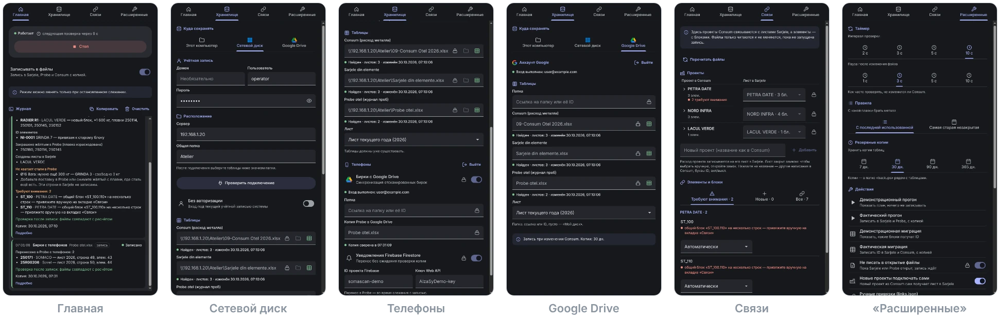
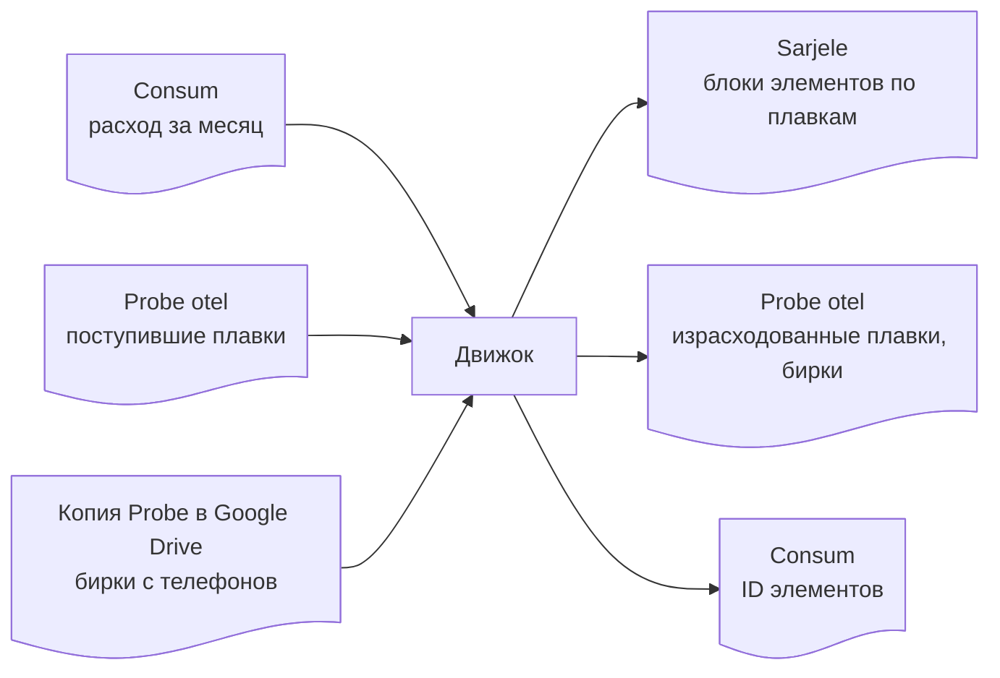

[English](README.md) · **Русский**

#  Somasync

Программа для компьютера (Windows и macOS) для **Somaco (Holcim), Румыния** — учёт арматурной стали по плавкам: распределение расхода элементов из месячного отчёта Consum по плавкам, блоки элементов в Sarjele и отметка израсходованных плавок в Probe.

**Интерфейс:**  English ·  Română ·  Тоҷикӣ ·  Русский  
**Стек:** Electron 44 · React 19 · TypeScript · Vite 8 · ExcelJS · i18next

## Скриншоты

Демо-данные: проекты, элементы и плавки вымышлены.



```bash
npm run build && node scripts/screenshots/capture.mjs   # переснять скриншоты
```

## Оглавление

- [Как это работает](#как-это-работает)
- [Хранение таблиц](#хранение-таблиц)
- [Телефоны](#телефоны)
- [Правила работы](#правила-работы)
- [Ручные привязки: links.json](#ручные-привязки-linksjson)
- [Разработка](#разработка)
- [Структура](#структура)
- [Известные риски](#известные-риски)
- [Лицензия](#лицензия)
- [Об использовании ИИ](#об-использовании-ии)

## Как это работает



| Файл | Содержание |
|---|---|
| **Consum** (лист «Decont Lunar») | расход за месяц: проекты, элементы, кг стали по кодам материала |
| **Sarjele din elemente** | лист на проект, блок на элемент: плавки и кг |
| **Probe otel** | журнал поставок; израсходованная плавка закрашивается жёлтым |

Порядок прогона:

1. **Слежение.** Сохранение Consum (изменение времени и размера) запускает движок.
2. **Чтение.** Движок читает поставки из Probe, списания из Sarjele и расход из Consum.
3. **Связи.** Каждому элементу сопоставляется блок Sarjele: по ID (`NI-0004`), реестру, ручной привязке или похожему названию; иначе создаётся новый блок.
4. **План.** Остаток плавки = поступило минус списано; расход распределяется по плавкам соответствующего Ø и формы.
5. **Запись:** копия, Sarjele, Probe, ID в Consum, проверка.

Каждый прогон отображается на главной вкладке карточкой с итогом: «Записано», «Только план», «Без изменений», «Отложено», «Ошибка». Настройки, `log.txt` и `links.json` хранятся в `%APPDATA%\Somasync\` (Windows) или `~/Library/Application Support/Somasync/` (macOS).

**Безопасность данных:** пробный режим без записи; копия перед каждой записью и откат на вкладке «Расширенные»; запись через временный файл с проверкой; файл, открытый в редакторе, не записывается — запись откладывается до его закрытия. Вся обработка выполняется локально; файлы передаются только в Google Drive и только если он выбран хранилищем.

## Хранение таблиц

Таблицы должны существовать заранее; программа их не создаёт. У каждого хранилища свой набор файлов.

- **Этот компьютер** — пути к таблицам.
- **Сетевой диск** (SMB) — учётная запись (домен, пользователь, пароль) и расположение (сервер, общая папка). «Проверить подключение» подключает папку системными средствами: Windows — `net use \\server\share` (пути `\\server\share\…`), macOS — `mount volume smb://…` (папка появляется в `/Volumes`); затем таблицы выбираются значком папки. Пароль хранится в зашифрованном виде (DPAPI / Keychain).
- **Google Drive** — вход через аккаунт Google в системном браузере (OAuth для программ на компьютере: ответ возвращается на `http://127.0.0.1:<порт>`, PKCE), ссылка на папку и имена таблиц. Без OAuth-клиента «Войти через Google» сообщает, что Google Drive не настроен. Таблицы обрабатываются в локальной копии (`<данные программы>/drive/<id папки>/`): скачиваются только изменённые, используются те же блокировки `<таблица>.lock`, что и в мобильном приложении, прежняя версия сохраняется в `backups` на сервере. Таблица, изменённая в Drive во время прогона, не перезаписывается.

Настройка Google Cloud (однократно; проект и экран согласия — те же, что у мобильного приложения, см. его [руководство по сборке](https://github.com/muhammad-halimov/somascan/blob/main/guides/BUILD.ru.md#google-drive-oauth-клиенты)):

1. [Google Cloud Console](https://console.cloud.google.com/) → APIs & Services → Library → **Google Drive API** → Enable.
2. Google Auth Platform → Data access → доступ `https://www.googleapis.com/auth/drive`; Audience → Test users для экрана External в режиме «Testing».
3. Google Auth Platform → Clients → Create client → тип **Desktop app** → Create → Download JSON.
4. JSON помещается в папку данных программы как `google-oauth.json`, либо сборка получает `SOMASYNC_GOOGLE_CLIENT_ID` и `SOMASYNC_GOOGLE_CLIENT_SECRET`: `SOMASYNC_GOOGLE_CLIENT_ID=… SOMASYNC_GOOGLE_CLIENT_SECRET=… npm run dist:win`.

## Телефоны

Если таблицы находятся на этом компьютере или сетевом диске, а у телефонов нет доступа к сети компании, мобильное приложение записывает бирки в **копию Probe в Google Drive**, а Somasync переносит их в Probe («Хранилище → Телефоны»; код — `host/PhoneBridge.ts`, `engine/ProbeBridge.ts`).

- Копия проверяется раз в 15 с во время слежения с записью (по MD5).
- Новые бирки (по скрытому листу `somascan-journal`) дописываются в Probe той же строкой, что записал бы телефон; затем Probe заменяет копию.
- Пока Probe открыт в Excel, перенос откладывается, копия не заменяется.
- Бирка с плавкой, которая уже есть в Probe, пропускается с указанием причины в журнале.

**Firebase Firestore** (необязательно, под замком) — мгновенный перенос: после записи телефон обновляет документ `somascan-bells/<канал>` (канал — SHA-256 от «id папки/имя копии», одинаковый на телефоне и в программе без отдельной настройки), и программа сразу запускает проверку. Firestore хранит только время последнего уведомления. Проверка копии остаётся запасной.

Настройка (однократно; подробно — в [руководстве по сборке мобильного приложения](https://github.com/muhammad-halimov/somascan/blob/main/guides/BUILD.ru.md#firebase-firestore)):

1. [Консоль Firebase](https://console.firebase.google.com/) → добавить Firebase в проект Google Cloud или создать новый.
2. Firestore Database → создать базу (Standard) → Rules: правила ниже → Publish.
3. Project settings → General: ID проекта и Web API key (если ключа нет — Add app → Web). Web API key не является секретом: доступ задают правила.
4. ID и ключ вводятся на компьютере («Хранилище → Телефоны → Уведомления Firebase Firestore») и на телефонах («Настройки → Хранилище → Google Drive → Firebase Firestore»).

Бесплатной квоты (50 000 чтений и 20 000 записей в день) достаточно с запасом.

```
rules_version = '2';
service cloud.firestore {
  match /databases/{database}/documents {
    match /somascan-bells/{channel} {
      allow get: if channel.size() == 64;
      allow create, update: if channel.size() == 64 && request.resource.data.keys().hasOnly(['at']);
    }
  }
}
```

## Правила работы

- **Режимы.** Пробный режим ничего не записывает; запись включается «Записывать в файлы» на главной или «Фактический прогон» в «Расширенных». «Старт» включает слежение.
- **Миграция** (однократно, для Sarjele, который вели вручную): существующие блоки получают ID без распределения по плавкам. Порядок: демонстрационная миграция → «Требуют внимания» на вкладке «Связи» → фактическая миграция.
- **Consum.** Лист `Decont Lunar`; колонки определяются по шапке (ELEMENT, «ID sync»); расход — колонки AK…AZ (код в строке 9, Ø в строке 7, форма в строке 8: «bob» — Bobina, иначе Bara); данные с 10-й строки. Для формул берётся сохранённый результат.
- **Новый месяц.** Месяц берётся из `LUNA <МЕСЯЦ> <ГОД>`; новый Consum — копия прошлого, ID переходят к нему.
- **Проекты.** Проект обрабатывается только при привязке к листу Sarjele (вкладка «Связи») или с «Новые проекты подключать сами».
- **Плавки.** «С последней использованной» начинает с плавки, записанной последней. Нехватка стали отображается как «— НЕТ ОСТАТКА —» и не записывается. Жёлтый снимается только с плавок, закрашенных программой (скрытый лист `sync-journal`).
- **Служебные данные.** Колонка «ID sync» в Consum и колонка «Model ID» в Sarjele скрыты; все ID — на скрытом листе `sync-registry` в Sarjele.
- **Копии** сохраняются в `backups/` рядом с файлами; откат — «Расширенные → Откат из копии».

## Ручные привязки: links.json

Задаёт блок для элемента Consum, когда автоматическая привязка невозможна или неверна. Выпадающий список на вкладке «Связи» пишет в этот же файл; открывается он через «Расширенные → Ручные привязки (links.json)».

```json
{
  "PETRA DATE|ST_100": "ST_100.110",
  "PETRA DATE|ST_110": "@new",
  "NORD INFRA|GRINDA 7": "@skip"
}
```

| Значение | Действие |
|---|---|
| `"название блока"` | запись в этот блок (пока у элемента нет ID) |
| `"@new"` | создание нового блока (пока у элемента нет ID) |
| `"@skip"` | элемент не обрабатывается |

Ключ — `ПРОЕКТ|элемент`; регистр и лишние пробелы не учитываются. Порядок поиска: `@skip` → ID в Consum → реестр в Sarjele → links.json → похожее название → новый блок. Неверный JSON останавливает прогоны с ошибкой; программа файл не перезаписывает.

## Разработка

```bash
npm install
npm start          # сборка и запуск из папки проекта
```

| Команда | Назначение |
|---|---|
| `npm run build` | `tsc -b` + окно (`dist/`) + движок (`dist-engine/`) + главный процесс (`dist-host/`) |
| `npm test` | все проверки (`node:test` + `tsx`) |
| `npm run dist` / `dist:x64` | macOS (Apple Silicon / Intel) → `release/` |
| `npm run dist:win` | Windows x64 → `release/Somasync-<версия>-win-x64.zip` |

- **Windows:** архив распаковывается в любую папку, программа запускается через `Somasync\Somasync.exe`; установка не требуется.
- **macOS:** после распаковки Somasync закрывается (Cmd+Q) и запускается `install-macos.command` рядом с `Somasync.app` (в первый раз: правый клик → «Открыть»); он копирует программу в «Программы», снимает карантин и подписывает её локально. Изменения проекта попадают в установленную программу только так.

Проверки выполняются на синтетических книгах (`tests/fixtures.ts`) и пустом журнале мобильного приложения (`tests/fixtures/Probe otel.xlsx`); Google Drive проверяется на поддельном сервере, вход — через `127.0.0.1` с поддельным сервером токенов (`tests/drive.test.ts`), мост с телефонами — с настоящим движком (`tests/phoneBridge.test.ts`, `tests/bridge.test.ts`). Реальные файлы завода в проект не входят: перед выпуском новой версии движка старая и новая версии запускаются на копиях реальных файлов, журнал и результат сравниваются.

## Структура

```
src/
  app/                  окно: вкладки, тема, состояние, слушатель Firestore
  features/             вкладки: run (главная), storage, links, settings («Расширенные»)
  locales/              тексты en / ro / tj / ru
  shared/               общее для окна, главного процесса и движка
  host/                 главный процесс Electron: настройки, журнал, слежение, Google Drive, телефоны
  engine/               движок без Electron и React: планирование, книги, запись, lab (бирки)
tests/                  проверки
```

Соглашения: движок взаимодействует только через аргументы, код выхода (0 — готово, 1 — ошибка, 3 — отложено) и JSON-файл; тексты передаются кодами сообщений и переводятся окном; импорты через `@/`; комментарии на русском; рискованные места отмечены `РИСК:`.

## Известные риски

| Что | Последствие |
|---|---|
| Блоки Sarjele и колонки Probe определяются по тексту шапки | переименованная шапка исключает блок или лист |
| Форма в Consum определяется по «bob» в строке 8 | опечатка меняет форму |
| ID в Consum записываются правкой XML | в нестандартном файле ID могут не записаться (с предупреждением) |
| Файл-замок аварийно закрытого редактора | запись откладывается до удаления замка |
| Пауза после изменения Consum | на медленной сети может быть прочитан недописанный файл |
| Пароль и ключ Google без системного шифрования | хранятся в `state.json` в base64 (`raw:`) |
| Запись бирки повторяет логику мобильного приложения (`engine/lab/`) | изменения вносятся вместе с `features/uploads/xlsx/` в main |

## Лицензия

[Apache License 2.0](LICENSE) © 2026 Muhammad Halimov ([NOTICE](NOTICE)). Названия и логотипы Somaco и Holcim — товарные знаки их владельцев.

## Об использовании ИИ

Автор отвечает за код, решения и сопровождение. ИИ задействован в разработке программы.
