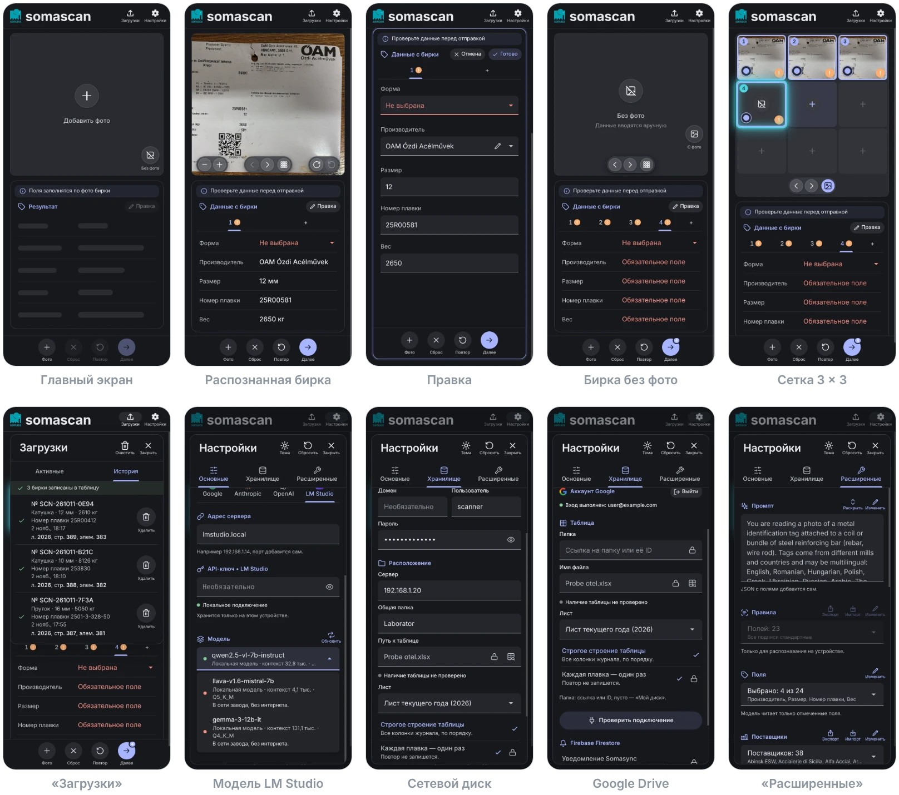
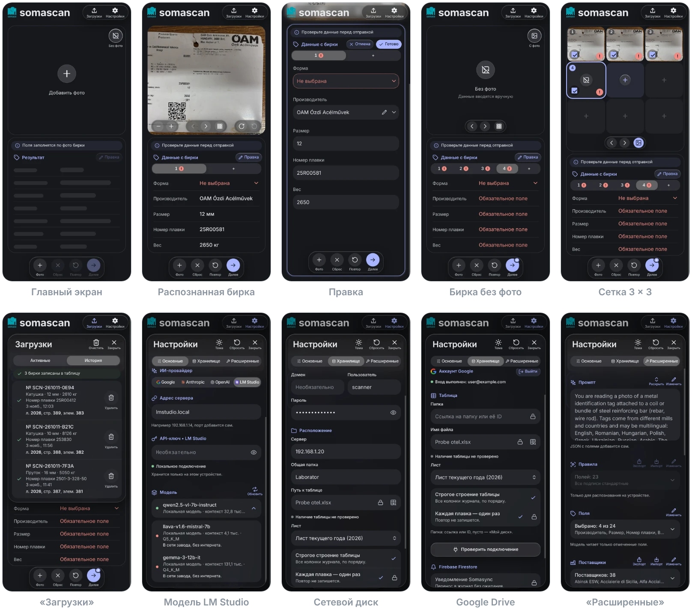

[English](README.md) · **Русский**

#  Somascan

Мобильное приложение для **Somaco (Holcim), Румыния**: читает бирки поступающей арматуры и записывает их в журнал проб стали.

Сотрудник фотографирует бирку (арматура, катанка в бунтах). Приложение распознаёт её на телефоне (ML Kit / Apple Vision, без интернета) или ИИ-моделью, показывает поля для проверки и дописывает строку в `Probe otel.xlsx` на сетевом диске Windows или в Google Drive.

**Интерфейс:**  English ·  Română ·  Тоҷикӣ ·  Русский  
**Стек:** Vite · React 19 · TypeScript · Capacitor 8 (Android / iOS) · oxlint

## Скриншоты

Тёмная тема, русский интерфейс, распознаёт LM Studio. Android — Material 3; iPhone — iOS 26 (Liquid Glass), на iOS 18 и раньше — классические материалы UIKit.

**Android**



**iPhone**



```bash
npm run build && node scripts/screenshots/capture.mjs   # переснять скриншоты
```

## Оглавление

- [Как это работает](#как-это-работает)
- [Распознавание](#распознавание)
  - [Провайдеры](#провайдеры)
  - [Распознавание на устройстве](#распознавание-на-устройстве)
  - [Фото](#фото)
  - [Расширенные настройки](#расширенные-настройки)
- [Главный экран](#главный-экран)
- [Журнал проб](#журнал-проб)
- [Запись в журнал](#запись-в-журнал)
  - [Очередь](#очередь)
  - [Одна запись](#одна-запись)
  - [Повторы и ошибки](#повторы-и-ошибки)
  - [Фоновый движок](#фоновый-движок)
  - [Настройки сетевого диска](#настройки-сетевого-диска)
  - [Google Drive](#google-drive)
  - [Телефоны без сети компании](#телефоны-без-сети-компании)
- [Разработка](#разработка)
- [Сборка](#сборка)
  - [Android](#android)
  - [Подпись](#подпись)
  - [iOS](#ios)
  - [Особенности платформ](#особенности-платформ)
  - [Иконка и сплэш-экран](#иконка-и-сплэш-экран)
- [Структура](#структура)
- [Известные риски](#известные-риски)
- [Лицензия](#лицензия)
- [Об использовании ИИ](#об-использовании-ии)

## Как это работает

```
Фото бирки ──► распознавание
               ├─ на устройстве: ML Kit (Android) / Vision (iOS) + правила полей
               └─ ИИ-модель: Gemini | Claude | OpenAI | LM Studio
           ──► поля (проверка и правка) ──► очередь ──► строка в Probe otel.xlsx
                                                        сетевой диск | Google Drive
```

## Распознавание

### Провайдеры

| Провайдер | Где работает | Примечание |
|---|---|---|
| **На устройстве** (по умолчанию) | телефон: ML Kit (Android), Apple Vision (iOS) | без интернета, ключей и сервера; поля по правилам |
| **Gemini** | облако Google | нужен API-ключ |
| **Claude** | облако Anthropic | нужен API-ключ |
| **OpenAI** | облако OpenAI | нужен API-ключ |
| **LM Studio** | сервер в сети завода | API, совместимый с OpenAI; данные не покидают сеть |

- **ИИ-модели закрыты замком** в «Основные → Распознавание»: первое нажатие открывает замок, второе выбирает. Фото тогда уходят провайдеру.
- **API-ключи** вводятся в приложении. Файлов `.env` нет: всё, что подставлено при сборке, читается из APK / IPA.
- **Списки моделей** берутся из API провайдера (с ключом) или из открытого каталога [models.dev](https://models.dev) (предпросмотр, без ключа). Показываются только модели, которые читают изображения и вышли за последние N месяцев (по умолчанию 6). Списки кэшируются на 30 дней.
- **LM Studio** показывает модели `vlm` с точкой: зелёная — загружена, красная — нет. Выбор модели выгружает прежнюю и загружает новую. Сервер общий для всех телефонов, поэтому смена модели ждёт, пока никто не распознаёт, а распознавание ждёт смены. Телефоны отмечаются в хранилище таблицы (`somascan-lmstudio`, `ModelUseGate.ts`); отметка истекает через минуту.

### Распознавание на устройстве

Телефон сам читает текст бирки: Google ML Kit на Android (Text Recognition v2 и Barcode Scanning, модели внутри APK), Apple Vision на iPhone. Движок возвращает строки текста с рамками, правила в `recognition/ocr/` собирают из них поля — без модели и обучения.

1. **Подписи.** Каждое поле знает, как его подписывают заводы на разных языках: Heat, Charge, Șarjă, Adag, Wytop, Плавка… (`ruleLabels.ts`, правятся в «Расширенные → Правила»). Регистр, диакритика и знаки не важны; частые ошибки OCR и подписи в две строки на двух языках учтены.
2. **Положение.** Значение — после подписи в той же строке, правее в том же ряду или сразу под ней. Рамки выпрямляются по наклону бирки; для фото с перспективой подбирается сдвиг рядов (`pageLayout.ts`).
3. **Вид.** Плавка — код с цифрами, размер — 4–60 с Ø или мм, марка — основа с классом (`B500C`), вес — в килограммах (`2.0 Ton` → 2000, у диапазона — верхняя граница) (`valueReaders.ts`). Плавку, повторённую в серийном номере, коде пачки или QR / DataMatrix, подтверждает или исправляет `heatCheck.ts`.
4. **Производитель.** Берётся из списка известных поставщиков с поправкой на ошибки OCR; без названия — по почте или сайту завода (`domainProducer.ts`). Свои бирки склада (после резки и гибки) — SOMACO; плавка — код под штрихкодом.
5. **Бирки канатов** (PC strand: BPM, D&D Drótáru) без плавки: берётся номер партии или бухты, диаметр — из обозначения по EN 10138-3 (`strandTag.ts`). Нечитаемый номер остаётся пустым: неверная плавка в журнале хуже пустой.
6. **Поворот.** Раскладка проверяется во всех четырёх поворотах; при необходимости фото читается ещё раз повёрнутым (`LabelExtractor.ts`).

Ответ того же вида, что у модели, поэтому остальное приложение не меняется. Правила покрыты тестами на настоящем выводе OCR бирок 11 заводов и своих бирок SOMACO (`tests/onDeviceLabel.test.ts`, `tests/fixtures/ocr/`). «Расширенные → Распознанный текст → Поделиться» выгружает последнее чтение в JSON: его стоит прислать разработчику, если бирка прочитана неверно. В браузере распознавание на устройстве недоступно.

### Фото

- **HEIC / HEIF** из галереи на Android сразу после выбора перекодируется в JPEG (`PhotoImportPlugin.java`). Формат, который провайдер не принимает, перекодируется перед отправкой (`imageType.ts`).
- **Качество.** Модель оценивает фото (`_photo` в ответе), приложение проверяет пиксели на размытие, темноту и пересвет (`PhotoQuality.ts`). При плохом фото — алерт «Фото плохого качества»; поля остаются на экране.
- **Подсказка.** Если обязательные поля пусты, на фото — подсказка в одну строку, что сделать: «Бирка не найдена», «Поверните фото», «Снимите бирку ближе», «Не все поля распознаны» (`retakeHint.ts`, `readingAdvice.ts`). «Поворот» действительно поворачивает фото, и «Повтор» отправляет его повёрнутым.

### Расширенные настройки

| Настройка | Что делает |
|---|---|
| Промпт | указания для ИИ-моделей; список полей и вид JSON добавляются сами (`labelPrompt.ts`) |
| Правила | подписи, по которым распознавание на устройстве находит поля; хранятся только изменённые поля; экспорт и импорт в JSON |
| Поля | какие поля читаются: по умолчанию четыре встроенных (производитель, размер, номер плавки, вес), необязательные и свои |
| Поставщики | известные заводы-поставщики (`knownSuppliers.ts`): модель и правила берут написание из списка; экспорт и импорт в JSON |
| Резервные копии | сколько хранятся копии таблицы: 7 (по умолчанию), 30, 90 или 365 дней |
| Модели | давность показываемых моделей и «Обновить» для списков |
| Фото | размер перед отправкой: 1024 / 1600 / 2048 px (по умолчанию) или исходный |
| О приложении | версия: одна на всё (`package.json`, `versionName`, `MARKETING_VERSION`) |

«Сбросить» в заголовке настроек возвращает значения по умолчанию, кроме API-ключей и хранилища.

## Главный экран

- **До девяти бирок.** «Фото» на пустой ячейке выбирает несколько снимков сразу; бирки идут строго по порядку. Удержание «Сброса» убирает все бирки.
- **Сетка 3 × 3.** «Сетка» уменьшает фото в его ячейку. Ячейка показывает состояние: спиннер — распознаётся, зелёная галочка — готова, оранжевый «!» — нужно действие, красный — ошибка.
- **Бирка без фото.** «Без фото» добавляет бирку, данные которой вводятся вручную; «Фото» на ней снова ждёт снимок.
- **Обязательные поля.** Включённые встроенные поля обязательны для каждой бирки; «Далее» не отправит бирку, пока они не заполнены.
- **Каждая плавка — один раз.** Плавка, которая уже есть на другой бирке или в «Загрузках», показывается ошибкой (переключатель в «Хранилище → Правила записи», включён по умолчанию).
- **Форма.** Катушка или пруток выбирается из списка прямо в карточке результата. Во всех списках выбора выбранное — первым.
- **Правка.** «Правка» открывает поля на весь экран; «Готово» сохраняет, «Отмена» отменяет изменения всех бирок.
- **«Далее»** отправляет все выбранные готовые бирки пачкой; если часть не готова — спрашивает «Отправить готовые?».
- **Раскладка.** Телефон вертикально: прокручивается весь экран, панель действий внизу. Телефон горизонтально: фото слева, поля справа.

## Журнал проб

Бирки записываются в `Probe otel.xlsx` — журнал, который ведёт цех (`A:\ATELIER ARMATURI\Probe si Sarje Otel\`).

- **Лист на каждый год** (`2026`, `2025`…). Недостающий лист года создаётся с шапкой и оформлением самого нового.
- **Шапка** в строках 4–6, данные с 7-й. Оформленные строки без данных считаются пустыми.
- **Колонки ищутся по тексту шапки**, а не по букве: их можно переставлять, а добавленная колонка с названием поля бирки тоже заполнится.

| Колонка | Значение | Источник |
|---|---|---|
| Nr. Crt. | предыдущий номер + 1 | — |
| Cantitatea | вес: `8126Kg` | Вес |
| Data trimitere la incercat | не заполняется — вносит лаборатория | — |
| Data intrare | дата записи, `DD.MM.YYYY` | — |
| Sarja | номер плавки: цифры — числом, иначе текстом | Номер плавки |
| Producator | завод | Производитель |
| Bobina / Bara | диаметр числом в колонку формы | Размер + Форма |
| Doc. de calitate | документ качества | Документ качества (необязательное) |

- **Каждая плавка — один раз.** Перед записью плавка ищется на всех листах; найденная — ошибка `duplicateHeat` с листом и строкой.
- **Строгое строение** (включено по умолчанию): запись идёт только на лист со всеми колонками журнала по порядку; иначе `layoutMismatch`.
- **Приложение не создаёт таблицу.** Без журнала — ошибка `tableNotFound`, пока путь не исправят. Проверка — значком в конце поля пути или «Проверить подключение».
- **Скрытый лист `somascan-journal`** хранит каждую записанную бирку (`SCN-…` → лист, строка, бирка). Он не даёт задвоить строку после прерванной записи; по нему Somasync переносит бирки с телефонов.
- **Пустой журнал** для тестов и нового начала: `tests/fixtures/Probe otel.xlsx` (лист 2026 без данных). Пересобирается так:

```bash
npx tsx --tsconfig tsconfig.app.json scripts/lab-table/make-template.ts "Probe otel.xlsx" "tests/fixtures/Probe otel.xlsx"
```

## Запись в журнал

### Очередь

«Далее» ставит бирки в очередь. Очередь хранится на устройстве, переживает перезапуск и пишется в фоне, по одной записи. В «Загрузках» две вкладки: **Активные** (ждут, пишутся, не записаны — с «Повтором») и **История** (записаны: лист, строка, «Nr. Crt.»). Незаписанную бирку можно отменить; запись, которая уже заменяет файл, доводится до конца.

### Одна запись

Один цикл для обоих хранилищ (`TableWriter`):

1. **Блокировка** — папка `<таблица>.lock` (в Drive — файл); другое устройство получает `busy`, блокировка старше 5 минут снимается.
2. **Чтение** журнала заново; нет таблицы — `tableNotFound`.
3. **Идемпотентность** — запись, которая уже есть в `somascan-journal`, считается выполненной.
4. **Строка** дописывается и проверяется: все прежние значения на всех листах на месте (иначе `integrityFailed`).
5. **Замена** атомарно: временный файл → проверка SHA-256 → старый файл в `backups/` → переименование.
6. **Сверка** записанной строки по ячейкам (`verifyFailed` — повтор).
7. **Очистка** копий старше выбранного срока.

Другие листы, стили, объединения, ширины, фильтры и примечания сохраняются (ExcelJS; проверено на настоящем журнале 2016–2026).

### Повторы и ошибки

Временные сбои (нет сети, таблица открыта в Excel, занята другим устройством) повторяются через 15 с, 30 с, 1, 2, 5, 10 минут, затем каждые 15 минут. Постоянные (неверный пароль, нет таблицы, нет листа, не то строение) ждут изменения настроек и затем повторяются сами. Коды — `UploadError`, тексты — `errors:upload.*`.

### Фоновый движок

Очередь пишет движок вне WebView экрана — `upload-engine.js` (`src/engine`, собирается `npm run build`), поэтому запись идёт и в свёрнутом приложении.

| | Android | iOS |
|---|---|---|
| Где работает | скрытый WebView (`UploadEngine.java`) | JavaScriptCore (`UploadEngine.swift`) |
| Свёрнуто | WorkManager, foreground service `dataSync` | фоновое время; iOS 26+ — `BGContinuedProcessingTask` |
| Ход записи | уведомление с `ProgressStyle`; Android 16 — отрезки и Live Update | iOS 26+ — системный прогресс; раньше — Live Activity (расширение `UploadActivity`) |
| Закрыто | работа продолжается | продолжается при открытии |
| Ждёт сети | WorkManager запускает движок | `BGAppRefreshTask` / `BGProcessingTask` |

Экран только отправляет команды и получает снимки очереди (`NativeUploadQueue.ts`, протокол `src/engine/protocol.ts`). В браузере очередь работает на странице (`LocalUploadQueue`). Журнал движка: `adb logcat -s UploadEngine UploadWork UploadNotification`; на iOS — Console.app, `[UploadEngine]`.

### Настройки сетевого диска

«Настройки → Хранилище → Сетевой диск»:

- **Сервер**, **общая папка**, **путь к таблице** (к существующему журналу, по умолчанию `Probe otel.xlsx`), **домен**, **пользователь**, **пароль**.
- **Замок.** Путь к таблице закрыт от случайной правки; значок замка открывает его, пока открыта вкладка.
- **Проверка таблицы.** Значок в конце поля пути проверяет таблицу и строение листа, куда пойдёт запись; результат — под полями.
- **Правила записи:** строгое строение таблицы и каждая плавка — один раз (под замком).
- **Лист:** по умолчанию лист текущего года или любой лист таблицы. Необязательное поле «Лист» отправляет отдельную бирку на другой лист.

SMB на Android — [smbj](https://github.com/hierynomus/smbj), на iOS — [AMSMB2](https://github.com/amosavian/AMSMB2) поверх libsmb2. Контракт операций — `uploads/smb/smbFiles.ts`.

### Google Drive

Тот же цикл записи; отличия — в `uploads/drive/DriveTableBackend.ts`:

- **Вход** через системный выбор аккаунта (плагин `GoogleDriveAuth`); дальше очередь сама получает свежие токены.
- **Папка и файл** — ссылка на папку или её ID и имя таблицы. Таблица должна уже существовать; `backups` создаётся при первой записи.
- **Конфликт версий** — таблица, изменённая между чтением и записью, не перезаписывается: запись повторяется с новыми данными.
- **Сверка** — MD5 от Drive сравнивается с отправленными байтами, затем строка читается обратно.

**Настройка Google Cloud (один раз):**

1. В [Google Cloud Console](https://console.cloud.google.com/) создать проект и включить **Google Drive API**.
2. Экран согласия OAuth: **Internal** для аккаунтов Google Workspace или **External** с тестовыми пользователями. Доступ — `https://www.googleapis.com/auth/drive` (к уже существующей папке).
3. **Клиент Android:** пакет `com.somascan.app`, SHA-1 ключа проекта `AA:67:2E:F2:C4:DB:4C:CD:2A:EB:78:15:64:C5:C6:2A:FD:88:87:88` (см. [Подпись](#подпись)).
4. **Клиент iOS:** bundle ID `com.somascan.app`. Client ID — в `ios/App/App/Info.plist` → `GIDClientID`, перевёрнутый ID — в `CFBundleURLSchemes`.
5. Пока экран External в режиме «Testing», добавить аккаунты склада в Test users.

### Телефоны без сети компании

Если журнал на сетевом диске, а телефоны до него не достают, телефоны пишут в копию `Probe otel.xlsx` в Google Drive. Программа **Somasync** для компьютера (ветка `desktop`, «Хранилище → Телефоны») переносит новые бирки из копии в журнал той же строкой и выкладывает журнал на место копии.

Somasync проверяет копию раз в 15 с. Для мгновенного переноса на вкладке Google Drive включается **Firebase Firestore** (под замком): после записи телефон обновляет документ `somascan-bells/<канал>` (SHA-256 от «id папки/имя таблицы»), и Somasync реагирует сразу. Firestore хранит только время звонка, без данных (`firestoreBell.ts`). Настройка проекта и правила — в README Somasync.

## Разработка

```bash
npm install
npm run dev        # веб-версия, http://localhost:5173
```

| Команда | Что делает |
|---|---|
| `npm run dev` | dev-сервер Vite |
| `npm run build` | проверка типов, сборка страницы и движка (`dist/upload-engine.js`) |
| `npm test` | все проверки (`node:test` + `tsx`) |
| `npm run lint` | oxlint |
| `npm run preview` | просмотр продакшен-сборки |
| `npm run cap:sync` | сборка и `cap sync` для всех платформ |
| `npm run cap:android` / `cap:ios` | сборка, синхронизация и открытие Android Studio / Xcode |
| `npm run cap:run:android` / `cap:run:ios` | сборка и запуск на эмуляторе или устройстве |

После изменения веб-кода — `npm run build && npx cap sync` (скрипты `cap:*` делают это сами). App ID: `com.somascan.app`.

**Тесты** покрывают журнал, резервные копии, SMB и Drive на поддельных серверах, движок очереди в «голом» JS-контексте, настройки и распознавание. Локальный SMB-сервер (Samba в Docker) — в `scripts/smb-test-server/`: сервер `10.0.2.2:1445` (эмулятор Android) или `127.0.0.1:1445` (симулятор iOS), папка `Warehouse`. В сборке для разработки хранилища доступны в консоли как `window.__somascan`.

## Сборка

### Android

Нужны Android SDK (Android Studio или `android-commandlinetools`) и JDK 21. Проект собирается под Android 16 (`compileSdk`/`targetSdk` 36, `minSdk` 24).

```bash
sdkmanager "platform-tools" "platforms;android-36" "build-tools;35.0.0" "emulator" \
  "system-images;android-35;google_apis;arm64-v8a"            # на Intel / Windows — x86_64
avdmanager create avd -n somascan_pixel7 -k "system-images;android-35;google_apis;arm64-v8a" -d pixel_7
echo "sdk.dir=$ANDROID_HOME" > android/local.properties        # не в git
npm run cap:run:android                                         # запуск на эмуляторе или устройстве
```

APK:

```bash
npm run build && npx cap sync android && (cd android && ./gradlew assembleDebug)
adb install -r android/app/build/outputs/apk/debug/app-debug.apk
```

По Wi-Fi: на телефоне «Для разработчиков → Отладка по Wi-Fi», затем `adb connect <ip>:<порт>`.

### Подпись

Debug и release подписываются ключом проекта `android/keystore/somascan.jks` (alias `somascan`), пароли — в `android/keystore.properties`. Оба файла **не в git**: их переносят вручную и хранят резервную копию — с потерянным ключом установленное приложение не обновить, а для Google Drive нужен новый OAuth-клиент. Без `keystore.properties` сборка подписывается debug-ключом машины.

SHA-1 ключа: `AA:67:2E:F2:C4:DB:4C:CD:2A:EB:78:15:64:C5:C6:2A:FD:88:87:88` (проверка: `./gradlew signingReport`). Сборку с другим ключом поверх этой не установить: сначала удалить приложение.

### iOS

macOS с Xcode 26+ (Swift 6.2). Проект `ios/` уже в репозитории; зависимости — через Swift Package Manager (AMSMB2, GoogleSignIn). Минимум — iOS 16.2.

```bash
npm run cap:ios          # открыть в Xcode, затем Run
npm run cap:run:ios      # запуск на симуляторе
```

- `simctl` не находится — `sudo xcode-select -s /Applications/Xcode.app/Contents/Developer`.
- Xcode 27: `cap run ios` падает на отсутствующем `Simulator.app` — запускать из Xcode.
- `Mach error -308` — `xcrun simctl shutdown all` и повторить.
- Расширению `UploadActivity` (Live Activity) нужна та же команда подписи, что и приложению.

### Особенности платформ

- **Безопасные зоны.** Страница рисуется под системными панелями; отступы приходят в CSS как `--safe-*` (`styles/tokens.css`). Цвет панелей следует теме (плагин `NativeTheme`).
- **Сеть.** LM Studio и другие запросы `http://` идут через нативный плагин `NativeHttp`: без CORS и без блокировки WebView. Адрес сервера можно вводить коротко — `192.168.1.14`.

### Иконка и сплэш-экран

Иконка и сплэш-экран делаются из `scripts/somaco-logo.png` одним скриптом, во всех размерах и вариантах темы:

```bash
python3 -m venv .venv && .venv/bin/pip install pillow   # один раз
.venv/bin/python scripts/generate-app-icon.py
```

## Структура

```
src/
  app/                  корневой компонент, шапка, общая синхронизация
  components/           общий UI: icons/, ui/ (ActionButton, Tabs, List, TextInput, Disclosure…)
  features/
    recognition/        providers/, catalog/ (списки моделей), label/ (поля, промпт, поставщики),
                        ocr/ (правила на устройстве), image/ (загрузка и качество фото)
    workspace/          главный экран: бирки, сетка, фото, карточка результата, правка
    settings/           окно настроек и его вкладки; SettingsStore
    uploads/            очередь и история, проверка таблицы, xlsx/ (журнал), smb/, drive/, leases/
  engine/               движок очереди выгрузки (upload-engine.js)
  hooks/                общие React-хуки
  i18n/, locales/       i18next; тексты en / ro / tj / ru
  lib/                  инфраструктура без React: store, storage, http, platform, theme, interaction
  styles/               токены, база, анимации, стили платформ
tests/                  проверки node:test и фикстуры
scripts/                lab-table, smb-test-server, screenshots, generate-app-icon.py
android/, ios/          нативные проекты и локальные плагины
```

### Соглашения

- **Модули.** Код функции — в `features/<функция>/`; общий код — в `components/`, `hooks/`, `lib/`. `lib/` не знает о React и бизнес-логике. Импорты — через `@/`.
- **Имена.** Компоненты и классы — `PascalCase`, хуки — `useSomething`, остальные модули — `camelCase`.
- **Стили** лежат рядом с компонентом; классы — kebab-case с префиксом компонента, состояния — `is-*`; цвета — только из `styles/tokens.css`.
- **Состояние** — в классах-хранилищах на `lib/store/Store`, читается через `useStore` / `useSettings`.
- **Тексты** — только через `t()` и `locales/`; ключи типизированы.
- **Комментарии** — на русском; JSDoc у каждого экспорта.
- **Касания.** Отклик на нажатие рисует код (`lib/interaction`), а не `:active`; системные диалоги — только через `NativeDialogs`.
- **Риски** отмечены в коде `РИСК:` и перечислены ниже.

### Как добавить

- **Провайдера:** подкласс `RecognitionProvider` в `recognition/providers/`, регистрация в `ProviderRegistry.ts`, id в `PROVIDER_IDS`, значок в `providerIcons.tsx`, название в `settings.json`.
- **Язык:** `locales/<код>/`, код в `i18n/languages.ts`, ресурсы в `i18n/resources.ts`, тексты разрешений iOS в `<код>.lproj/InfoPlist.strings`.
- **Поле бирки:** запись в `BUILT_IN_FIELDS` (`labelFields.ts`) и название в `label.json`.
- **Настройку:** поле в `settingsSchema.ts`, метод в `SettingsStore`, элемент во вкладке.

## Известные риски

| Что | Где | Последствие |
|---|---|---|
| Недокументированные части ExcelJS | `uploads/xlsx/excelInternals.ts` | после обновления `exceljs` — `npm test` и сравнение настоящего журнала до и после записи |
| Проверка перед заменой сравнивает значения, а не оформление | `TableWriter.ts` | потерянные стили не заметит; прежняя версия — в `backups/` |
| Защита от дублей — на скрытом листе `somascan-journal` | `LabelWorkbook.ts` | без листа повтор может дописать строку ещё раз |
| Год листа и «Data intrare» — по часам телефона | `LabelWorkbook.append` | неверная дата — не тот лист |
| Брошенная блокировка определяется по часам разных устройств | `TableBackend.ts` | при расхождении часов больше 5 минут блокировка может сработать неверно |
| Список листов — снимок последней проверки | `TableCheckStore.ts` | переименованный лист даёт `sheetNotFound` до следующей проверки |
| Ошибки SMB от Windows на iOS распознаются по тексту | `SmbShareClient.swift` | проверить после обновления AMSMB2 |
| Отметки очереди LM Studio истекают по часам телефонов | `ModelUseGate.ts`, `uploads/leases/` | два телефона, начавшие в одну секунду, могут столкнуться |
| Вход в Google зависит от OAuth-клиентов | `Info.plist`, `android/keystore` | новый ключ или удалённый клиент — вход перестаёт работать |
| Нижняя панель Android зависит от версии WebView | `NotesCard.css` | проверять на старом и новом WebView |
| API-ключи и пароль SMB хранятся без шифрования | `SettingsStore.ts` | перед широкой раздачей — перенести в Keychain / Keystore |
| Подсказка известных поставщиков | `labelPrompt.ts` | на плохом фото модель может выбрать похожего поставщика |

Сценарии экрана (сетка, правка, отправка, настройки) проверяются вручную, без автотестов.

## Лицензия

[Apache License 2.0](LICENSE) © 2026 Muhammad Halimov. Сохраняйте уведомление об авторстве и лицензии ([NOTICE](NOTICE)) и отмечайте изменённые файлы. Названия и логотипы Somaco, Holcim и сервисов — товарные знаки их владельцев, лицензия на них не распространяется. Сторонние библиотеки — под своими лицензиями (libsmb2 — LGPL-2.1, подключена динамически).

## Об использовании ИИ

За код, проектные решения и поддержку отвечает автор. При разработке приложения использовались инструменты ИИ.
