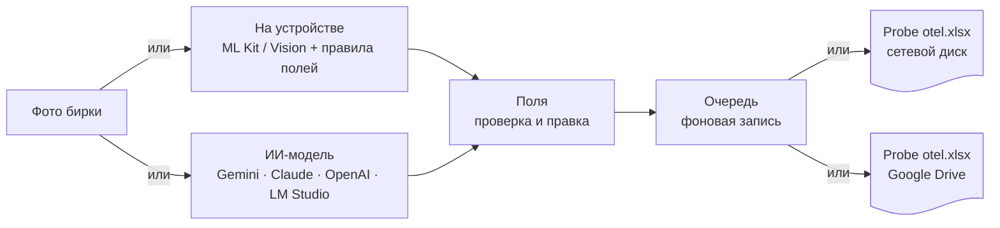

[English](README.md) · **Русский**

#  Somascan

Мобильное приложение для **Somaco (Holcim), Румыния** — распознавание бирок поступающей арматуры и запись их данных в журнал проб стали `Probe otel.xlsx` на сетевом диске Windows или в Google Drive.

**Интерфейс:**  English ·  Română ·  Тоҷикӣ ·  Русский  
**Стек:** Vite · React 19 · TypeScript · Capacitor 8 (Android / iOS) · oxlint

## Скриншоты

**Android** (Material 3)


**iPhone** (iOS 26, Liquid Glass)


```bash
npm run build && node scripts/screenshots/capture.mjs   # переснять скриншоты
```

## Оглавление

- [Как это работает](#как-это-работает)
- [Распознавание](#распознавание)
- [Журнал проб](#журнал-проб)
- [Запись в журнал](#запись-в-журнал)
- [Разработка](#разработка)
- [Сборка](#сборка)
- [Структура](#структура)
- [Известные риски](#известные-риски)
- [Лицензия](#лицензия)
- [Об использовании ИИ](#об-использовании-ии)

## Как это работает



- На главном экране — до девяти бирок (сетка 3 × 3). Бирка отправляется кнопкой «Далее» после выбора формы (катушка или пруток) и заполнения обязательных полей.
- Каждая плавка принимается один раз (по умолчанию): повтор на экране, в «Загрузках» или в журнале считается ошибкой.
- Бирка без фото заполняется вручную.

## Распознавание

| Провайдер | Где работает | Примечание |
|---|---|---|
| **На устройстве** (по умолчанию) | телефон: ML Kit (Android), Apple Vision (iOS) | без интернета и ключей; поля по правилам |
| **Gemini**, **Claude**, **OpenAI** | облако провайдера | API-ключ, вводится в приложении |
| **LM Studio** | сервер в сети завода | данные не покидают сеть |

- **На устройстве.** Текст бирки распознаётся на телефоне; правила в `recognition/ocr/` определяют поля по подписям на разных языках (Heat, Șarjă, Adag, Плавка…) и по виду значения. Подписи настраиваются в «Расширенные → Правила». Правила проверены на реальных данных распознавания бирок 11 заводов (`tests/fixtures/ocr/`).
- **ИИ-модели** закрыты замком в «Основные → Распознавание». Списки моделей загружаются из API провайдера или из [models.dev](https://models.dev). LM Studio — общий сервер для всех телефонов: смена модели выполняется, когда ни один телефон не ведёт распознавание.
- **Качество фото.** Размытие, блики, недостаток света и отсутствие бирки определяются автоматически; на фото выводится однострочная подсказка («Поверните фото», «Снимите бирку ближе»).
- **«Расширенные»:** промпт, правила, читаемые поля, известные поставщики (экспорт и импорт в JSON), срок копий, размер фото.

## Журнал проб

Бирки записываются в `Probe otel.xlsx` — журнал цеха: отдельный лист на каждый год, шапка в строках 4–6, данные с 7-й строки. Колонки определяются по тексту шапки, поэтому их порядок может меняться.

| Колонка | Значение |
|---|---|
| Nr. Crt. | предыдущий номер + 1 |
| Cantitatea | вес, `8126Kg` |
| Data intrare | дата записи, `DD.MM.YYYY` |
| Sarja | номер плавки |
| Producator | завод |
| Bobina / Bara | диаметр в колонке формы |
| Doc. de calitate | документ качества (необязательное поле) |

- **Таблица не создаётся приложением.** При отсутствии журнала запись завершается ошибкой `tableNotFound` до исправления пути; наличие таблицы проверяется значком в конце поля пути.
- **Строгое строение** (по умолчанию): запись выполняется только на лист со всеми колонками журнала в установленном порядке.
- **Скрытый лист `somascan-journal`** хранит все записанные бирки и исключает повтор строки после прерванной записи.
- Пустой журнал для тестов: `tests/fixtures/Probe otel.xlsx`.

## Запись в журнал

Кнопка «Далее» ставит бирки в очередь. Очередь сохраняется при перезапуске и записывается в фоне по одной бирке; состояние отображается в «Загрузках». На телефоне запись выполняет движок вне экрана (`src/engine`): на Android — WorkManager с уведомлением, на iOS — фоновая задача (до iOS 26 — с Live Activity).

Порядок записи (`TableWriter`), общий для обоих хранилищ:

1. Блокировка `<таблица>.lock`; блокировка старше 5 минут снимается.
2. Чтение журнала, добавление строки, проверка сохранности всех прежних значений.
3. Атомарная замена файла; прежняя версия сохраняется в `backups/` (по умолчанию 7 дней).
4. Повторное чтение и сверка записанной строки.

Временные сбои (нет сети, таблица открыта в Excel) повторяются с растущим интервалом, до одного раза в 15 минут; постоянные (неверный пароль, нет таблицы, неверное строение) ожидают изменения настроек.

**Сетевой диск** — «Настройки → Хранилище → Сетевой диск»: сервер, общая папка, путь к существующему журналу, домен, пользователь, пароль. SMB: [smbj](https://github.com/hierynomus/smbj) на Android, [AMSMB2](https://github.com/amosavian/AMSMB2) на iOS.

**Google Drive** — вход через аккаунт Google, ссылка на папку и имя таблицы. Настройка Google Cloud (однократно):

1. В [Google Cloud Console](https://console.cloud.google.com/) включить **Google Drive API**; экран согласия Internal (Workspace) или External с тестовыми пользователями; доступ `https://www.googleapis.com/auth/drive`.
2. Клиент Android: пакет `com.somascan.app`, SHA-1 ключа проекта (см. [Подпись](#подпись)).
3. Клиент iOS: bundle ID `com.somascan.app`; Client ID — в `ios/App/App/Info.plist` → `GIDClientID`, перевёрнутый ID — в `CFBundleURLSchemes`.

## Разработка

```bash
npm install
npm run dev        # веб-версия, http://localhost:5173
```

| Команда | Что делает |
|---|---|
| `npm run build` | проверка типов, сборка страницы и движка |
| `npm test` | все проверки (`node:test` + `tsx`) |
| `npm run lint` | oxlint |
| `npm run cap:sync` | сборка и `cap sync` |
| `npm run cap:run:android` / `cap:run:ios` | сборка и запуск на эмуляторе или устройстве |

После изменения веб-кода выполняется `npm run build && npx cap sync`. Локальный SMB-сервер для проверок (Samba в Docker) — `scripts/smb-test-server/`.

## Сборка

### Android

Android SDK (Android Studio или `android-commandlinetools`), JDK 21; `compileSdk` 36, `minSdk` 24. В `android/local.properties` — `sdk.dir=…`.

```bash
npm run build && npx cap sync android && (cd android && ./gradlew assembleDebug)
adb install -r android/app/build/outputs/apk/debug/app-debug.apk
```

### Подпись

Debug и release подписываются ключом проекта `android/keystore/somascan.jks`, пароли хранятся в `android/keystore.properties`. Оба файла **не входят в git**: они переносятся вручную и требуют резервной копии — без ключа обновление установленного приложения невозможно. SHA-1: `AA:67:2E:F2:C4:DB:4C:CD:2A:EB:78:15:64:C5:C6:2A:FD:88:87:88`.

### iOS

macOS с Xcode 26+; минимум iOS 16.2. Зависимости — через Swift Package Manager.

```bash
npm run cap:ios          # открыть в Xcode, затем Run
```

Если не находится `simctl`: `sudo xcode-select -s /Applications/Xcode.app/Contents/Developer`.

## Структура

```
src/
  app/                  корневой компонент, шапка
  components/           общий UI
  features/
    recognition/        провайдеры, списки моделей, поля бирки, правила на устройстве, фото
    workspace/          главный экран: бирки, сетка, карточка результата, правка
    settings/           настройки и их вкладки
    uploads/            очередь, журнал (xlsx), сетевой диск (smb), Google Drive
  engine/               движок фоновой выгрузки
  lib/, hooks/          инфраструктура без бизнес-логики
  locales/              тексты en / ro / tj / ru
tests/                  проверки и фикстуры
android/, ios/          нативные проекты и плагины
```

Соглашения: импорты через `@/`; тексты только через `t()` и `locales/`; цвета только из `styles/tokens.css`; комментарии на русском; рискованные места отмечены `РИСК:`.

## Известные риски

| Что | Последствие |
|---|---|
| Недокументированные части ExcelJS (`excelInternals.ts`) | после обновления `exceljs` — `npm test` и сравнение реального журнала до и после записи |
| Защита от дублей — на скрытом листе `somascan-journal` | при утрате листа повторная запись может продублировать строку |
| Год листа и дата — по часам телефона | при неверной дате бирка попадёт на другой лист |
| Блокировки оцениваются по часам разных устройств | при расхождении часов более 5 минут блокировка может сработать неверно |
| API-ключи и пароль SMB хранятся без шифрования | перед широким распространением — перенос в Keychain / Keystore |

## Лицензия

[Apache License 2.0](LICENSE) © 2026 Muhammad Halimov ([NOTICE](NOTICE)). Названия и логотипы Somaco, Holcim и сервисов — товарные знаки их владельцев.

## Об использовании ИИ

Автор отвечает за код, решения и сопровождение. ИИ задействован в разработке приложения.
