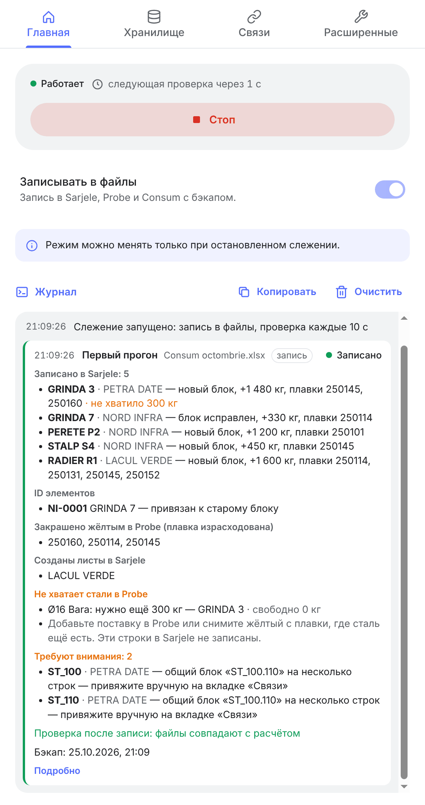
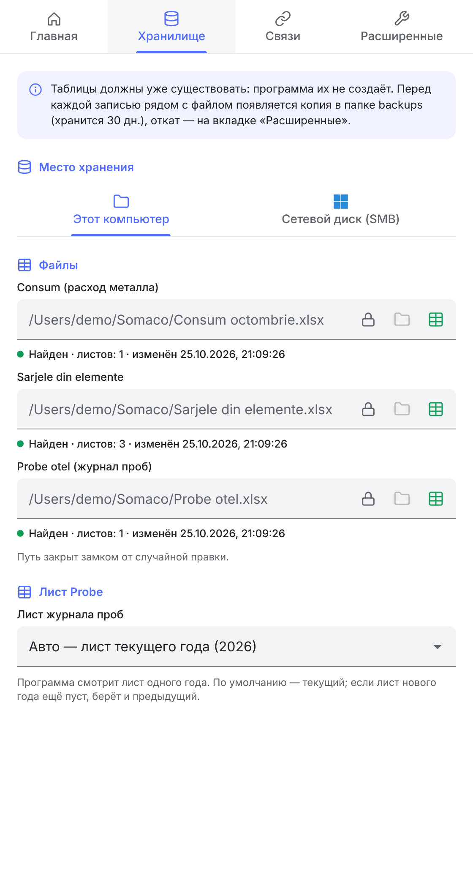
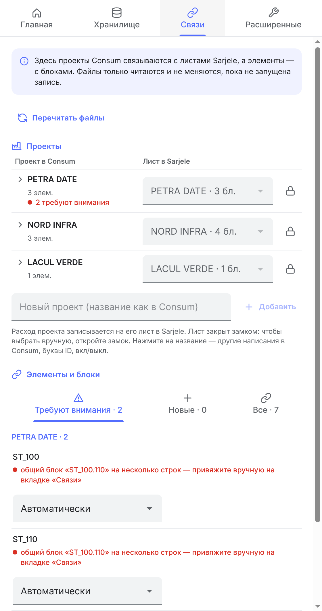
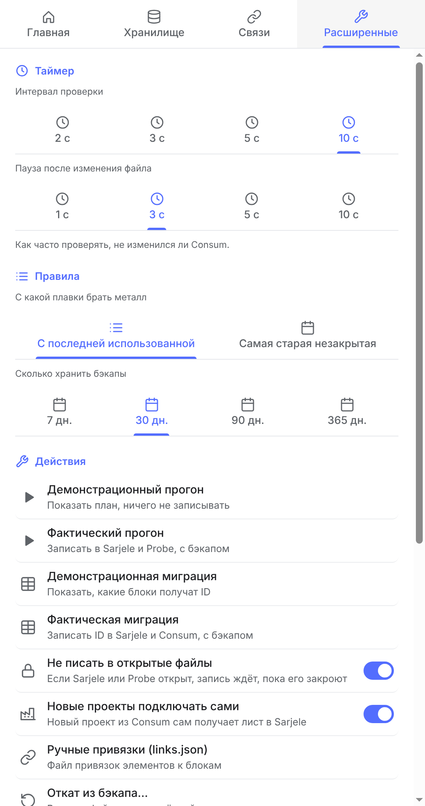

[English](README.md) · **Русский**

#  Somasync

🇬🇧 English · 🇷🇴 Română · 🇹🇯 Тоҷикӣ · 🇷🇺 Русский

Настольная программа (macOS и Windows) для Somaco (Holcim, Румыния), которая сама ведёт учёт арматурной стали по плавкам. Она переносит расход из месячного отчёта Consum в таблицы Sarjele и Probe — раньше это делали вручную.

**Предметная область.** На заводе Somaco арматурная сталь идёт в элементы (балки, стены, колонны…) строительных проектов. Сталь приходит плавками: у каждой свой номер, диаметр (Ø), форма — пруток (Bara) или бухта (Bobina) — и вес. Учёт ведётся в трёх файлах Excel:

| Файл | Что в нём |
|---|---|
| **Consum** (лист «Decont Lunar») | расход за месяц: проекты, их элементы и кг стали по кодам материала. Его заполняют операторы |
| **Sarjele din elemente** | по листу на проект; на каждый элемент — блок: из каких плавок и сколько кг стали он сделан |
| **Probe otel** | журнал поставок: какие плавки пришли и сколько; израсходованная плавка закрашивается жёлтым |

**Что делает программа.** Следит за Consum. Когда оператор сохраняет файл, программа:
1. считает остаток каждой плавки: пришло по Probe минус списано в Sarjele;
2. раскладывает расход каждого элемента по плавкам нужного Ø и формы;
3. дописывает или исправляет блоки элементов в Sarjele и закрашивает израсходованные плавки в Probe;
4. показывает в журнале, что записано, где не хватает стали и какие элементы требуют внимания.

Чтобы надёжно узнавать элемент из месяца в месяц, программа ставит ему ID (`NI-0004`) — в скрытой колонке Consum и рядом с блоком в Sarjele.

**Безопасность данных.** Пробный режим, где ничего не пишется. Бэкап перед каждой записью и откат из «Расширенных». Файл, открытый в редакторе, не трогается — запись откладывается. Запись через временный файл и проверка после записи. Всё работает локально: файлы никуда не отправляются (Sarjele — конфиденциальный файл).

**Технологии.** Electron 44, React 19, TypeScript, Vite 8, ExcelJS, i18next. Файлы — локально или на сетевом диске Windows (SMB). Языки интерфейса: английский (по умолчанию), румынский, таджикский, русский.

## Скриншоты

<table>
  <tr>
    <td align="center" valign="top"><br><sub><b>Главная</b><br>слежение, режим записи, журнал прогонов</sub></td>
    <td align="center" valign="top"><br><sub><b>Хранилище</b><br>где лежат Consum, Sarjele и Probe</sub></td>
    <td align="center" valign="top"><br><sub><b>Связи</b><br>проекты → листы, элементы → блоки</sub></td>
    <td align="center" valign="top"><br><sub><b>Расширенные</b><br>таймер, правила, бэкапы, действия</sub></td>
  </tr>
</table>

<sub>Данные демонстрационные: проекты, элементы и плавки вымышлены. Нажмите на картинку, чтобы открыть её целиком.</sub>

## Оглавление

- [Как это работает](#как-это-работает)
- [Сборка и установка](#сборка-и-установка)
- [На практике](#на-практике)
- [Ручные привязки: links.json](#ручные-привязки-linksjson)
- [Проверки](#проверки)
- [Структура](#структура)
- [Известные риски](#известные-риски)
- [Решения](#решения)
- [Лицензия](#лицензия)
- [Об использовании ИИ](#об-использовании-ии)

## Как это работает

```
Consum (Decont Lunar) ──► движок ──► Sarjele (блоки элементов, реестр ID)
        ▲                        └─► Probe (жёлтые плавки, sync-journal)
        └── ID элементов (скрытая колонка «ID sync»)
```

1. Слежение. Раз в несколько секунд программа сравнивает время изменения и размер Consum. Если файл изменился, она ждёт паузу и запускает движок.
2. Чтение. Движок (отдельный процесс) читает Probe (сколько пришло по каждой плавке), Sarjele (сколько уже списано) и Consum (элементы, расход по кодам, ID, месяц).
3. Связи. Элемент Consum ищет свой блок Sarjele: по ID, по реестру, по ручной привязке, по похожему названию. Не нашёл — создаётся новый блок с новым ID.
4. План. Остаток плавки = пришло по Probe минус списано в Sarjele. Он нигде не хранится и считается заново при каждом прогоне. Расход раскладывается по плавкам нужного Ø и формы.
5. Запись: бэкап, Sarjele, Probe, ID в Consum, затем проверка.

У этого компьютера и сетевого диска свои пути к файлам: переключение места хранения в «Хранилище» переключает и набор файлов.

Настройки, журнал (`log.txt`) и `links.json` лежат в папке данных программы: `~/Library/Application Support/Somasync/` на Mac, `%APPDATA%\Somasync\` на Windows. Файл журнала открывается из значка в трее.

**Журнал** (главная вкладка). События программы — одной строкой: слежение запущено, файл недоступен, ошибка. Каждый прогон движка — карточка: что его запустило (Consum изменился, повтор отложенной записи, действие из «Расширенных»), по какому Consum, в каком режиме и итог — «Записано», «Только план», «Без изменений», «Отложено», «Ошибка». В карточке по разделам: блоки Sarjele (новый / заполнен / исправлен, кг и плавки), ID элементов, плавки, закрашенные или открытые в Probe, нехватка стали, элементы, которые требуют внимания (с причиной), проверка после записи и бэкап. «Подробно» — технический вывод движка: он же пишется в `log.txt` (по-русски, для разбора проблем).

**Открытые файлы.** Если Sarjele или Probe открыт в редакторе, программа не пишет в него: редактор показал бы старую версию, а его сохранение затёрло бы записанное. Запись откладывается и повторяется сама, когда файл закроют. Если открыт только Consum, Sarjele и Probe пишутся, а ID в Consum ждут закрытия. Отключается в «Расширенные» → «Не писать в открытые файлы».

## Сборка и установка

```bash
npm install          # первый раз и после изменения package.json
npm start            # собрать и запустить из папки проекта
npm run dist         # Mac (Apple Silicon): release/
npm run dist:x64     # Mac (Intel)
npm run dist:win     # Windows x64: release/Somasync-<версия>-win-x64.zip
npm test             # проверки
```

Mac: закрыть Somasync (Cmd+Q) и запустить `Установить.command`. Он копирует приложение в «Программы», снимает карантин и подписывает локально. Изменения в проекте попадают в установленную программу только так.

Windows: распаковать zip в любую папку и запускать `Somasync\Somasync.exe`. Установка не нужна.

## На практике

Запуск
- Пробный режим ничего не пишет. Писать: переключатель «Записывать в файлы» на главной или «Фактический прогон» в «Расширенных».
- «Старт» включает слежение, оно продолжается после перезапуска программы.

Прогон и миграция («Расширенные» → «Действия»)
- **Прогон** — один полный проход по каждому Consum, как при слежении, но разово и по кнопке. Программа читает файлы, связывает элементы с блоками, раскладывает расход по плавкам. «Демонстрационный» только показывает план в журнале. «Фактический» записывает: блоки в Sarjele, жёлтые плавки в Probe, ID в Consum (с бэкапом).
- **Миграция** — однократный переход старого Sarjele, который вели вручную, под управление программы. В старых блоках нет ID. Миграция только находит для элементов Consum их существующие блоки (по похожему названию или ручной привязке) и выдаёт им ID: рядом с блоком в Sarjele, в реестре `sync-registry` и в колонке «ID sync» в Consum. Расход по плавкам не раскладывается, новых блоков нет; элементы без своего блока пропускаются. «Демонстрационная» показывает, какие блоки получат ID, «Фактическая» записывает (с бэкапом).
- Порядок для нового Sarjele: демонстрационная миграция → разобрать «Требуют внимания» на вкладке «Связи» → фактическая миграция → обычная работа. После миграции элементы находят свои блоки по ID.

Слежение
- Прогон запускает только сохранение Consum. Правки в Sarjele или Probe сами прогон не запускают.
- На медленном сетевом диске пауза после изменения может оказаться короткой, тогда её стоит увеличить.
- Если файл пропал (удалён, нет сети), в журнале будет «недоступен», а когда вернётся — «снова доступен».
- Свою запись ID в Consum программа изменением не считает: после записи лишнего прогона нет.

Открытые файлы
- Если редактор аварийно закрылся, его файл-замок (`~$…` или `.~lock.…#`) может остаться, и запись будет откладываться. Путь к замку есть в журнале — его можно удалить вручную.
- Если редактор не показывает изменения, файл нужно закрыть и открыть заново.

Consum
- Лист `Decont Lunar`. Колонки ищутся по шапке: ELEMENT (строки 7–9), «ID sync» (строки 1–9). Вставленная слева колонка ничего не ломает.
- Расход — колонки AK…AZ: код в строке 9, Ø в строке 7, форма в строке 8. Если в строке 8 есть «bob», это Bobina, всё остальное считается Bara.
- Проекты — объединённые ячейки колонки A. Если все строки проекта скрыты, проект не используется. Регистр, знаки и год в названии не важны.
- Берутся строки с 10-й; «TOTAL…» и «PIERDERI…» пропускаются. Килограммы округляются до целых.
- Для формул берётся сохранённый результат. Если файл сохранён без пересчёта, расход будет пустым.
- В колонке ID допустим только вид `NI-0004`. Чужой текст или одинаковый ID в двух строках — строка пропускается, причина в журнале.

Новый месяц
- Месяц берётся из надписи `LUNA <МЕСЯЦ> <ГОД>`. Новый Consum — копия прошлого, ID продолжаются.
- ID переходят к новому файлу, если старый убран из «Хранилища» или месяц нового позже. Иначе строка с чужим ID пропускается: скорее всего, её скопировали, и ID нужно стереть.

Связи
- Ручные привязки элементов к блокам — `links.json`, см. [отдельный раздел](#ручные-привязки-linksjson).
- Проекты — таблица «проект Consum → лист Sarjele». Лист закрыт замком; чтобы выбрать вручную, откройте замок. Нажатие на название — другие написания в Consum, буквы ID, вкл/выкл, удаление.
- Ненастроенный проект не обрабатывается. С «Новые проекты подключать сами» он подключается сам и получает лист (в таблице — «подключён сам»); выбор листа вручную добавляет его в настройки.
- Если похожих блоков несколько или один блок на несколько строк, элемент пропускается. Блок выбирается вручную в разделе «Элементы и блоки».

Плавки
- Правило «С последней использованной» начинает с той плавки, с которой писали последней. Более старые незакрытые плавки перечисляются в журнале — их стоит проверить и закрасить вручную.
- Не хватает стали — в плане строка «НЕТ ОСТАТКА», в Sarjele она не пишется.
- Если под блоком нет свободных строк, элемент пропускается.
- Жёлтый снимается только с плавок, которые закрасила сама программа (скрытый лист `sync-journal` в Probe).

Запись и бэкапы
- Перед записью все файлы копируются в `backups/` рядом с ними. Откат — «Расширенные» → «Откат из бэкапа».
- Запись идёт через временный файл с проверкой. Если программу закрыли посреди записи, оставшаяся папка `<файл>.lock` снимается сама.
- В Consum меняется только колонка «ID sync», формулы и оформление не трогаются.

Служебные данные
- В Consum колонка «ID sync» скрыта. Её буква есть в журнале (`Consum: колонка ID — …`).
- В Sarjele скрыта колонка «Model ID» (коды и ID блока). Если колонка общая с другими блоками, она не скрывается, а текст в ней невидим (формат `;;;`).
- Все ID — на скрытом листе `sync-registry` в Sarjele (правый клик по вкладке → «Показать»).

## Ручные привязки: links.json

Файл говорит программе, в какой блок Sarjele писать элемент Consum, когда сама она решить не может или решает не так. Выпадающий список у элемента на вкладке «Связи» (раздел «Элементы и блоки») пишет в этот же файл — обычно руками его править не нужно.

**Где лежит.** `~/Library/Application Support/Somasync/links.json` на Mac, `%APPDATA%\Somasync\links.json` на Windows. Открыть: «Расширенные» → «Ручные привязки (links.json)» — если файла нет, программа создаст пустой `{}`. Файл свой у каждого компьютера и в бэкапы таблиц не входит.

**Формат.** JSON-объект: одна строка — один элемент.

```json
{
  "PETRA DATE|ST_100": "ST_100.110",
  "PETRA DATE|ST_110": "@new",
  "NORD INFRA|GRINDA 7": "@skip"
}
```

Ключ — `ПРОЕКТ|элемент`:
- `ПРОЕКТ` — название проекта в программе (первая колонка таблицы «Проекты» на вкладке «Связи»), не обязательно как в Consum;
- `элемент` — название из колонки ELEMENT в Consum;
- регистр и лишние пробелы не важны: `petra date|st_100 ` — то же самое.

Значение — что делать с элементом:

| Значение | Что делает | Когда действует |
|---|---|---|
| `"заголовок блока"` | писать в этот блок (блок без ID на листе проекта; регистр и пробелы не важны) | пока у элемента нет ID: после первой записи элемент получает ID, дальше связь — по нему |
| `"@new"` | создать для элемента новый блок | пока у элемента нет ID |
| `"@skip"` | никогда не обрабатывать элемент | всегда, даже если ID уже есть |

Убрать привязку — удалить строку или выбрать «Автоматически» на вкладке «Связи». Файл читается при каждом прогоне, перезапуск не нужен.

**Порядок, в котором программа ищет блок элемента:** `@skip` → ID в колонке Consum → реестр ID в Sarjele → строка в links.json (заголовок или `@new`) → старый блок без ID с похожим названием → новый блок.

**Защита от ошибок:**
- файл не читается как JSON (лишняя запятая, нет кавычки) или это не объект — прогоны не выполняются: в журнале карточка «Ошибка» с причиной и местом в файле, Sarjele и Probe не меняются. Иначе молча пропали бы `@skip` и привязки и элементы ушли бы не туда. Испорченный файл программа не перезаписывает — правки в нём не теряются;
- блока с указанным заголовком нет (опечатка, у блока уже есть ID) или команда неизвестна (`@neww`) — элемент пропускается с причиной в «Требуют внимания», лишний блок не создаётся;
- строка с ключом без `|` или со значением не-текстом — пропускается, остальные работают; в журнале предупреждение;
- один и тот же элемент дважды (в разном регистре) — действует последняя строка, в журнале предупреждение;
- один блок можно привязать только к одному элементу: вторая строка с тем же блоком — пропуск «общий блок»;
- BOM в начале файла (Блокнот Windows) и пустой файл допускаются.

## Проверки

`npm test` — проверки на маленьких искусственных книгах (`tests/fixtures.ts`): план, запись, повторный прогон, открытый файл, откат, блокировки, бэкапы, распределение по плавкам, настройки, links.json, переводы. Настоящих файлов завода в проекте нет.

Перед выпуском новой версии движка прогнать старую и новую версии на копиях настоящих файлов и сравнить журнал и результат.

## Структура

```
src/
  main.tsx                окно: точка входа
  app/                    App (вкладки, заголовок macOS, тема), state (мост к главному процессу и сторы), i18n
  features/               вкладки
    run/                  Главная: RunScreen (состояние, Старт/Стоп, режим), Journal (журнал, карточки прогонов)
    storage/              Хранилище: место хранения, сетевой диск, файлы с проверкой, лист Probe
    links/                Связи: LinksScreen, ProjectsTable (проект → лист, замок), ElementsSection (элемент → блок)
    settings/             Расширенные: таймер, правила, действия, система, язык
  components/             общий UI: icons/ (иконки, флаги), ui/ (Button, Inputs, Layout, List, Tabs)
  locales/<язык>/         тексты: common, run, storage, links, settings, messages (сообщения движка и программы)
  shared/                 общее для окна, главного процесса и движка: протокол, настройки, сообщения, названия, Store
  host/                   главный процесс Electron (один класс — один файл)
    HostServices          сборка служб и их связи
    SettingsStore         настройки (state.json), пароль сетевого диска
    Journal               события и прогоны, log.txt
    SyncService           прогоны движка и их состояние; ConsumWatcher — слежение; EngineRunner — запуск движка
    LinksService          вкладка «Связи»: чтение связей, links.json
    StorageService        вкладка «Хранилище»: проверка файлов, подключение сетевого диска
    MainWindow, TrayMenu, ipc, preload, main
  engine/                 движок (dist-engine/sync.mjs), без Electron и React
    SyncEngine            команды: sync, scan, create-sheets, restore
    Workspace             прочитанные файлы, проекты, связи элементов с блоками, сведения для «Связей»
    planning/             ProjectCatalog, ElementLinker (+ Ownership, LinksFile), HeatAllocator, Planner (план и что переписать)
    books/                ConsumBook, ConsumIdPatcher, SarjeleBook, SarjeleWriter, ProbeBook — чтение и запись файлов
    SyncWriter            запись (открытые файлы, блокировки, бэкап, SafeSave) и проверка после записи
    RunReport             технический текст и итог прогона (RunSummary) для журнала
    FileGuard             FileLock, EditorLock, Backups
    Cells                 ячейки и адреса ExcelJS
tests/                    проверки
scripts/                  generate-app-icon.py — иконки из логотипа Somaco
assets/, build/           значки трея, значок приложения
docs/screenshots/         скриншоты для README (демо-данные), en/ и ru/
```

Правила
- Движок общается с программой только аргументами, переменными окружения, кодом выхода (0 — готово, 1 — ошибка, 3 — запись отложена) и JSON-файлом (`JSON_OUT`: итог прогона или сведения для «Связей»).
- Тексты для человека движок и главный процесс передают кодами (`Message`: код + параметры), окно переводит их само. Новый текст — ключ во всех четырёх `locales/<язык>/`; проверки сверяют ключи и параметры языков.
- Окно говорит с главным процессом только через `window.api`.
- Импорты через `@/` (= `src/`). Комментарии на русском. Рискованные места помечены `РИСК:`.

## Известные риски

| Что | Где | Чем грозит |
|---|---|---|
| Блок Sarjele узнаётся по шапке (Model / ø / KG) | `engine/books/SarjeleBook.ts` | если шапку переименовать, блок не найдётся и расход выпадет из остатков |
| Колонки Probe — по словам шапки | `engine/books/ProbeBook.ts` | переименованная шапка выключает лист |
| Форма в Consum — по «bob» в строке 8 | `engine/books/ConsumBook.ts` | опечатка в шапке меняет форму |
| ID в Consum пишутся правкой XML | `engine/books/ConsumIdPatcher.ts` | у нестандартного файла ID могут не встать (будет предупреждение) |
| Вид таблицы у скрытой колонки «Model ID» | `engine/books/SarjeleWriter.ts` | после изменений оформления смотреть настоящий Sarjele глазами |
| Пустой скрытый лист берётся для нового проекта | `engine/books/SarjeleWriter.ts` | такой лист будет переименован и показан |
| Замок упавшего редактора | `engine/FileGuard.ts` | запись откладывается, пока замок не удалят |
| Срок брошенной блокировки — по часам | `engine/FileGuard.ts` | при расхождении часов больше 10 минут возможна ошибка |
| Пауза после изменения Consum | `host/ConsumWatcher.ts` | на медленной сети движок может прочесть недописанный файл |
| Пароль сетевого диска без системного шифрования | `host/SettingsStore.ts` | хранится в `state.json` без шифрования |

## Решения

- SQLite не используется. Данные живут в самих файлах: ручные правки учитываются, а второй источник правды не нужен.
- Всё работает локально. Sarjele — конфиденциальный файл.

## Лицензия

[Apache License 2.0](LICENSE) © 2026 Muhammad Halimov. Код можно использовать, менять и распространять, в том числе в коммерческих целях, при условии сохранить уведомление об авторстве и лицензии (файл [NOTICE](NOTICE)) и отметить изменённые файлы. Названия и логотипы Somaco и Holcim — товарные знаки их владельцев: лицензия на них не распространяется. Сторонние библиотеки — под своими лицензиями (Electron, React, ExcelJS, i18next — MIT; JSZip — MIT или GPL-3.0, используется по MIT).

## Об использовании ИИ

Автор отвечает за код, решения и сопровождение. ИИ использовался в разработке приложения.
